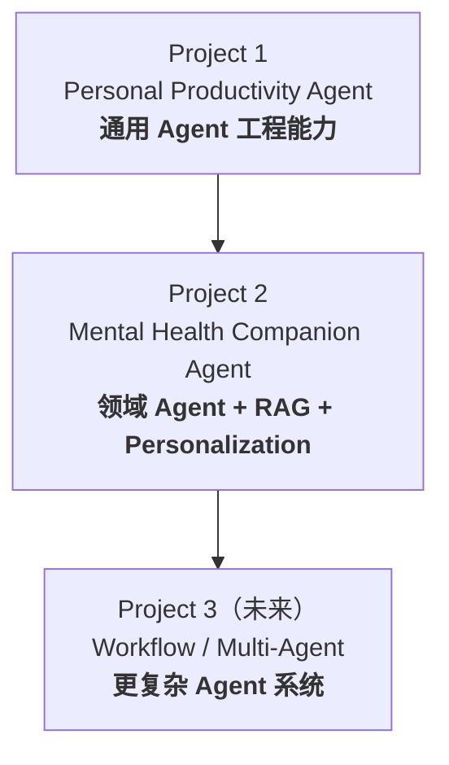
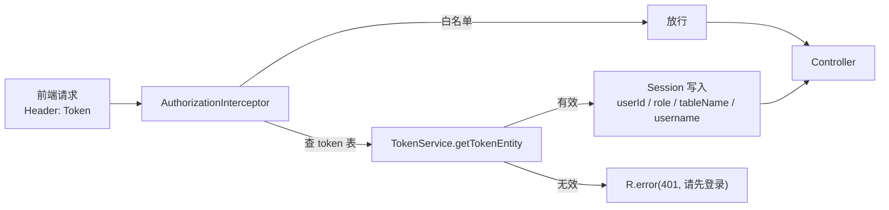
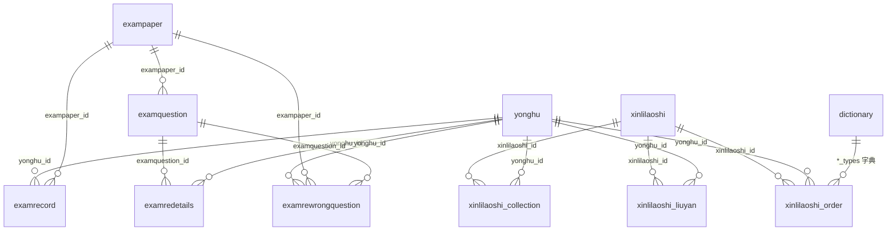
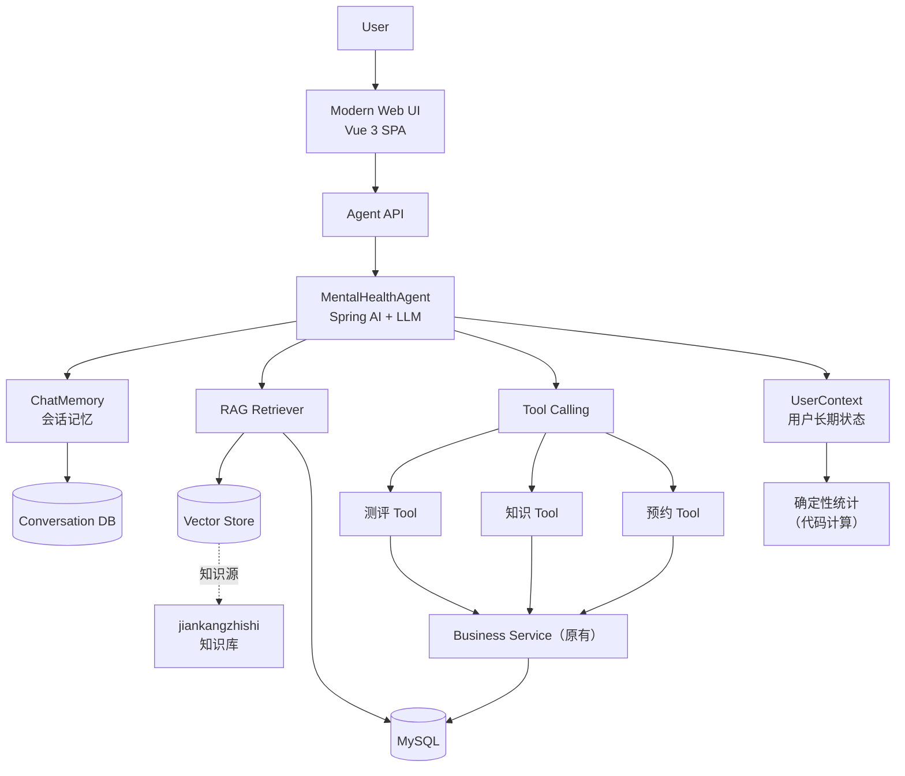
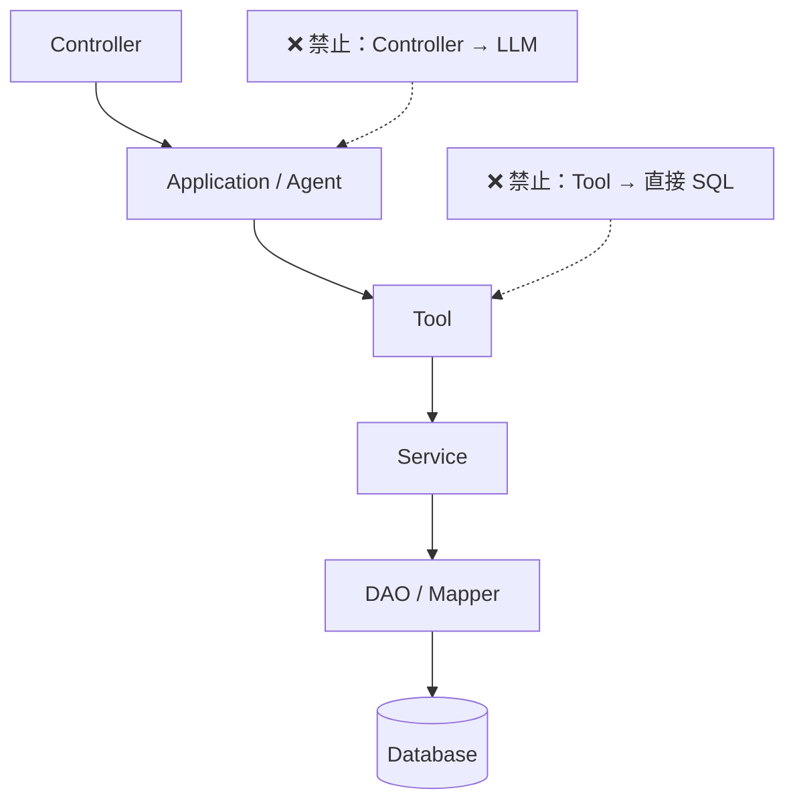

# Project 2 Master Plan｜Mental Health Companion Agent

> **文档性质**：Project 2 的总纲与路线图，供后续所有实现 Agent 作为输入。
> **文档状态**：`Draft v1`（基于 Step 0 前置只读核查撰写；Step 0 正式审计完成后须校准）
> **适用范围**：`d:/ai/job project/Mental Health Companion Agent`
> **强制约束**：本文件中的 Step 是**路线图而非施工图**。Step 0 审计结论与本文冲突时，**以真实代码为准**，并回写本文件。

---

## 0. 阅读指引

| 读者 | 建议阅读顺序 |
| --- | --- |
| 项目负责人 | §1 → §2 → §5 → §7 → §8 |
| 实现 Agent（后端） | §4 → §5 → §6 → §7 → 配套 `AGENT-EXECUTION-RULES.md` |
| 实现 Agent（前端） | §4 → §7（Phase 3）→ 配套 `AGENT-EXECUTION-RULES.md` |
| 执行 Step 0 的审计 Agent | 直接读 `STEP0-AUDIT-SPEC.md` |

配套文档：

- `AGENT-EXECUTION-RULES.md`：实现 Agent 的强制行为规则（**先读它再动代码**）
- `STEP0-AUDIT-SPEC.md`：Step 0 只读审计规范与交付物要求
- `README.md`：文档索引

---

## 1. 项目定位与产品边界

### 1.1 名称

| 类型 | 名称 |
| --- | --- |
| 英文项目名（**Phase 1 定稿**） | **Mental Health Companion Agent** |
| 中文名（**Phase 1 定稿**） | **智能心理健康管理与支持平台** |
| 旧项目名 | 大学生心理健康管理系统（`xinlijiankangxitong`） |

> **名称已于 Phase 1 定稿**：英文名随数据库名 `mental_health_companion_agent` 固化；中文名**必须保留「管理与支持」**。
> 边界与用词规范详见 [`PHASE1-SCOPE-AND-BOUNDARY.md`](./PHASE1-SCOPE-AND-BOUNDARY.md)。

### 1.2 一句话定位

> 将既有的**大学生心理健康管理系统**（成熟业务 + 真实数据）就地改造为具备 **RAG、Tool Calling、Memory、个性化分析与辅助规划**能力的**领域 Agent 应用**。

核心关键词：

```text
旧系统重构 + 领域 Agent + RAG + 用户历史数据 + 个性化分析 + Memory + Tool Calling + UI/UX 重构
```

### 1.3 产品边界（P0 级约束，不可协商）

本项目是**心理健康管理与支持平台**，**不是**医疗诊断或治疗系统。

| 能力维度 | ✅ 可以做 | ❌ 不可以做 |
| --- | --- | --- |
| 知识 | 提供心理健康知识科普 | 冒充心理医生 / 精神科医生 |
| 测评 | 帮助用户理解测评结果与历史变化 | 诊断精神疾病 |
| 分析 | 分析用户历史数据的一般性趋势 | 依据单次对话判定用户患有某疾病 |
| 建议 | 提供一般性自我管理建议、放松方法、学习与作息建议 | 给出高风险医疗决策（用药、诊疗方案） |
| 咨询 | 帮助预约心理老师 | 替代专业心理咨询 |
| 规划 | 辅助制定日常计划 | 生成伪装成治疗方案的「医嘱」 |

### 1.4 边界必须在四个层面统一落地

| 层面 | 落地方式 | 归属 Phase |
| --- | --- | --- |
| **Prompt** | System Prompt 中显式声明身份与禁止项 | Phase 4（Step 11） |
| **UI** | 页面文案、免责声明、空状态话术不使用「诊断/治疗」措辞 | Phase 3（Step 6–9） |
| **Tool** | 高风险动作（预约/取消）设权限等级与确认流程；不提供「疾病判定」Tool | Phase 9（Step 29） |
| **README** | 明确写出产品定位与「已知边界」章节 | Phase 12（Step 38） |

### 1.5 安全红线（心理健康领域特有）

以下内容**不允许任何实现 Agent 自行设计**，必须先出方案经用户确认：

- 高风险内容（自伤、自杀、伤害他人等）的**识别策略**
- 高风险触达后的**响应流程与话术**
- 任何形式的「心理危机评分/算法」

> 理由：这类策略一旦设计不当，可能对真实用户造成伤害；且它不是工程问题而是专业问题。**Phase 9 必须先产出设计文档并等待确认**。

---

## 2. 与 Project 1 的关系

### 2.1 Project 1 已经证明的能力（不再重复证明）

Project 1（Personal Productivity Agent）已完成的技术栈：Spring Boot + Spring AI + LLM + Tool Calling + Service + Repository + MySQL + 多用户 + 风险控制 + Memory + Planning。

> **注意**：Project 1 的代码**不在本工作区**，因此**不可复用其代码**，只能参考其方法论与设计模式（如风险分级、PendingAction 思路、ToolCallObserver 思路）。

### 2.2 Project 2 要证明的能力

> **「我能够把一个已有的复杂业务系统 Agent 化。」**

即从**通用 Agent 工程**递进到**领域 Agent 工程**。

### 2.3 能力递进矩阵

| 能力 | Project 1 | Project 2 |
| --- | --- | --- |
| Spring Boot / Spring AI / LLM | ✅ | ✅ |
| Tool Calling | ✅ | ✅（面向领域业务能力） |
| MySQL / 多用户 | ✅ | ✅ |
| 风险控制 | ✅ | 视业务设计（预约/取消/高风险识别） |
| Memory | ✅ | ✅（并区分「会话记忆」与「用户长期状态」） |
| Planning | ✅ | 升级为**个性化辅助规划** |
| **RAG** | ❌ | **核心** |
| **领域知识库** | ❌ | **核心** |
| **历史用户状态** | 基础 | **核心** |
| **测评数据分析** | ❌ | **核心** |
| **旧系统 Agent 化** | ❌ | **核心** |
| **完整 UI/UX 重构** | ❌ | **核心** |

递进关系：



---

## 3. 现状基线（Step 0 核实前后的已知事实）

> 本节事实来自对 `pom.xml`、`application.yml`、`mental_health_companion_agent.sql`、`src/main/java`、`src/main/resources/admin|front` 的**只读核查**。标注 `⚠️ 待 Step 0 确认` 的条目尚未验证。

### 3.1 技术栈（`pom.xml` 实测）

| 项 | 当前值 |
| --- | --- |
| Spring Boot | **2.2.2.RELEASE** |
| Java | **1.8** |
| 构建 | Maven（`spring-boot-maven-plugin`） |
| ORM | **MyBatis-Plus 2.3** + `mybatisplus-spring-boot-starter 1.0.5`（MP 2.x 写法，含 `LogicSqlInjector`） |
| 安全 | `shiro-spring 1.3.2`（**引入但未见 Shiro 配置类**，实际鉴权走自研拦截器） |
| JSON | `fastjson 1.2.8`（存在已知反序列化风险） |
| 第三方 | `com.baidu.aip:java-sdk 4.4.1`（人脸比对/地图） |
| 报表 | `poi 3.9` 系列 |
| 其他 | `hutool-all 4.0.12`、`commons-lang3 3.0`、`javax.validation 2.0.1.Final`、`thymeleaf`、`devtools` |
| 端口 / 上下文 | `8080` / `/xinlijiankangxitong` |
| 数据库 | MySQL（`127.0.0.1:3306/mental_health_companion_agent`，`root/123456`） |

### 3.2 后端结构

包根 `com`，共 **149 个 `.java`**：

| 包 | 数量 | 说明 |
| --- | --- | --- |
| `com.controller` | 17 | 业务接口（含 `CommonController` 通用统计接口） |
| `com.service` | 18 | Service 接口（另有 `impl` 子包实现） |
| `com.dao` | 17 | MyBatis-Plus Mapper 接口 |
| `com.entity` | 16 | 实体 + `TokenEntity` / `EIException` 等 |
| `com.entity.model` | 13 | 视图模型（Model） |
| `com.utils` | 14 | `R`、`Query`、`PageUtils`、`MPUtil`、`BaiduUtil`、`PoiUtil`、`SQLFilter` 等 |
| `com.config` | 3 | `InterceptorConfig`、`MybatisPlusConfig`、`MyMetaObjectHandler` |
| `com.annotation` | 3 | `IgnoreAuth`、`LoginUser`、`APPLoginUser` |
| `com.interceptor` | 1 | `AuthorizationInterceptor` |
| `com.thread` | 1 | `MyThreadMethod`（空循环线程） |
| `com.ServletContextListener` | 1 | `DictionaryServletContextListener`（启动时加载字典） |
| 根 | 1 | `xinlijiankangxitongApplication` |

Mapper XML：`src/main/resources/mapper/*.xml`（17 个）。

### 3.3 认证与身份



- 登录入口：`users/login`、`yonghu/login`、`xinlilaoshi/login`（均 `@IgnoreAuth`）
- Token：`token` 表，`token = 32 位随机串`，有效期 **1 小时**，按 `(userid, role)` 查重刷新
- 白名单（拦截器硬编码）：`/dictionary/page`、`/file/upload`、`/yonghu/register`
- 三类角色由 `token.tablename` 区分：`users`→管理员、`yonghu`→学生、`xinlilaoshi`→心理老师
- ⚠️ **无 `CurrentUserProvider` 抽象**，身份从 Session 手工取（Phase 2 Step 5 改造点）

### 3.4 数据库（`mental_health_companion_agent.sql` 实测 **16 张表**）

> **与早期规划「17 张表」的偏差已核实**：`mental_health_companion_agent.sql` 仅含 16 张表；实体类也仅 16 个业务实体。文档统一按 **16 张表**表述。

| # | 表 | 注释 | 关键字段 |
| --- | --- | --- | --- |
| 1 | `config` | 配置文件 | `name`、`value`（轮播图 1/2/3） |
| 2 | `dictionary` | 字典 | `dic_code`、`code_index`、`index_name`（25 条字典数据） |
| 3 | `exampaper` | 试卷表 | `exampaper_name`、`exampaper_date`(时长)、`exampaper_myscore`(总分)、`exampaper_delete`(逻辑删) |
| 4 | `examquestion` | 试题表 | `exampaper_id`、`examquestion_options`(JSON)、`examquestion_answer`、`examquestion_types` |
| 5 | `examrecord` | 考试记录表 | `examrecord_uuid_number`、`yonghu_id`、`exampaper_id`、`total_score` |
| 6 | `examredetails` | 答题详情表 | `examredetails_uuid_number`、`examquestion_id`、`examredetails_myanswer`、`examredetails_myscore` |
| 7 | `examrewrongquestion` | 错题表 | `yonghu_id`、`exampaper_id`、`examquestion_id` |
| 8 | `jiankangzhishi` | 健康知识 | `jiankangzhishi_name`、`_types`、`_content`(text) ← **RAG 核心知识源** |
| 9 | `token` | token 表 | `userid`、`tablename`、`role`、`token`、`expiratedtime` |
| 10 | `tongzhi` | 通知 | `tongzhi_name`、`_types`、`_content`(text) |
| 11 | `users` | 管理员 | `username`/`password`/`role` |
| 12 | `xinlilaoshi` | 心理老师 | `xinlilaoshi_name`、`_shanchang`、`_lvli`、`_content`(text) |
| 13 | `xinlilaoshi_collection` | 心理老师收藏 | `xinlilaoshi_id`、`yonghu_id` |
| 14 | `xinlilaoshi_liuyan` | 心理老师留言 | `xinlilaoshi_liuyan_text`、`reply_text` |
| 15 | `xinlilaoshi_order` | 预约订单 | `yuyue_time`、`shijianduan_types`、`xinlilaoshi_order_yesno_types` |
| 16 | `yonghu` | 学生 | `yonghu_name`、`_id_number`、`sex_types`、`_email` |

**无物理外键**（仅 `PRIMARY KEY`，脚本头关闭 `FOREIGN_KEY_CHECKS`），全部为**逻辑关联**：



字典项映射（`dictionary.dic_code`）：

| dic_code | 业务含义 | 取值 | 业务表字段 |
| --- | --- | --- | --- |
| `sex_types` | 性别 | 1 男 / 2 女 | `yonghu.sex_types`、`xinlilaoshi.sex_types` |
| `xinlilaoshi_collection_types` | 收藏类型 | 1 收藏 | `xinlilaoshi_collection.*_types` |
| `xinlilaoshi_order_yesno_types` | 预约状态 | 1 待审核 / 2 同意 / 3 拒绝 | `xinlilaoshi_order.*_types` |
| `shijianduan_types` | 时间段 | 1–8（08:00–18:00） | `xinlilaoshi_order.shijianduan_types` |
| `tongzhi_types` | 通知类型 | 1/2/3 | `tongzhi.tongzhi_types` |
| `jiankangzhishi_types` | 健康知识类型 | 1/2 | `jiankangzhishi.*_types` |
| `examquestion_types` | 试题类型 | 1 单选 / 2 多选 / 3 判断 / 4 填空 | `examquestion.*_types` |
| `exampaper_types` | 试卷状态 | 1 启用 / 2 禁用 | `exampaper.exampaper_types` |

### 3.5 核心业务流程（后端调用链已核实）

| 流程 | 调用链 | 关键文件 |
| --- | --- | --- |
| 登录（三角色） | `XxxController.login` → Service 查表校验 → `TokenService.generateToken` → `token` 表 | `UsersController` / `YonghuController` / `XinlilaoshiController` / `TokenServiceImpl` |
| 测评 | `examrecord/saveExamrecord`（生成 uuid+记录）→ `examquestion/page`（拉题）→ `examredetails/saveExamredetails`（判分 + 错题）→ `examredetails/addUnsaved`（补漏答） | `ExamrecordController`、`ExamredetailsController`、`ExamquestionController` |
| 知识浏览 | `jiankangzhishi/list`（`@IgnoreAuth`）→ `detail/{id}` | `JiankangzhishiController` |
| 预约 | `xinlilaoshi/list` → `xinlilaoshiOrder/add`（待审核）→ `xinlilaoshiOrder/update`（同意/拒绝） | `XinlilaoshiOrderController` |
| 留言 | `xinlilaoshiLiuyan/add` → `update` 写 `reply_text` | `XinlilaoshiLiuyanController` |
| 收藏 | `xinlilaoshiCollection/add`（查重）→ `list` / `delete` | `XinlilaoshiCollectionController` |
| 通知 | `tongzhi/list` → `detail/{id}` | `TongzhiController` |

### 3.6 前端现状

| 端 | 技术 | 规模 | 构建 |
| --- | --- | --- | --- |
| 管理端 | Vue 2 + Element UI（hash 路由） | 55 个 `.vue`、23 个模块目录 | 有 `package.json`（`1-install.bat` / `2-run.bat` / `3-build.bat`），含 `dist/` |
| 用户端 | **Layui + CDN Vue + ElementUI 静态页** | **49 个 `.html`**，17 个子目录 | **无构建体系** |

管理端要点：

- 路由：`src/router/router-static.js`（约 33 条路由）
- 请求：`src/utils/http.js`，`baseURL = /xinlijiankangxitong`，请求头注入 `Token`，`401` 跳登录
- 状态管理：**未使用 Vuex**（`src/store/store.js` 为空文件），依赖 `src/utils/storage.js`（localStorage 封装）

用户端要点：

- 请求：`front/front/modules/http/http.js`，`baseurl = http://localhost:8080/xinlijiankangxitong/`，`beforeSend` 注入 `Token`
- 登录页 `pages/login/login.html` **仅支持「学生」登录**（硬编码 `role='yonghu'`），管理员与心理老师登录入口未在前端暴露
- 首页 `pages/home/home.html` 聚合轮播、健康知识、心理老师、通知四块

### 3.7 已知缺口与技术债（Phase 2/3 必须处理）

| # | 问题 | 证据 | 影响 |
| --- | --- | --- | --- |
| 1 | **后端无任何 chat 接口** | `src/main/java` 搜 `chat` 0 匹配 | `pages/chat/chat.html` 是**僵尸功能**；`index.html` 的 `chatTap()` 还指向不存在的 `pages/chat/list.html` |
| 2 | **无 `src/main/webapp`** | 目录不存在 | 上传实际落在 `classpath:static/upload`（编译产物目录），《说明文档.txt》所述路径已过时；**重启/清理后上传文件可能丢失** |
| 3 | **无 `src/test/`** | 目录不存在 | 零测试基线，Phase 10 需从零建立 |
| 4 | 无统一异常处理 | 全仓无 `@ControllerAdvice` | 错误结构不统一，Agent 化后难以可靠处理失败 |
| 5 | Entity 直出 API | Controller 直接返回 `Entity` | 违反「Entity 不直出」原则，Phase 2 Step 3 处理 |
| 6 | 前端两套异构技术栈 | 管理端 Vue2 SPA + 用户端 Layui 静态页 | 复用性差，Phase 3 统一为 Vue 3 |
| 7 | 技术栈全面过旧 | Boot 2.2.2 / JDK 8 / MP 2.3 / Shiro 1.3.2 / FastJSON 1.2.8 / POI 3.9 | 无法使用 Spring AI 1.x，且含安全风险 |
| 8 | `Shiro` 引入但未使用 | 无 Shiro 配置类，鉴权走自研拦截器 | 死依赖，升级时可直接移除 |
| 9 | `MyMetaObjectHandler` 字段名不匹配 | 填充 `ctime`，实体实际为 `insert_time`/`create_time` | 自动填充实际不生效，疑为模板遗留 |
| 10 | 部分 CRUD 无角色校验 | 如 `DictionaryController`、`YonghuController` 角色判断恒 `false` | 仅校验登录、不校验角色，存在越权面 |
| 11 | `logout` 未放行且为 GET | 三处 `logout` 均无 `@IgnoreAuth` | Token 过期时登出本身返回 401 |
| 12 | 空循环线程 | `MyThreadMethod` 为 `while + sleep(5000)` 空体 | 无意义常驻资源 |
| 13 | 拦截器硬编码白名单 | `AuthorizationInterceptor` 中写死路径 | 维护性差 |
| 14 | ~~**项目未纳入 Git 版本控制**~~ | **已解决（2026-09-22）**：已 `git init` 并提交初始基线（`master`） | 回滚能力已具备，后续每个 Step 均可 `git revert` |
| 15 | 🔴 **敏感字段随接口外泄** | 实测 `GET /yonghu/page` 返回 `password` 与 `yonghu_id_number` | 严重隐私泄露；Agent 化后极易被带入 LLM 上下文。**须在 Phase 2 Step 3 提前修复**，详见 `project-audit.md` §8.1 S1 |
| 16 | 🔴 **通用动态表名接口可越权/注入** | `CommonController` + `CommonDao.xml` 以 `${table}`/`${column}` 拼接，且 `/option`、`/follow`、`/cal`、`/queryScore` 等**免鉴权**；`/sh/{tableName}` 可 UPDATE 任意表 | 未登录即可读写任意表。**须在 Phase 2 Step 2/4 收敛为白名单**，详见 `project-audit.md` §8.1 S3/S4 |
| 17 | 密码明文存储 | `users`/`yonghu`/`xinlilaoshi.password` 均为明文，登录明文比对 | 高风险；需哈希化（须先出数据迁移方案），详见 `project-audit.md` §8.1 S2 |
| 18 | **本机存在用途不明的 `mental_health_system` 库** | 其表为 `sys_user`/`knowledge_article`/`eval_report`/`counsel_appointment` 等，与本项目 16 表**完全不同** | 若为重设计后的目标 schema，将显著影响 Phase 2/5 数据策略。**需用户澄清**，详见 `project-audit.md` §4.1 / 附录 B.4 |

### 3.8 启动依赖与环境

- **启动强依赖数据库**：`DictionaryServletContextListener`（`@WebListener`）在 `contextInitialized` 时查 `dictionary` 表，**DB 不可用则启动失败**
- `CommonController` 的百度 `AipFace` 为**懒加载**，不阻塞启动
- `src/main/resources/static/upload/` 存在（上传落盘处）

**Step 0 已确认（2026-09-22，详见 `project-audit.md` 附录 A）**：

| 项 | 实测结果 |
| --- | --- |
| JDK | OpenJDK **17.0.0.1**（本机**无 JDK 8**，项目在 JDK 17 下可构建可运行） |
| Maven | **3.8.8** |
| MySQL | **8.0.23**，数据库已更名为 `mental_health_companion_agent`（2026-09-22 变更，原 `xinlijiankangxitong`），16 张表 |
| 构建 | ✅ `mvn -B -DskipTests clean package` BUILD SUCCESS（18.7s） |
| 启动 | ✅ 成功（6.4s，Tomcat 9.0.29，端口 8080） |
| 接口冒烟 | ✅ 登录 / 公开列表 / 静态资源 / 鉴权 401 / 带 Token 分页 全部通过 |
| 用户端页数 | 实测 **49 个 HTML**（早期笔误「47 个」已纠正） |

---

## 4. 目标架构

### 4.1 终态架构（Phase 4–8 完成后）



> **本图是最终形态，不是第一天实现的内容。** 各模块按 §7 的 Phase 顺序逐步引入。

### 4.2 分层与依赖方向（强制）



约束：

1. 依赖**单向向下**，禁止反向依赖与跨层调用
2. **Agent 不直接访问 DAO**，必须经 Tool → Service
3. **Entity 不直出 LLM**，必须经领域 DTO（Tool DTO）转换
4. **LLM 决定语义，代码决定合法性**：参数校验、权限判断、数据一致性一律由代码完成

### 4.3 关键设计原则

| 原则 | 说明 |
| --- | --- |
| 保留旧业务 | 先保留既有业务能力，再逐步 Agent 化，禁止为 Agent 化而删除业务 |
| 数据库变更受控 | 现有 schema → 影响分析 → 迁移方案 → 执行（Phase 5 建向量相关表时严格遵守） |
| Prompt 外置 | System Prompt 放 `src/main/resources/prompts/`，不硬编码进 Java |
| 确定性统计下沉代码 | 平均值、变化率、趋势、次数等由代码计算，LLM 只负责解释 |
| 会话记忆 ≠ 用户长期状态 | 前者是对话上下文，后者必须来自结构化业务数据 |
| 不做过度设计 | 单 Agent + Tool + RAG 能解决就不引入 Multi-Agent / Workflow |
| 每步可回滚 | 每个 Step 必须能独立回归，禁止一次性大改 |

---

## 5. 技术主线决策记录（ADR）

### ADR-001：后端就地升级至 Spring Boot 3.x + JDK 17

| 项 | 内容 |
| --- | --- |
| **状态** | ✅ **已定稿（2026-09-23 Phase 2 前复核）** |
| **背景** | Spring AI 要求 Spring Boot 3.x+；现有项目为 Boot 2.2.2 + Java 8，二者不兼容 |
| **决策** | **就地升级**现有单体，而非新建独立 Agent 服务 |
| **理由** | 避免双服务运维与数据一致性成本；可原生使用 Spring AI；符合「旧系统 Agent 化」的叙事 |
| **影响范围** | Phase 2（后端重构）与后续所有后端 Phase |

#### ADR-001.1 目标版本定稿（2026-09-23 复核）

**复核触发**：原 ADR 写于「Spring AI 只有 1.x」时期；2026-06-12 Spring AI 2.0 GA 后出现第二条路，必须重新决策。

| 分支 | Spring AI | 兼容要求 | 结论 |
| --- | --- | --- | --- |
| **1.x** | `1.1.6`（2026-05-09） | **Spring Boot 3.3+ / Java 17+** | ✅ **选定**（1.0.7 / 1.1.6 仍在持续维护） |
| 2.x | `2.0.0` GA（2026-06-12） | **Spring Boot 4.x + Spring Framework 7**，与 Boot 3.x **不兼容** | ❌ 本次不采用 |

> **最终目标栈：Spring Boot 3.5.x + JDK 17 + Spring AI 1.1.6**

**为什么不一并升到最新的 Spring AI 2.0 / Boot 4**

1. 旧依赖包袱重（Shiro 1.3.2、MyBatis-Plus 2.3、FastJSON 1.2.8、POI 3.9、Thymeleaf）：跨**一个**大版本已需大量改造，跨两个（2.2.2 → 4.x）会显著挤压真正做 Agent 能力（RAG / Tool / Memory）的时间
2. 项目的差异化价值在 **Agent 工程能力**，而非框架版本新旧
3. Spring AI 1.1.6 的 Agent / RAG / Tool Calling / ChatMemory 抽象**已完整覆盖** Phase 4–8 全部需求
4. Boot 4 / Spring AI 2 作为**后续演进项**写入简历（Phase 13）

#### ADR-001.2 前置发现（显著降低迁移量）

实测全仓 `src/main/java` 搜索 `shiro` / `Shiro` → **0 处匹配**。

即 **Shiro 只是遗留依赖，代码从未使用**（鉴权实际由自建 `AuthorizationInterceptor` + `auth_token` 表实现）。

> **结论**：**直接移除 `shiro-spring` 依赖即可**，无需迁移到 Spring Security。§6 风险清单中的「Shiro 替换」降级为「依赖删除」。

**明确决策：不引入 Spring Security**（2026-10-05 确认）。实际鉴权链是自建的 `AuthorizationInterceptor` + `auth_token` 表，Shiro 从未参与；为了「现代化」再引入一个安全框架，只会制造**第二次迁移成本**而没有任何安全收益。权限体系的重构（如需）属 Phase 9，且须先出设计文档。

### ADR-002：用户端重建为 Vue 3 SPA

| 项 | 内容 |
| --- | --- |
| **状态** | 已决策（待 Phase 3 执行） |
| **背景** | 用户端为 Layui + CDN Vue 静态页（49 个 HTML、无构建体系），无法支撑「目标驱动」的新型信息架构与统一 Design System |
| **决策** | **新建 Vue 3 SPA** 替换 Layui 静态页 |
| **理由** | 满足「传统管理系统 → 现代平台」的产品升级验收；可实施统一组件与设计令牌 |
| **代价** | 需完整重写用户端；管理端（Vue 2）需另行重构，二者暂时并存 |
| **影响范围** | Phase 3 |

### ADR-003：Vector Store 暂不锁定

| 项 | 内容 |
| --- | --- |
| **状态** | 延后决策（Phase 5 Step 18 定） |
| **背景** | 候选方案：MySQL Vector / PGVector / Milvus / Chroma |
| **决策** | **本轮不锁定**，Phase 5 按实际 Spring AI 版本与已有基础设施决定 |
| **理由** | 避免过度设计与提前返工；现有基础设施只有 MySQL |
| **待评估维度** | 与 Spring AI 的 `VectorStore` 抽象兼容性、本机/部署可行性、运维成本、混合检索能力 |
| **约束** | 无论选型如何，**知识源统一为 `jiankangzhishi` 表**，处理链在 Step 17 定义 |

---

## 6. Spring Boot 3.x 迁移风险清单（Phase 2 执行前必读）

| # | 风险项 | 现状 | 建议动作 | 严重度 |
| --- | --- | --- | --- | --- |
| 1 | `javax.*` → `jakarta.*` | 使用 `javax.validation`、`javax.servlet` | 全量替换为 `jakarta.*`（`validation-api`→`jakarta.validation-api`） | 高 |
| 2 | MyBatis-Plus 2.3 → 3.5.x | 使用 `LogicSqlInjector`、`field-strategy`、`EntityWrapper` 等 2.x API | 升级到 3.5.x，`EntityWrapper`→`LambdaQueryWrapper`/`QueryWrapper`，逻辑删除改全局配置，`sql-injector` 移除 | 高 |
| 3 | Shiro 1.3.2 | 引入但未配置（鉴权走自研拦截器） | **直接移除依赖**，鉴权保留自研拦截器并重构为 `CurrentUserProvider` | 中 |
| 4 | FastJSON 1.2.8 | 存在已知反序列化漏洞 | 升级至 FastJSON2 或替换为 Jackson | 高 |
| 5 | POI 3.9 | 用于 Excel 导入导出 | 升级至 5.x | 中 |
| 6 | 百度 AI SDK 4.4.1 | 人脸比对 / 地图，依赖未知兼容性 | 评估：保留（需验证 Boot 3 兼容）或移除该功能 | 中 |
| 7 | `thymeleaf` | 引入但项目为前后端分离 | 确认无模板使用后移除 | 低 |
| 8 | `MyMetaObjectHandler` 字段名不匹配 | 填充 `ctime`，与实际字段不符 | 重写为 `insert_time` / `create_time` 或移除 | 低 |
| 9 | `InterceptorConfig` 静态资源映射 | 基于 `WebMvcConfigurationSupport` | 迁移后按 Boot 3 规范重写（建议改 `WebMvcConfigurer`） | 中 |
| 10 | `@WebListener` + `@ServletComponentScan` | 启动即查库 | 迁移后确认 `jakarta.servlet` 注解生效；建议改为 `ApplicationRunner` 更可控 | 中 |
| 11 | `hutool 4.0.12` | 工具库 | 升级至 5.x | 低 |
| 12 | 无测试基线 | 无 `src/test/` | Phase 2 前先补最小回归测试，确保升级不破坏旧业务 | 高 |

> **Phase 2 的验收前置**：升级过程中必须保证 §8 验收标准 1（旧业务未被破坏）。

---

## 7. 实施路线图（Phase 0–13，共 14 个阶段 / Step 0–40 共 41 个步骤）

> **再次强调**：本路线图是**路线图而非施工图**。Step 0 完成后必须回写校准 Phase 1 及之后的内容。
> 每步的「回滚」列表示该步是否可独立回退。

### Phase 0：项目审计

| Step | 目标 | 涉及文件/表 | 验收标准 | 可回滚 |
| --- | --- | --- | --- | --- |
| **0** | 建立旧项目基线（**禁止改代码**） | 全仓只读；产出 `docs/project-audit.md` | 旧系统能启动并跑通核心业务流程；审计报告 11 章齐全 | N/A（只读） |

详见 `STEP0-AUDIT-SPEC.md`。

### Phase 1：确定 Project 2 边界

| Step | 目标 | 涉及文件/表 | 验收标准 | 可回滚 |
| --- | --- | --- | --- | --- |
| **1** | 明确产品定位为「管理与支持」而非「诊断/治疗」 | 本文档 §1；Phase 1 产出边界说明 | 边界在 Prompt/UI/Tool/README 四层面的落点已定义 | ✅ **已完成** |

> **Phase 1 必须在 Step 0 审计报告之后重做**：基于真实代码重新确认产品定位与范围。
>
> **✅ Phase 1 已完成（2026-09-23）**，产出 [`PHASE1-SCOPE-AND-BOUNDARY.md`](./PHASE1-SCOPE-AND-BOUNDARY.md)：
> 名称定稿、能力边界矩阵（10 允许 / 10 禁止）、Prompt/UI/Tool/README 四层落地规范（具体到文件与检查点）、
> 用词规范（禁用词 → 推荐替代）、角色边界与数据可见性矩阵、边界验收清单，并**校准了 Phase 2**（见下）。
> ⚠️ 该文档 §10 有 **4 个待决项**，确认后方可进入 Phase 2。

### Phase 2：后端结构重构

| Step | 目标 | 涉及文件/表 | 验收标准 | 可回滚 |
| --- | --- | --- | --- | --- |
| **2** | 建立清晰分层 `Controller→Application/Agent→Tool→Service→DAO` | 全后端 | 无 `Controller→LLM`、无 `Tool→SQL` 越层；Boot 3.x + JDK17 升级完成 | ⚠️ 难（结构性），需分支开发 |
| **SH-A** | 🔴 **Security Hotfix A**：收敛 `CommonController` 动态表名接口（**独立安全修复，不在原 41 步路线内**） | `CommonController` + `CommonDao.xml` + 调用方 | 动态表/列访问改为**白名单 + 固定 SQL 模板**，或删除无合法调用方的接口；`/sh/{tableName}` 不再可 UPDATE 任意表；**不重构权限体系、不引入 Spring Security** | ✅ |
| **3** | DTO / VO 重构（Request DTO / Response VO / Domain Entity） | 各 `controller` + 新增 `dto`/`vo` 包 | ① Entity 不再作为 API 返回值；② **强制剔除 `password` / 身份证号**（🔴 S1）；③ **清理 26 个孤儿类**（`entity/model` 13 + `entity/vo` 13，仅自引用） | ✅ 分接口逐步 |
| **4** | 统一异常处理 | 新增 `BusinessException` + `GlobalExceptionHandler` | 统一返回 `{code, message, data}` | ✅ |
| **5** | 统一用户身份（`CurrentUserProvider` → `currentUserId`） | `AuthorizationInterceptor`、`annotation`、各 Controller | 用户相关 Tool 自动使用服务器身份，**不从入参读 userId** | ✅ |
| **5b** | **Java 类名重命名**（`Yonghu*`→`Student*` 等 16 组） | entity/dao/service/impl/controller（**≈102 文件**） | 类名与表名语义一致；分层分批，每批独立构建 + 提交 | ✅ 分批 |
| **5c** | **接口路径重命名**（`/yonghu/*`→`/student/*` 等） | 17 个 Controller + 用户端 49 html + 管理端 55 vue | 路径与资源语义一致；新前端按最终路径开发，避免返工 | ✅ |

> **Phase 2 校准后的执行顺序（2026-10-05 确认）**
>
> ```text
> Step 2 ✅  →  SH-A ✅  →  Step 3  →  T-1  →  T-2  →  Step 4  →  Step 5  →  Step 5b  →  Step 5c
> ```
>
> - **`SH-A`（Security Hotfix A）✅ 已完成**：**独立的安全修复步骤，不在原 41 步路线内**（Step 0 审计新发现的高危项）。**不重构权限体系、不引入 Spring Security。**
> - **`Step 3`（API 数据边界治理）—— 三条硬约束**：
>   1. **先做真实 API 暴露面审计，再设计 DTO/VO** —— 禁止全量机械 `Entity → VO`，只按**实际 HTTP 暴露面**做
>   2. **S1 敏感字段治理独立提交、独立验证**；验收**以实际 API 响应为最终证据**，**不以代码搜索结果为准**
>   3. **不重构认证授权体系**（`AuthorizationInterceptor` / Session / Token / 权限模型**一律不动**）—— 本步只解决「API 数据暴露」
> - **`T-1`（26 个孤儿类取证与清理）**：`entity/model`(13) + `entity/vo`(13)。**必须先取证**再删：Spring 组件扫描 / 反射 / Mapper XML 引用 / `Class.forName` / 注解驱动 / Servlet·Listener / 前端字符串间接引用 / 配置文件。确认无隐式引用后方可删除。**独立提交。** ✅ **已完成**（提交 `7302cf8`，−5270 行，源文件 147 → 117；9 类向量全部为 0）
> - **`T-2`（最小回归测试基线）**：登录 / 列表 / 分页 / 测评 / 预约。放在批量重命名（Step 5b/5c）之前，作为「旧业务未被破坏」（硬验收 1）的可验证依据。**独立提交。** ✅ **已完成**（提交 `5e122b7`，8 项用例 `mvn test` 全通过，零新增依赖，经反向对照验证断言有效）
>
> > **编号说明**：`T-*` 为**技术债 / 清理步骤**序列；`Step 3` 之后的顺序按 2026-10-05 复核调整（用户要求：**孤儿类清理不得与 S1 混提交**）。

### Phase 3：前端 UI/UX 重构（与 Phase 2 并行）

| Step | 目标 | 涉及文件/表 | 验收标准 | 可回滚 |
| --- | --- | --- | --- | --- |
| **6** | 重设用户端信息架构（首页 / AI 助手 / 我的状态 / 心理测评 / 知识中心 / 咨询预约 / 我的） | 新 `frontend/` 工程 | 从「功能菜单驱动」转为「用户目标驱动」 | ✅ |
| **7** | 建立 Design System（字体/间距/圆角/卡片/Button/Input/Dialog/导航/状态标签/空状态/Loading/Error） | 新工程 `design-system` | 各页面不各自造轮子 | ✅ |
| **8** | 重做 Dashboard（今日状态 / 最近测评 / AI 助手 / 推荐知识 / 近期预约） | Dashboard 页 | 首页不再是「欢迎登录 + 菜单」 | ✅ |
| **9** | AI 助手页面（快捷动作 + Tool Calling 结构化反馈） | AI 助手页 | 有「正在查询测评…/正在检索知识…/正在生成建议…」等过程反馈 | ✅ |
| **10** | 管理端 UI（Dashboard / 用户 / 测评 / 心理知识 / 预约 / 留言 / AI 对话统计 / 知识库管理） | 管理端 | 知识库管理含 文档/分类/分块/索引状态/更新时间 | ✅ |

### Phase 4：Agent 基础能力

| Step | 目标 | 涉及文件/表 | 验收标准 | 可回滚 |
| --- | --- | --- | --- | --- |
| **11** | Spring AI 接入（`MentalHealthAgent` / `PromptService` / `ChatClient`），Prompt 外置 | `resources/prompts/`、新增 agent 包 | Prompt 不硬编码进 Java | ✅ |
| **12** | 第一个 Agent Tool：`get_my_health_profile` | Tool 层 + Service 复用 | 打通 `User→Agent→Tool→Service→DB→ToolResult→LLM` | ✅ |
| **13** | 测评 Tool：`get_latest_assessment` / `get_assessment_history` / `get_assessment_detail` | 复用 `exam*` 表；经领域 DTO | 数据经领域 DTO，不直出 Entity | ✅ |
| **14** | 知识 Tool：`search_health_knowledge` / `get_health_knowledge`（第一版走 DB 关键词搜索） | `jiankangzhishi` 表 | 证明 Agent 可使用领域知识业务能力 | ✅ |
| **15** | 预约 Tool：`get_my_appointments` / `find_available_counselor` / `create_appointment` / `cancel_appointment` | `xinlilaoshi_order` 等 | 复用风险等级/校验/身份/Service 模式（**不机械复制 PendingAction**） | ✅ |

### Phase 5：RAG（核心）

| Step | 目标 | 涉及文件/表 | 验收标准 | 可回滚 |
| --- | --- | --- | --- | --- |
| **16** | 确定知识源，建立 `KnowledgeDocument` 概念 | `jiankangzhishi` | 优先用原系统知识，不凭空抓数据 | ✅ |
| **17** | 知识处理 Pipeline：原始知识→Document→清洗→Chunk→Embedding→Vector Store | 新增 ingestion 模块 | 明确「RAG 处理链」与「业务 CRUD」是两个问题 | ✅ |
| **18** | Vector Store 选型与接入 | 见 ADR-003 | 依实际 Spring AI 版本与基础设施选择 | ✅ |
| **19** | Retriever：相似度阈值 / TopK / metadata filtering | 新增 retriever 层 | 参数可配置 | ✅ |
| **20** | RAG Agent 打通 `查询→检索→知识→LLM→Grounded Answer` | `MentalHealthAgent` | **有知识**：正确基于知识回答；**无知识**：明确回复「当前知识库中没有找到足够相关的信息」，**不得编造** | ✅ |

### Phase 6：Memory

| Step | 目标 | 涉及文件/表 | 验收标准 | 可回滚 |
| --- | --- | --- | --- | --- |
| **21** | Conversation Memory（`conversationId` / `userId` / `messages`） | 新增会话表（需先出迁移方案） | 多会话隔离、按用户隔离 | ✅ |
| **22** | 严格区分 Conversation Memory 与 User Long-term State | 本文档 §4.3 | 长期状态来自结构化业务数据，不轻信 LLM Memory | ✅ |

### Phase 7：个性化 Agent

| Step | 目标 | 涉及文件/表 | 验收标准 | 可回滚 |
| --- | --- | --- | --- | --- |
| **23** | 状态汇总 `UserContext`（基本信息 + 最近测评 + 历史趋势 + 近期预约 + 主动记录） | 多表聚合 | **不无脑塞全库**，按需裁剪 | ✅ |
| **24** | 个性化分析（「帮我看看最近状态」） | UserContext + RAG + LLM | **确定性统计由代码计算**（平均值/变化率/趋势/次数），LLM 只做解释 | ✅ |

### Phase 8：Planning

| Step | 目标 | 涉及文件/表 | 验收标准 | 可回滚 |
| --- | --- | --- | --- | --- |
| **25** | 辅助计划（用户状态+目标+知识+当前时间→Planning→建议→用户确认） | Agent + 计划输出 | 计划需用户确认后生效 | ✅ |
| **26** | 计划不得伪装成治疗方案 | Prompt + 输出校验 | 可含：学习/休息/运动/情绪记录/放松/知识阅读；禁止：服药/患有/需接受… | ✅ |

### Phase 9：安全与边界

| Step | 目标 | 涉及文件/表 | 验收标准 | 可回滚 |
| --- | --- | --- | --- | --- |
| **27** | Prompt Safety（不诊断 / 不冒充医生 / 不替代专业帮助） | Prompt 层 | 边界话术生效 | ✅ |
| **28** | 高风险内容识别与安全响应流程 | **须先出设计文档并经用户确认** | 普通情绪→正常 Agent；明显高风险→安全响应流程 | ✅ |
| **29** | Tool 权限分级（读自己数据 LOW / 预约 MEDIUM / 取消预约 MEDIUM–HIGH） | Tool 层 | 按实际业务定级并有校验 | ✅ |

> **Step 28 是唯一禁止 Agent 自行设计的 Step**，必须产出方案 → 用户确认 → 再实现。

### Phase 10：测试与交付

| Step | 目标 | 涉及文件/表 | 验收标准 | 可回滚 |
| --- | --- | --- | --- | --- |
| **30** | 纯单元测试（Parser / Service / Business Rules / RAG Query / 状态计算） | `src/test/`（需新建） | 覆盖率达标（具体阈值 Phase 10 定） | ✅ |
| **31** | Tool 测试（Mockito）：正常 / 参数错误 / 用户越权 / 数据不存在 | `src/test/` | 四类用例齐全 | ✅ |
| **32** | RAG 测试：命中 / 不命中 / 相似但错误 / 多文档 / 空知识库 | `src/test/` | 五类用例齐全 | ✅ |
| **33** | API Integration Test（`@SpringBootTest` + MockMvc + MySQL + `@Transactional`） | `src/test/` | 关键接口全绿 | ✅ |
| **34** | 前端 E2E：登录 / 首页 / AI 对话 / 测评 / 知识 / 预约 / 个人中心 | E2E 工程 | 关键路径可自动回归 | ✅ |
| **35** | Agent E2E：固定测试脚本（问→Tool→RAG→Memory→回答） | E2E 工程 | 不依赖肉眼，可重复执行 | ✅ |

### Phase 11：性能与可观测性

| Step | 目标 | 涉及文件/表 | 验收标准 | 可回滚 |
| --- | --- | --- | --- | --- |
| **36** | Agent Trace（request / LLM call / Tool call / RAG retrieval / latency） | 新增观测组件 | 能回答「一次 Agent 请求花在哪里」 | ✅ |
| **37** | RAG Observability（query / topK / docs / similarity / latency，日志脱敏） | 观测组件 | 有结构化检索日志且脱敏 | ✅ |

### Phase 12：文档与简历

| Step | 目标 | 涉及文件/表 | 验收标准 | 可回滚 |
| --- | --- | --- | --- | --- |
| **38** | README（简介/功能/系统架构/Agent 架构/Tool Calling/RAG/Memory/Personalization/安全边界/UI/技术栈/启动/测试/已知边界） | `README.md` | 14 个章节齐全 | ✅ |
| **39** | 项目演进记录 `jiaojie.md`（为什么 Agent 化 / 为什么 RAG 放这里 / 为什么记忆与状态分开 / 为什么统计用代码 / 为什么预约有风控） | `jiaojie.md` | 五个「为什么」有明确回答 | ✅ |

### Phase 13：简历与面试

| Step | 目标 | 涉及文件/表 | 验收标准 | 可回滚 |
| --- | --- | --- | --- | --- |
| **40** | 最终简历版本 | 简历材料 | **只写真正完成并验证的东西**，不写未实现的 Multi-Agent / Workflow / 向量库 | ✅ |

---

## 8. 四项硬验收标准

> 最终不以「代码量」评价，只看以下四件事。

### 验收 1：旧业务没有被破坏

```text
登录 / 用户 / 测评 / 知识 / 预约 / 管理端
```

核心功能在改造后仍然正常（Phase 2 升级与 Phase 3 前端替换后必须回归）。

### 验收 2：Agent 真正使用业务能力

必须存在如下链路，而不是 `用户 → ChatGPT → 文本`：

```text
LLM → Tool → Service → Database
```

### 验收 3：RAG 真正影响回答

必须能证明：

```text
问题 → Retriever → 知识 → 回答
```

而不是「代码里装了个 Vector Store 就算完成」。

### 验收 4：UI 真正完成产品升级

用户应明显感觉到从「传统管理系统」到「现代心理健康平台」的变化，而不是只换了颜色和字体。

---

## 9. 声明：路线图不是施工图

1. 本文档 Step 0 完成后**必须重新校准** Phase 1 及之后的内容。
2. 若真实代码与本文档冲突，**以代码为准**，并回写本文档。
3. 任一 Step 执行前，执行 Agent 必须先核对本文档与真实代码的一致性。
4. **禁止**为了完成计划表而强行改代码。

---

## 10. 附录

### 10.1 术语表

| 术语 | 含义 |
| --- | --- |
| Agent Tool | LLM 可调用的领域能力函数，内部经 Service 访问 DB |
| Tool DTO | 面向 LLM 的领域数据传输对象，屏蔽 Entity 细节 |
| Conversation Memory | 会话级上下文记忆 |
| User Long-term State | 用户长期状态，来自结构化业务数据 |
| UserContext | 用户状态汇总对象（Phase 7） |
| Grounded Answer | 基于检索知识生成的回答，不得编造 |
| CurrentUserProvider | 统一用户身份提供者（Phase 2 Step 5） |
| PendingAction | Project 1 中的待确认动作模式（本项目参考但**不机械复制**） |

### 10.2 修订记录

| 版本 | 日期 | 说明 |
| --- | --- | --- |
| Draft v1 | 2026-09-22 | 基于 Step 0 前置只读核查首次撰写；已纠正「17 张表」为「16 张表」 |
