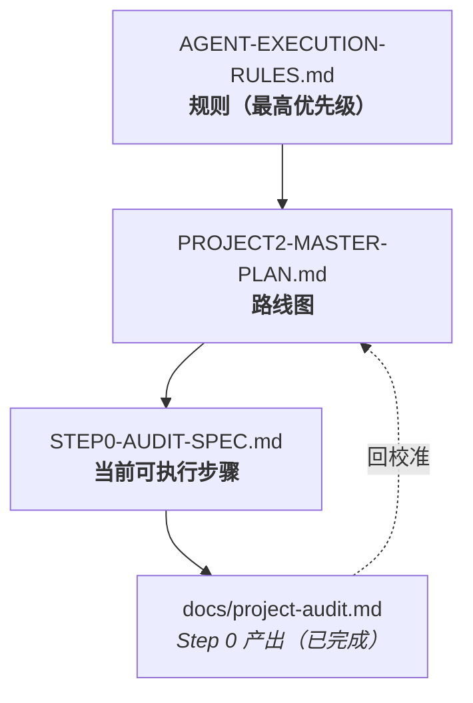

# docs 文档索引｜Project 2

> 本目录是 **Project 2（Mental Health Companion Agent）改造工程**的文档入口。
> 所有实现 Agent 在动手前都必须先读本目录的文档。

---

## 1. 文档清单

| 文档 | 作用 | 读者 |
| --- | --- | --- |
| [`jiaojie.md`](./jiaojie.md) | **唯一入口 / 交接文档**：30 秒速览、项目背景、已有资产、当前进度、架构决策与五个「为什么」、红线、风险、Onboarding 步骤 | **新接手者必读** |
| [`PROJECT2-MASTER-PLAN.md`](./PROJECT2-MASTER-PLAN.md) | **总纲**：项目定位与产品边界、与 Project 1 的关系、现状基线、目标架构、技术决策（ADR）、迁移风险、Phase 0–13 路线图、四项硬验收标准 | 全员 |
| [`AGENT-EXECUTION-RULES.md`](./AGENT-EXECUTION-RULES.md) | **强制规则**：逐 Step 推进机制、六条严禁、分层依赖约束、身份与隐私规则、安全边界规则、测试与交付模板 | 实现 Agent |
| [`STEP0-AUDIT-SPEC.md`](./STEP0-AUDIT-SPEC.md) | **审计规范**：Step 0 只读审计的禁令、待核实清单、输出物与验收标准 | 审计 Agent |
| [`project-audit.md`](./project-audit.md) | **Step 0 产出（已完成）**：11 章审计报告 + 架构图/关系图/页面地图/技术债/三分清单 + 启动验证证据 + 路线图校准建议 | 全员 |
| [`db-naming-convention.md`](./db-naming-convention.md) | **命名基准**：16 表 / 150 列 / 8 类字典编码映射与执行记录（含残留修复、已知未修项、回滚风险） | 全员 |
| [`PHASE1-SCOPE-AND-BOUNDARY.md`](./PHASE1-SCOPE-AND-BOUNDARY.md) | **边界基准（Phase 1 产出）**：名称定稿、能力边界矩阵（10 允许 / 10 禁止）、Prompt/UI/Tool/README 四层落地规范、用词规范、角色边界、Phase 2 校准 | **Phase 3/4/9 必读** |
| [`PHASE2-STEP2-REPORT.md`](./PHASE2-STEP2-REPORT.md) | **Step 2 交付报告**：平台升级（Boot 3.5.16 + JDK17 + MP 3.5.8）改动清单、测试证据、回滚方式、遗留项与 4 条技术结论 | 全员 |
| [`PHASE2-SHA-REPORT.md`](./PHASE2-SHA-REPORT.md) | **SH-A 交付报告**：下线 15 个动态 SQL 端点；含**调用方取证过程**（「有调用点 ≠ 有合法调用方」）与方案取舍（为何移除而非白名单） | 全员 |
| [`PHASE2-STEP3-REPORT.md`](./PHASE2-STEP3-REPORT.md) | **Step 3 交付报告**：API 数据边界治理；含 **51 次真实调用**的暴露面审计、`@JsonIgnore` 机制说明、假阴性修正教训与 3 项待决策 | 全员 |
| [`PHASE2-T1-REPORT.md`](./PHASE2-T1-REPORT.md) | **T-1 交付报告**：26 个孤儿类取证与清理；含 **9 类隐式引用向量**的逐项取证表与对照验证，及「不复用 VO 类」的裁决 | 全员 |
| [`PHASE2-T2-REPORT.md`](./PHASE2-T2-REPORT.md) | **T-2 交付报告**：最小回归测试基线；含测试现状取证、**9 项**用例、**反向对照**（证明断言有效）与过程事故记录 | 全员 |
| [`PHASE2-T4-EXCEPTION-AUDIT.md`](./PHASE2-T4-EXCEPTION-AUDIT.md) | **Step 4 第一阶段取证（已完成）**：异常处理现状 7 条链取证、**运行时实测契约表**、改 HTTP 401 的真实影响面（2 文件 4 处）、3 个额外发现（**P0 错误体被劫持** / P1 参数校验缺失 / P1 code 语义崩坏） | **进入 Step 4 实现前必读** |
| [`PHASE2-T4-REPORT.md`](./PHASE2-T4-REPORT.md) | **Step 4 交付报告（第二 + 第三阶段）**：新增 `GlobalExceptionHandler` + 拦截器排除 `/error`；契约前后对照、4 项验收 + 7 项补充覆盖实测、**异常契约用例 5 项（总计 14 项全绿）**、**两次反向对照**、MockMvc 环境限制、观察项 O7–O10 | 全员 |
| [`PHASE2-T5-IDENTITY-AUDIT.md`](./PHASE2-T5-IDENTITY-AUDIT.md) | **Step 5 第一阶段取证（✅ 已验收通过）**：10 个身份向量全量扫描、身份来源全图、**A/B/C/D 信任边界分类**、**运行时越权实测 6 项**、8 项缺口清单（2 项实测证实 / 6 项静态确证）、**§5.1 匿名 `/list` 归属登记** | **进入 Step 5 实现前必读** |
| [`PHASE2-T5B-DESIGN.md`](./PHASE2-T5B-DESIGN.md) | **Step 5 第二阶段设计（v2 已定稿）**：三层边界原语、**fail-closed 角色策略**、**15 个 `/info/{id}` 逐接口分类**、**密码重置 6 端点清单与证据**、写路径分类规则（`stampOwner` vs `authorizedTargetUser` + 证据准入约束）、**回归矩阵 13 项 + DB 前后快照断言**、**§0.1 已锁定决策**、批 1 收窄 | **实现前必读** |
| [`PHASE2-T5B1-REPORT.md`](./PHASE2-T5B1-REPORT.md) | **Step 5 批 1 交付报告（✅ 完成）**：新增 `OwnershipGuard` + `ForbiddenException` + 403 契约；8 个 `/info/{id}` 接入；**22/22 全绿**（8 新增 + 14 既有）；**反向对照 4/4 失败**证明断言有效；登记 **U1/U2 教师侧未收敛项**（无 schema 依据，不凭空发明规则） | 全员 |
| [`PHASE2-T5B2-REPORT.md`](./PHASE2-T5B2-REPORT.md) | **Step 5 批 2 交付报告（✅ 完成）**：2 个 `/resetPassword?id=` **限管理员**（管理端按钮的真实调用方，故不删除只加授权）；用例 9–11 含 **DB 前后快照**断言；**25/25 全绿**；**独立核验数据库零变更**；`/resetPass` 系列保持现状并登记（D3：不凭空设计业务规则） | 全员 |
| [`PHASE2-T5B3A-WRITE-PATH-AUDIT.md`](./PHASE2-T5B3A-WRITE-PATH-AUDIT.md) | **Step 5 批 3A 写路径身份审计（已完成）**：55 个写端点全清单；`/save` 10 处生效 / `/add` 3 处生效 / **`/update` 9 处注释 = 缺口**；**调用方证据**（用户端只调 `/add`、0× `/update`；管理端**动态 `${this.table}/update`** + **「请选择学生」选择器** → **B 类确证 → 注释不可机械恢复**）；**A/B/C/D 矩阵**；实施清单；**附带 D7 调用面核查（全区域零调用）** | **批 3B 前置必读** |
| [`PHASE2-T5B3B-REPORT.md`](./PHASE2-T5B3B-REPORT.md) | **Step 5 批 3B 交付报告（✅ 完成）**：`OwnershipGuard` 写路径 API（**具名操作枚举**——不是「管理员万能绕过」+ 目标可写性 + 归属解析）；6 个 `/update` + 2 个 `/add` 接入；**30/30 全绿**；**6 项验收逐条通过**；数据库前后快照一致；**反向对照精准命中**（伪造归属用例失败、鉴权用例仍通过） | 全员 |
| [`PHASE2-T5B4A-REPORT.md`](./PHASE2-T5B4A-REPORT.md) | **Step 5 批 4-A 交付报告（✅ 完成）**：新增 `DataScope`（**fail-closed 读范围**）+ **12 处 `/page` 收敛**；**33/33 全绿**；矩阵 **3/11/12** 通过；**反向对照实测复现**旧行为下「未知角色 → 拿到全表 + 关联用户 PII」 | 全员 |
| [`PHASE2-T5-D7-REPORT.md`](./PHASE2-T5-D7-REPORT.md) | **D7 独立安全小批次（✅ 完成并提交）**：下线匿名密码重置端点 `/users/resetPass`（零调用面 + 消歧复核）；**34/34 全绿**；运行期 **404** + 对照端点仍可用；数据未改动独立核对（含一次空跑纠正） | 全员 |
| [`PHASE2-T5B4B-REPORT.md`](./PHASE2-T5B4B-REPORT.md) | **Step 5 批 4-B 交付报告（✅ 完成）**：**Q1 代码取证**（老师对业务数据**无写入口**，回复由管理员在管理端完成）；**Q2 规则落地**（`assertSelfOrAdmin` + 固定字段服务端恢复）；**闭合对象级授权缺失（IDOR）**；**38/38 全绿**；反向对照精确隔离（§5.3 查实「无人拒绝」的真相）；如实记录 2 起过程事故 | 全员 |
| [`ADR-0001-server-authoritative-identity-fields.md`](./ADR-0001-server-authoritative-identity-fields.md) | **ADR**：**身份属性字段为「服务端权威」** —— Q2 命名字段（`username`/`gender`）+ **额外收紧 `idCardNo`（独立依据，非 Q2）**；澄清 `password`/`idCardNo` 因 `@JsonIgnore` **不可由 JSON 绑定**；含显式回退方式 | 全员 |
| [`PHASE2-T5B5-REPORT.md`](./PHASE2-T5B5-REPORT.md) | **批 5 交付报告（✅ 主体收口）**：校准「103 → 54 → 50」；A1a/A1b/A2/A3/依赖反转 **5 提交**；逐项验收（含 A3 迁移前后逐字比对）；**3 项语义差异显式声明**；A4 摘要；6 项遗留；**三次自我更正** | 全员 |
| [`PHASE2-D2-LIST-AUDIT.md`](./PHASE2-D2-LIST-AUDIT.md) | **D2-1 免鉴权 `/list` 只读最终审计（✅ 完成，零代码）**：14 个 `/list` 全量表（`@IgnoreAuth` / 数据表 / PII / 前端调用 / 匿名与登录**实测** / `DataScope` 覆盖）；**匿名可达 13/14** ✗、**8 个返回 PII** ✗、**首页调用 4 个**（= 公开硬证据）；三组分类 **A 收敛 7 / B 公开 4 / C 暂缓 2 + 1 已收敛**；`/xinlilaoshi/list` 需求冲突（首页要公开 vs 返回 PII）归入 phone/email 批次 **D2-2a 已完成**（A 组 7 个 `/list` 移除方法级 `@IgnoreAuth`；44/44 + 反向对照命中 + 端到端三组探针：匿名 401 / 登录不变 / B·C 组未误伤）；**D2-2b Phase 1 只读勘察已完成**（`/list` 与 `/page` 共用 `selectListView(page,params)`；逐端点 5 问表；分 **G1 直接注入 6 / G2 需补 XML 1 / G3 教师侧无字段 4**；实测登记两处「同表两入口不一致」）；**D2-2b-G1 6/6 与 G2 均已完成并推送**（`e164d2f`…`99d6147` + `c879e51`）：G1 逐模块独立验收（含**伪造 owner 参数**与 **SQL 条件证据**；模块 3–6 以**临时对照数据**证明非空跑后删除复原）；G2 修复一处**同时影响 `/yonghu/list` 与 `/yonghu/page` 的 XML 缺口**（G2-A/G2-B 分别验收，SQL 出现 `a.id = ?` 绑定服务端身份）；**同步修订 1 个把缺口当正确行为的回归用例**；**G3 教师侧挂账暂不实施** |
| [`PHASE2-T11-ROLE-MISSING-AUDIT.md`](./PHASE2-T11-ROLE-MISSING-AUDIT.md) | **T11：`role` 缺失的 E2E 覆盖缺口（✅ Phase 1 只读审计 + Phase 2 仅测试收口）**：身份链逐环节取证（拦截器唯一写入源 / `currentRole` 唯一读取实现 / 19 处 `DataScope` + 33 处 `OwnershipGuard` 静态 fail-closed）；`auth_token.role` **允许 NULL** + `/users/login` 的 role 取自 DB ⇒ **缺失令牌真实可达**；精确缺口 = **NULL/空 role 无任何 E2E 守护**（#16/#19 只覆盖"非空未登记"，#25 只覆盖函数契约）；**Phase 2 新增 #28/#29**（NULL / `""` → `/page`+`/list` 均 403，含**正向控制**）→ **46/46** + **一次性反向对照命中**（破坏 deny → 两用例失败，body 显示 `total=6` 全表）+ **生产代码零改动**；同批登记 `/save` 无终态拒绝 → 并入 T3 | 全员 |
| [`PHASE2-T1-EMPTY-SET-AUDIT.md`](./PHASE2-T1-EMPTY-SET-AUDIT.md) | **T1：空 `SET` 的 `updateById` → 500（✅ Phase 1 只读审计 + **Phase 2 已修复：HTTP 400 + 零写入**）**：**500 产生层 = DAO/MP 生成 SQL 层**（`UPDATE … SET  WHERE id=?` → MySQL 解析期拒绝 ⇒ **0 行写入**）→ 兜底 500；**15/15 个 `/update` 无"更新体为空"防护**；**前端 7/7 调用点均提交完整对象**（多处有必填校验）⇒ **非正常业务流可达**；现有契约 400 仅用于"无法解析/绑定"、业务前置用 `200+R.error(511)`、兜底 500；**空 SET 无任何用例**；分类 **② 非法/不完整客户端请求 → 应定义"参数错误"语义**（**不预设 HTTP 状态**，Phase 2 候选未采纳）| 全员 |
| [`PHASE3-STEP6-DESIGN.md`](./PHASE3-STEP6-DESIGN.md) | **Step 6 新 Vue3 前端设计版（✅ 只设计不编码）**：清点旧 front **17 目录 / 51 HTML** ✓ 与 **16 控制器真实端点 + 公开端点精确清单** ✓；任务流 A–D ✓；目录按**业务域**推导 ✓；**51 → 18 条路由（合并率 ≈65% ✓）**，`dictionary`/`chat`/`recharge` 淘汰 ✓；API 模块严格对齐 Step 5c 冻结合同 ✓；**页面→API→权限契约**（含"前端需要 vs 旧 API 实际" ✓）+ 差距 **G1 公开详情缺端点** ✓ / **G2 答题提交非原子** ✓ / **G3 公开 `resetPass` 🔴**；未决 **P0-1 `/config`≠`sysConfig`** ✗、**P1-1 `dist` 重建独立工单** ✓ | 全员 |
| [`AUTHZ-COUNSELOR-STUDENT-SCOPE-EVIDENCE.md`](./AUTHZ-COUNSELOR-STUDENT-SCOPE-EVIDENCE.md) | **Student 三项证据核查 + 修复设计要素（🔍 只读 · 设计待审批 · 4 项待裁定）**：🔴 **推翻原审计建议 C** —— 实查 `xinlilaoshiOrder/list.vue` 表格列**已含 `studentName`**、审核对话框只有 `status`+`reviewComment`、该页**不调用任何 `student/info`** ⇒ **审核不需要 Student 详情** ⇒「待审核」**无业务依据**作为详情访问理由（记录自我更正：原建议属**未核实假设**）；✅ **空下拉不会误清空 `studentId`** —— 全模块 `clearable` **0 处**、留言表单对非管理员**禁用 `studentId`**、提交体是 `ruleForm`（值来自回填，与选项列表无关）；风险仅「编辑态学生姓名辅助字段显示为空」= **显示降级非数据破坏**；🔴 **附带发现既有 UI 缺陷**：`:label="item.studentName"` 而接口返回 `name` ⇒ 选项标签本就可能空白；✅ **撤销天然失效** —— 拒绝=改 `status=3`、取消=**物理删除**，`EXISTS(status=2)` 立即失效；**结论：四入口统一按 `status=2`**（不再分列表/详情）；**设计草案**：`StudentDao` 加 `EXISTS`（复用 `APPROVED_STATUS`，一处覆盖 page+list 无旁路）+ `info`/`detail` 共用**同一关系回调**（满足 Step 14 一致性）；**测试矩阵 T1–T14**（含 T3 证明不含 `status=1`、T13 变异实验、T14 撤销后失效）；**回滚**：单 commit revert，无 DB/前端/依赖，实验改动不入提交；后端·SQL·DB·前端·pom **0 改动** | 全员 |
| [`BIZ-PAPER-QUESTION-VISIBILITY-BATCH.md`](./BIZ-PAPER-QUESTION-VISIBILITY-BATCH.md) | **独立批次：Paper/Question 资源可见性（🏁 CLOSED · 正式基线 `e15e0a2` · 目标 28/28 · 全量 197/197）**：🔴 **重大更正** —— **`SEC-QUESTION-ANSWER-PUBLIC` 实测已修复**：匿名/学生访问 `assessmentQuestion` 的 `list`/`page`/`info` **均 `answer=false · analysis=false`**，仅**管理员**可见 ⇒ 既有登记「P1/Unfixed」**已过时**，应改「待复核关闭」；前端 `assessment.ts` 注释「匿名返回 answer/analysis」**已失效**（但「前端不调用」结论仍正确）；**可见性缺口实测**：`assessment_paper` 2 条均 `status=1(启用) / is_deleted=1(已删除)`，而 `/list`（**@IgnoreAuth 匿名**）、`/page`、`/info/{id}`（**无任何守卫**）对匿名/学生**均返回**；**试题可绕过父卷状态** —— `AssessmentQuestionDao.xml` **已 JOIN 试卷并投影 `paperStatus`/`paperIsDeleted`，却无 WHERE 过滤** ⇒ 只修 paper 会留旁路（**好消息：无需新增 JOIN**）；**实施要点**：①**不得写成「非 admin 就过滤」**，必须明确列角色集合且**覆盖匿名** ②`/info/{id}` 必须单独处理（等效旁路，用户视角 **403**）③试题**继承父卷**（父卷缺失 fail-closed）；⚠️ **必须预告的后果**：两张试卷均已删除 ⇒ 修复后学生/匿名列表变 **0 条**，这是**规则生效**而非功能损坏；**验收矩阵 A1–A13 + 反向自检 3 条**（admin 必须 2/6 条且含 answer）+ **独立验收 S1–S5**（原答案外泄项只做回归固化，不与可见性混合）+ **变异验证 3 项**；后端·SQL·DB·前端·pom **0 改动** | 全员 |
| [`C3-NOTIFICATION-AND-PAPER-VISIBILITY-EVIDENCE.md`](./C3-NOTIFICATION-AND-PAPER-VISIBILITY-EVIDENCE.md) | **C3 后续取证：Notification 结构 + Paper/Question 影响面（🔍 只读 · 3 项待裁定）**：**Notification 五问全部取证** —— Entity/表**无任何用户或受众字段**、创建走标准 CRUD（管理员录入**无目标用户选择器**）、**全仓无任何按 userId/studentId 写通知的代码**、查询**无任何用户维度过滤**、新 Vue 直接 `GET /notification/list` 并注明「公开接口」⇒ **「用户私有通知」当前无法表达/无法写入/无法查询** ⇒ **属功能尚未存在，不得判为现存漏洞**，登记为**未来需求**（需加归属字段 + 写入路径 + 查询过滤，独立立项）；🔴 **Paper/Question**：`is_deleted=1` 已裁定为「已删除」，而 `/assessmentPaper/list` 对**匿名返回 2 条已删除试卷** ⇒ **已确认违反可见性规则**（不再是「待确认」）；🔴 **修复不能一刀切** —— 旧 Admin `exampaper/examquestion` 管理页**必须看到未发布/已删除**，故必须**区分视角**（admin 全量 / 学生·匿名仅已发布未删除）；🔑 **定性**：`DataScope ownership（这是谁的数据） ≠ resource visibility（当前是否可用）` ⇒ **本项不属 DataScope 审计**，独立立项；同时指出与既有 **`SEC-QUESTION-ANSWER-PUBLIC`**（答案/解析匿名可读）**同源不同问题**（状态可见性 vs 字段外泄），建议同批次分别验收；**C3 已正式拆为 4 类**（knowledge 保持 / counselor 名录 / paper·question 独立缺口 / notification 未来需求）；后端·SQL·DB·前端·pom **0 改动** | 全员 |
| [`BIZ-C3-VISIBILITY-DECISION-PACKAGE.md`](./BIZ-C3-VISIBILITY-DECISION-PACKAGE.md) | **C3 Business Visibility 决策包（📐 只读取证 · 4 项待裁定）**：`DataScope` 审计主线**最高优先**项 —— 不解决则审计难以关闭；核心问题 = 「这个资源**本来就该所有人看到**，还是**存在未实现的范围**」；🔴 **关键新发现：C3 内部并不一致** —— `notification`/`knowledge_article`/`counselor` **确无任何用户维度字段**，但 **`assessment_paper` 有 `status` + `is_deleted` 可见性字段**，只是当前**仅作客户端可选过滤条件**（`params.status`/`params.isDeleted`），**无服务端强制约束**（实测两张试卷 `is_deleted=1` 仍对匿名返回 2 条）⇒ **不得把 C3 五个模块当成同一类问题**；`assessment_question` 依附 `paper_id`，可见性应跟随试卷，且含 **`answer`/`analysis`**（答案外泄直接影响测评有效性）；`notification` 需明确 **A 全站公告 / B 用户私有通知**（B 属**数据模型缺归属字段**，需改表，独立立项）；`knowledge_article` content 为 **7 字符占位符**（RAG 前置）；`counselor` 倾向公开目录，须与既有 `DEF-COUNSELOR-LIST-PUBLIC-PII` 合并裁定；**4 项待裁定**（notification A/B · `is_deleted` 语义 · 是否强制仅已发布 · 知识是否需草稿态）；零代码改动 | 全员 |
| [`AUTHZ-COUNSELOR-STUDENT-EVIDENCE-AND-IMPL.md`](./AUTHZ-COUNSELOR-STUDENT-SCOPE-EVIDENCE.md) | **Student 三项证据核查 + 修复实现（🏁 CLOSED · `36bb760`）**：⚠️ **两个结论分开写**：✅「Student 咨询师范围修复已通过**行为回归测试**」（12/7 → 12/12 → 169/169）；❌**不可**写「Student M2 已完成**变异验证**」—— **T13 未执行**（已并入 DataScope 审计挂账，**不重开 CLOSED 批次**）；**先红后绿**（修复前 `12/7 失败` → 修复后 `12/12` → 全量 **169/169**）；🔴 **推翻原建议 C 并记录自我更正** —— 实查审核页**已含 `studentName`** 且**不调用任何 `student/info`** ⇒「待审核」无业务依据，四入口**统一 `status=2`**；✅ **空下拉不会误清空 `studentId`**（`clearable` 0 处、留言表单对非管理员禁用、提交体为回填 ruleForm）；**撤销天然失效**（拒绝=status3 · 取消=**物理删除**）；🛠 实现 = `CounselorStudentScope`（**复用 Step 13 关系判定实现，不另写一套 SQL**）+ `StudentDao` `EXISTS(status=2)`（page/list 共用，**无旁路**）+ `approvedStatus` 常量传入（**XML 不写死 2**，漏传 fail-closed）+ `info`/`detail` 接**同一个非空回调**（避免 `relationChecker==null` 放行）；🔴 **修正错误旧基线**：`StudentDetailIdorRegressionTest` 原断言「咨询师读任意学生=200」——**越权行为被固化为基线** → 改为无关系 403，并新增 **T3b 有批准关系=200** 防「一律 403」假通过；未动 DataScope / 前端 / DB / com.agent | 全员 |
| [`AUTHZ-COUNSELOR-STUDENT-SCOPE-AUDIT.md`](./AUTHZ-COUNSELOR-STUDENT-SCOPE-AUDIT.md) | **Student 全入口审计（🔍 只读 · 零代码 · 不修复 · 3 项待裁定）**：四条入口对咨询师**全部放行**且返回 `phone`+`email`（`password`/`idCardNo` 已收敛）；🔴 `/page`、`/list`：`counselorId` 被 `DataScope` 注入但 `StudentDao.xml` **0 处消费**（**同一根因，与 `AUTHZ-FILTER-PROBE` 一致**）；🔴 `/info`、`/detail`：`assertOwnership(..., null)` 在「老师 + 无 `counselor_id` + **无回调**」组合下 `return` **放行**（对照：`assessment_record` 已接回调故能拒绝）；📌 **这不是遗漏而是已登记挂账** —— `StudentDao.xml:35` 注释明写「教师侧不映射…挂 G3」；**实测**：counselor1/2 在 `page`、`list` 均得 **3 条**（应为 1 / 0），counselor2 读 `info/1`、`detail/1` 均 **200**；✅ **建约不需咨询师选学生** —— 预约由**学生发起**（`api/appointment.ts` 只传 `counselorId`，`studentId` 服务端强制），旧 Admin 预约表单还依赖 admin-only 的 `counselor/page` ⇒ 咨询师根本打不开；🔴 **最重要的发现：规则与流程有 3 处语义冲突** —— ①**审核面向 `status=1`**，严格 `status=2` 会使「审核前看不到申请人」②留言/考试记录/错题本的「查看·修改」表单会加载 `student/page` 作下拉 ③`/student/detail` **仅测试调用**（无生产调用方）⇒ **规则必须区分「服务管理 / 流程处理 / 选择枚举」三种意图**，不得用一个条件覆盖；**4 入口适用建议**（page/list 用 EXISTS；info/detail 接关系回调）；**3 项待裁定**（有效关系是否含 `status=1` / 表单下拉如何处理 / `detail` 是否保留）；后端·SQL·DB·前端·pom **0 改动** | 全员 |
| [`DATASCOPE-C1-COVERAGE-IMPL.md`](./DATASCOPE-C1-COVERAGE-IMPL.md) | **Batch：DataScope C1 coverage completion（✅ 已推送 `9a1cb70` · 待 CLOSED）**：**仅 1 新增测试文件（+267）· 生产代码 0 改动**；补齐 C1 唯一测试盲区 —— `counseling_appointment` / `counselor_favorite` 此前**无行级范围断言**（`Phase2Core` 的 `/page` 请求只是**敏感字段检查**，不能算授权覆盖）；**7 例**：A1/A2（appointment 双维度）· B1/B2（favorite 双维度）· C1/C2（提交他人 id 不得放大）· D1（未认证 401）；**防假通过**：每例先断言「有权侧 `total>0`」再断言「无权侧被排除」，并以 **admin 全量对照**（appointment 3 / favorite 6）排除「表里本就这么多」；🔴 **红/绿验证（两次变异，均只删 XML 5 行）**：删 `AppointmentDao` counselor 条件 → **`appointment_counselorScope` 失败 `expected: 1 but was: 3`**；删 `FavoriteDao` counselor 条件 → **`favorite_counselorScope` + `counselorCannotWidenByParam` 双双失败 `expected: 2 but was: 6`**（证明两类断言互补）；`Errors=0` 全程 ⇒ **断言失败而非 SQL/启动错误**；恢复后 **7/7** · 全量 **156/156**（149+7）· `HEAD` 未变 · **零提交**；🚫 **未做**：C3（保留 no-op 调用）· C4 `Student`（下一批仅审计）· `DataScope` 实现 · `counselor_message` 变异实验 | 全员 |
| [`DATASCOPE-D4-CONTRACT-GUARD-DESIGN.md`](./DATASCOPE-D4-CONTRACT-GUARD-DESIGN.md) | **`DataScope` D4 契约保护机制设计选型（📐 零代码 · 4 方案比较 · 3 项待裁定）**：**M2 与 D4 分工** —— M2 证明「当前确实消费」，D4 解决「以后如何尽早发现**声明了却没消费**」；**事实基线**：19 调用点 / 12 Controller / **每个 XML 恰好 1 条 `selectListView`**（命名约定稳定 ⇒ 静态映射可行）；🔴 **关键约束**：当前 **7 个模块存在维度被丢弃**（C2×2 + C3×5）⇒ 任何机制上线第一天即命中，**必须支持显式例外清单**（把静默丢弃变成书面裁定，否则会被改成永远绿）；**四方案比较**：A 编译期（成本高·与 C 重叠）· B 启动期（**需手写声明表 ⇒ 配置漂移**）· **C 测试期静态一致性（零生产侵入·成本最低·推荐阶段 1）** · **D 运行期拦截器（基于 `BoundSql` 真实参数映射·可靠性最高·推荐阶段 2 test-only）**；🟡 **能力差异**：C **发现不了「`<if test="false">` 条件永假」**，D 能 ⇒ 故两阶段互补；**验收 V1–V6**（V3 专门证明「只做一层不够」）；**D4 不解决** C2/C3 业务裁定、不替代 M2、不检测「消费但语义错」；后端·SQL·DB·前端·pom **0 改动** | 全员 |
| [`BATCH-DEBT-CLEANUP-PLAN.md`](./BATCH-DEBT-CLEANUP-PLAN.md) | **债务清理批次实施计划 v1（📋 零代码 · 停等审查批准后才改代码）**：**敏感 DAO 全量枚举 18 个分级**——P0 新发现 🔴 **`AuthTokenDao` 含 `token` 字段（登录令牌进日志 = 会话劫持面，最高优先）** + P1 内容/凭据/PII/答案 8 个（留言内容/作答原文/测评正确答案/三账号密码 phone email/预约评语/成绩）+ P2 维持 debug 5 个（公开语料/公告/字典/配置/试卷名）⇒ yml 追加 9 行例外**不全局关闭**；**债 1 遮蔽设计**：遮蔽点=AgentService 最终 answer（模型原始输出无持久化，不改语料/SafetyRules）+ 4 组高置信电话正则（纯短数字/编号不命中）+ 替换文案附指引（落实产品语义）+ **8 项误伤矩阵映射到 S1–S8**；**债 2 探针回归**：留言内容/token/低敏对照 T-a/b/c（OutputCapture）+ 还原 yml 变异转红；测试 330→预计 341；流程：计划审查 → 实现 → 变异 → 真实 LLM 抽查 → 独立 commit（不与 ⑦b 合并）| 全员 |
| [`STEP7B1-VECTOR-EXPERIMENT-DESIGN.md`](./STEP7B1-VECTOR-EXPERIMENT-DESIGN.md) | **⑦b-1 向量检索可行性——对照实验设计（🧊 零代码 · 待批准实验方案）**：**先定义「什么算改善」**——H0 不立项（缺口归因语料）/H1 成立才进第二阶段；**Query 测试集 G1–G4 预注册**（G2 同义漏检组 7 条含 L2c 原始查询，实验前冻结防挑结果）· 两条对比实现（生产关键词基线 vs 实验向量 topK=2 按篇切分）· **embedding 候选**（推荐本地 bge-small-zh ONNX：零费用+离线可复现，契合「不提前引依赖」——实验代码放独立目录 `experiments/step7b1/` 不进主 pom）· **决策门**：H1 ⇒ 生产接入设计单独裁定；H0 ⇒ ⑦b-1 关闭转 ⑥ 语料补充 | 全员 |
| [`STEP7B2-USERMESSAGE-ASSESSMENT.md`](./STEP7B2-USERMESSAGE-ASSESSMENT.md) | **⑦b-2 独立 UserMessage 架构评估（🧊 零代码 · 不预设必须改造）**：风险定性（伪造段=低频低危 · 标记碰撞极低 · 同消息双信任级=架构权衡 · 来源扩展前必须重评）；**四方案对比**：a 维持前缀（现状可接受）/ b 独立 UserMessage（硬隔离但接口签名变更+Spring AI 1.1.8 多消息 Spike）/ c 第二条 System（❌ 信任模型矛盾，否决）/ **d 用户原文标记转义（推荐叠加项——1 纯函数消除伪造段，零接口变更，变异可证伪）**；**推荐组合 a+d**，b 登记为条件性候选（仅当来源扩展到第三方或真实观察到混淆时先 Spike 后立项）| 全员 |
| [`DEBT-ASSESSMENT.md`](./DEBT-ASSESSMENT.md) | **挂账债务风险评估（🧾 零代码 · 实测探针取证 · 方案矩阵 · 待裁定）**：**债 1 UNVERIFIED-PHONE**——残余敞口=模型自由文本（卡片/语料零数字已达成；Prompt 软约束不可依赖）；**推荐 A 服务端遮蔽**（高置信电话模式，实测对「20–30 分钟」类零误伤，复用 Round 3 冻结 8 项误伤矩阵）；**债 2 SQL-PARAM-LOGS**——风险面经实测**重定义**：对话内容（会话 DAO 已降级）与明文密码探针均 **0 泄露** ✅，残余面=写操作参数 + Controller debug 潜伏语句；**推荐 C 敏感 DAO 逐个降级**（沿用 Step ⑤ 模式）+ A 部署 profile 分层；两项待裁定，⑦b 维持待启动 | 全员 |
| [`PHASE4-RETROSPECTIVE.md`](./PHASE4-RETROSPECTIVE.md) | **Phase 4 · 阶段性技术复盘与下一阶段规划（🧾 零代码 · 架构/能力/证据/债务/面试锚点/优先级）**：**调用链全图**（Gate→检索→隔离段→Memory→Tool 循环→SafetyRules→卡片追加）· **8 批次能力×证据对照**（每批先红→绿→变异→真实调用）· **安全设计性质表**（结构保证 vs Prompt 引导 vs 辅助提示，逐项定性）· **职责边界**（Tool/Memory/RAG/Gate/卡片）· **债务与限制全录**（2 项挂账 + L2c 召回缺口 + 伪造标记段 + 拼音绕过 + 语料规模…）· **面试 Q&A 锚点 8 条**（Spring AI Spike 事实/窗口自实现/注入式取舍/防注入分层/两阶段 token/变异证伪/检索质量评估/隐私）+ **诚实边界话术**（4 条禁语）· **下一阶段优先级**：债务两项评估（零代码）→ 再判定 ⑦b-1/⑦b-2 是否启动 | 全员 |
| [`PHASE4-STEP7-RAG-DESIGN.md`](./PHASE4-STEP7-RAG-DESIGN.md) | **Phase 4 · Step ⑦a 实施：RAG 关键词最小实现（🏁 CLOSED · Gate + 检索 + 独立段注入 · 变异全命中 · 真实 LLM L1–L8 · 330/330）**：v2 补强用户裁定的两个缺口 —— ① **RAG Eligibility / Routing Gate**：服务端**确定性规则**（同 SafetyRules 模式，**不用 LLM 判意图**）四态：R1 Tool 域特征→DEFER_TO_TOOL · R2 第一人称疾病判断→DENY_RAG（≠拒绝回答：不注入+引导求助）· R3 会话指代→MEMORY_ONLY · 其余 ALLOW_RAG；**误判不对称 ⇒ 宁可 DENY**；② **组合规则**：Memory+RAG **允许** / **Tool+RAG ⑦a 不自动组合**（另立编排设计）；③ **M1 重定义**：adversarial retrieval fixture 做**可重复**验证，不把单次 LLM 输出当绝对安全保证（服务端硬保证=片段永不进 System、永无工具执行权）；④ **注入结构=独立消息段**（`KNOWLEDGE_CONTEXT…END`，禁止拼入 System 正文）；D3 改称「⑦a 初始安全上限/工程参数，非最优值」；不变项：注入式（D1）· 双阶段 ⑦a 关键词（Retriever=接口，零依赖）→⑦b 向量需同义失败证据（D2）· 危机文章参与+SafetyRules 正交（D4）· **S1–S19 + M1–M4/M6**（Gate 可证伪：删 R2→S16 红）；❌ 片段过滤 ❌ LLM 自判指令 | 全员 |
| [`PHASE4-KNOWLEDGE-CONTENT-DESIGN.md`](./PHASE4-KNOWLEDGE-CONTENT-DESIGN.md) | **Phase 4 · Step ⑥ 实施：知识内容建设（🏁 CLOSED · 12 篇审核语料入库 · 6 类 × 2 · 前端分页修复 · 311/311）**：路线图 step ⑥（RAG 前置）；**硬事实 7 条**：表 7 列**无摘要/标签/来源列** · 现有 5 条**占位**（7 字符）· 前端**纯文本 pre-wrap 渲染** ⇒ 文章必须纯文本（禁 Markdown/HTML）· `/knowledgeArticle/list` **@IgnoreAuth 公开** ⇒ 对未登录访客安全 · 字典 `knowledge_category` 仅 2 个**占位名**（`健康知识类型1/2`）· **无号码原则延伸到文章**（Round 3 Q2）· SafetyRules 只评估用户输入（⑦ RAG 检索注入需重评，已登记）；**知识域提案**：6 域 × 2 篇 = **12 篇**（睡眠 / 学业压力 / 情绪基础 / 人际沟通 / 求助去污名化 / 危机识别与身边人支持，每域「认知篇 + 行动篇」）；**文章骨架**（纯文本固定结构 800–1200 字 / 小节「一、二、三」/ 标题 ≤30 字带域标签 / 结尾固定免责块）；**内容边界（硬约束）**：❌ 诊断用语 · ❌ 药物剂量 · ❌ 自伤方法 · ❌ 未核实号码 · ❌ 编造统计文献；✅ 逐字免责句 + 无号码指引 + 去污名化基调 + **不署专业头衔**（AI 起草、用户逐篇审核）；**验收闸门**：逐篇 8 项（字数/纯文本/骨架/免责句逐字/禁止项正则/术语白话/主题互补/标题）+ 语料级 3 项（6 域覆盖 / 全局去重 / **RAG 就绪** ≥10K 字）；**交付**：`docs/content/step6/*.txt`（可评审）+ `docs/sql/STEP6-knowledge-content.sql`（删占位 5 条 + 字典修正 + 插入 12 篇 + 回滚，手工执行）；**D1–D6 待裁定**（域范围 / 12 篇 / 删占位 / 字典方案 B / 免责句逐字 / 全篇人工审核）| 全员 |
| [`PHASE4-MEMORY-DESIGN.md`](./PHASE4-MEMORY-DESIGN.md) | **Phase 4 · Step ⑤ 实施：多轮会话 Memory + 会话体系（🏁 CLOSED · 正式基线 `83cfe5d` · 311/311 · 真实两轮闭环）**：路线图 step ⑤；**现状事实**：请求无 `conversationId`、全库无会话表、前端无会话 UI；**Spring AI 1.1.8 内置** `ChatMemory`（conversationId 键控）/ `ChatMemoryRepository` / `MessageWindowChatMemory` / `MessageChatMemoryAdvisor`（jar 实测），本地还有官方 **JDBC memory starter**（未引入）；**归属模型**：`agent_conversation(student_id,…)` + `agent_message(conversation_id, role, content)`，**每次携带 conversationId 必须校验归属否则 403**（不存在也 403，防存在性预言机）；**存储选型 D1**：A 自建 `ChatMemoryRepository`（**推荐**：零新增依赖、归属字段可控）vs B 官方 JDBC starter（新增依赖 + 默认表无归属字段）；**窗口**：最近 20 条；**Advisor**：`MessageChatMemoryAdvisor`；**保存时机**：成功返回后由服务端写 user+assistant，**失败不污染历史**；**隐私**：内容/标题零日志、观测不新增 conversationId、用户可删会话（物理删除）；**前端 D4**：DashboardView 内折叠列表 + 历史 + 新会话 + 删除（**首次前端改动**）；**两处第一次需授权**：前端改动 + **第 2 处 schema**（两张新表含回滚）；**测试 T1–T14**（T3 跨用户 403 / T4 不存在 403 / T7 失败不污染 / T9 窗口裁剪 / T10 多轮下安全兜底仍生效）+ **变异 M1–M6**；实施顺序：测试→DDL→后端→前端→变异→真实 LLM 追问验证 | 全员 |
| [`RESUME-PROJECT-SUMMARY.md`](./RESUME-PROJECT-SUMMARY.md) | **简历项目说明（可直接使用 · 详细版 6 条 / 精简版 3 条 / 一句话版）**：定位「心理健康平台 AI 助手 · 独立项目」；6 条经历覆盖 **身份域隔离**（二元身份 + 调模型前 403）· **只读 Tool 矩阵**（字段白名单 / 代码内字典翻译 / 显式 truncated）· **确定性安全兜底**（R/N 语义 + 服务端后置追加 + 未配置不伪造号码）· **受控写操作**（预览/确认 + HMAC capability + Session 单条草稿 + 应用查重 + **DB 生成列唯一键** + 状态白名单）· **Tool 观测**（仅 name/elapsedMs/ok，Spike 修正 `.toolCallbacks()`）· **证据链**（299 测试 / 21 变异 / 真实 LLM）；🔴 **§五 禁写清单 7 条**（不得写多轮 Memory / RAG / 咨询师域 / 号码已禁止 / 完整监控 / 压测 / 真实用户）；§六 两个「负分转正分」主动说明 | 全员 |
| [`INTERVIEW-QA-EVIDENCE.md`](./INTERVIEW-QA-EVIDENCE.md) | **面试问答与证据链（12 题 · 30 秒版 + 追问 + 禁答）**：Q1 为什么不用 Memory（三项前置缺 + conversationId 是新可控标识）· Q2 为什么没有 RAG（语料 5×7 字符，只能证明「会调检索」）· Q3 为什么预约确认不是多轮（Session 单条草稿、非授权依据、M8 变异）· Q4 为什么参数不进日志（心理健康数据 + O5 哨兵串 + **M3 使隐私断言转红**）· Q5 为什么应用查重 + DB 唯一（**M4 仅 S2 红 / M5 S18 红** 证明分工）· Q6 为什么兜底不能只靠 Prompt（**M2 12 红 / M4 恰红 modelCannotSuppressResources**）· **Q7 299 测试证明了什么又没证明什么**（L1/L2/L3 口径，T0/T3/T4 未单独真实验证）· Q8 怎么知道调了哪个工具（`[AGENT][TOOL]` trace、Spike `.tools()` 不接受 callback）· Q9 二元身份 · Q10 token 非一次性（业务查重 + DB 兜底）· Q11 为什么先修 status 再加索引（否则 P1 升级为占槽）· Q12 下一步优先级；附「最难的是划清确定性与概率性边界」 | 全员 |
| [`PHASE4-OBSERVABILITY-DESIGN.md`](./PHASE4-OBSERVABILITY-DESIGN.md) | **Phase 4 · Observability 小批实施（🏁 CLOSED · 正式基线 `057c774` · 299/299 · M1–M4 全命中 · 真实运行已验证）**：**范围严格限定为 `toolName / durationMs / success`**，回答「模型调了哪个工具、耗时多少、失败没有」；**现状缺口**：只有整轮 `elapsed` 与 `safetyTriggered`，**无 tool 名与单工具耗时**；**拦截点选型**：**A 包装 `ToolCallback`（选定）** —— 用 `MethodToolCallbackProvider` 把 POJO 工具转成回调并逐层计时，**单一拦截点、新增 Tool 自动覆盖**；B 逐方法埋点（易漏）· C AOP（代理可能让 Spring AI 扫不到注解）· D 只有整轮耗时（答不了问题）；**已核实 1.1.8 API**（`ToolCallback.getToolDefinition/call(String)/call(String,ToolContext)`、`MethodToolCallbackProvider.getToolCallbacks()`）+ **落地前 3 项 spike**（`ChatClient.tools(ToolCallback...)`、name 不变、ToolContext 透传）；**数据模型**：`ToolCallRecorder.record(name, durationNanos, success)` + 按工具聚合快照，**内存有界、不存每次调用历史**；**日志只允许三字段** `name / elapsedMs / ok`，**禁止**入参、返回、用户消息、异常 message；**失败语义**：先记 `ok=false` 再**原样抛出**（不吞异常，不影响 fail-closed）；**验收 O1–O9**（含 O5 哨兵串隐私断言、O6 行格式正则、O7 ToolContext 透传、O9 真实 LLM）+ **变异 M1–M4**（M3=日志带 toolInput ⇒ 隐私断言红）；**改动 5 文件**（2 新增 + 2 修改 + 1 测试），不碰 Controller/Service/Tool/Prompt/DB/前端/pom；零依赖 | 全员 |
| [`PHASE4-CAPABILITY-INVENTORY.md`](./PHASE4-CAPABILITY-INVENTORY.md) | **Phase 4 总体能力盘点与「是否继续加能力」判断（📊 零代码 · 三级证据口径 · 3 项待裁定）**：**先证明「已有什么」再决定 Round 5**；**口径**：L1 测试 / L2 变异 / **L3 真实运行**（只有 L1+L2 才写「已证明」，不用 L1 冒充 L3）；**量化**：8 个 Tool 类 / **9 个 `@Tool` 方法**（7 只读 + 1 对写）· **291 测试** · **17 项变异**（R2 4 + R3 5 + R4 8）· 1 处 schema · 0 前端 / 0 依赖；**能力清单含 L3 真实运行标注**（T1 3 条、T2 2 条、T5 INSUFFICIENT、T6 2 位老师、T7 `appointmentId=9252`；**T0/T3/T4 未单独真实验证**）；**八条必须先说清的边界**（仅学生域 · 单轮无状态 · 只有一个写操作 · 无 RAG · 两条软约束 · 观测很薄 · 无压测 · 无真实用户）；**剩余候选**：Memory 三项前置仍缺 · RAG 语料 5×7 字符 · Counselor 无前端 · **Observability 建议做** · 更多写操作禁止；**简历口径**：4 个可防御故事 + **6 条 overclaim 禁写** + 5 个会被追问但答不上的点；**结论**：简历层面已达标，**短板在可观测性而非功能数量**；**建议 A**：不开 Round 5，先做「tool 名/耗时/成功失败（不含参数与内容）」+ 叙事收口；零代码 | 全员 |
| [`PHASE4-ROUND4-DESIGN-FREEZE.md`](./PHASE4-ROUND4-DESIGN-FREEZE.md) | **Phase 4 · Round 4 实施：受控创建预约（🏁 CLOSED · 正式基线 `16cd8bd` · 291/291 · M1–M8 全命中 · 真实两轮闭环已验证）**：用户四项裁定已落地 —— **Q3-a 一师一槽一有效预约**（明确是**Round 4 建立的规则**，不是「旧系统本来就有」）· **Q3-b 生成列方案 B**（表述纪律：**应用层查重负责业务语义，DB 唯一约束负责并发兜底，生成列让 `status=3` 不占槽**，不是「生成列解决了幂等」）· **Q3-c 改名为「预约状态来源与状态转换最小修复」** —— **必须保护咨询师审核流**：创建强制 `status=1`（`/add`+`/save`），更新仅 `1→2/1→3` 且限 `心理老师/管理员`，学生不可改 `status`，**明确禁止 `2→1/2→3/3→1/3→2`**，**不是「禁止 update 改 status」** · **Q3-d 今天~+30 天仅约束 Agent 路径**（`today` 取服务端时间）；**两阶段**：`previewAppointment(cid,date,slot)` **不写库** → 签发 **signed capability token(TTL 300s)** → `confirmAppointment(token)` **token 为唯一参数**（结构上消除模型改字段）；**Token 规格**：`v1.payload.sig`，payload 含 `act/uid(HMAC 不是裸 userId)/cid/d/s/iat/exp/n`，校验顺序 6 步；**明确 token 非一次性** —— 重复提交由业务查重 + DB 唯一键拒绝；**状态策略**：`forceCreateStatus` / `resolveUpdateStatus`；**Schema**：`active_slot_guard = CASE WHEN status=3 THEN NULL ELSE 1 END`（`status NULL` 视为有效，故意保守）+ `uk_counselor_slot`，含回滚语句，无 Flyway ⇒ 新增 `docs/sql` 脚本、**不改全量 dump**；**测试 S1–S18**（含 **S4 串行重复 vs S18 并发** 的区分、S7 跨用户 token、S13 结构上无 studentId/status 入参）+ **变异 M1–M8**（M5 需临时卸索引；M8=不清理草稿）；**R4-Q5=C 已落地**：`confirmAppointment()` **无任何参数**，从 `HttpSession` 单条草稿取 token（新的预览覆盖旧的；确认成功/失败都清理），**Session 不是授权依据**（值仍是签名 token，全部重新验签），**不是 Memory**；🔴 **R4-Q6 实测**：仅改工具描述模型仍不调用（两次失败），**必须由 Controller 在存在草稿时向 system prompt 追加状态提示** —— 第 3 次真实两轮成功（`appointmentId=9252` → 已删除，基线回到 3 条）；**仍属模型中介**，确定性在服务端；新增 `Phase4AppointmentSessionFlowTest` C1–C5（跨用户凭证、覆盖、清理、无草稿）+ C1 断言提示注入；DDL 已执行（含回滚脚本）；DB/前端/pom 仅代码 21 文件、无前端/pom 改动 | 全员 |
| [`PHASE4-ROUND4-APPOINTMENT-MODEL-EVIDENCE.md`](./PHASE4-ROUND4-APPOINTMENT-MODEL-EVIDENCE.md) | **Phase 4 · Round 4 取证：预约时间模型与唯一键可行性（🔍 零代码 · 4 项待裁定）**：回应「唯一字段不得拍脑袋」；**时间模型 = `appointment_date` + `time_slot` 字典槽（1–8，每项固定 1 小时，互不重叠）⇒ 重叠 ⟺ 同一 `(date, slot)`**，你说的「14:00–15:00 vs 14:30–15:30」在当前模型下**不存在**（前提：Agent 必须校验 slot ∈ 字典，否则可写 999）；**唯一键可行性实测**：`(counselor,date,slot)` **无重复 ✅ 兼容**；`(student,date,slot)` 🔴 **与现有数据冲突** —— student 1 在 2022-03-30 slot 8 **已有 2 条**（咨询师 2/3）⇒ **学生维度唯一键不可加**；**推荐方案 B**：`UNIQUE(counselor_id,date,slot, active_slot_guard)`，其中 `active_slot_guard = CASE WHEN status=3 THEN NULL ELSE 1 END` 生成列（MySQL 8.0.23 ✅）⇒ **拒绝后释放槽位**（方案 A 会让拒绝永久占槽）；🔴 **新发现（Q3 的真正风险）**：`/add` `/update` **从不 setStatus**（唯一一处是注释）⇒ 学生可 `status=2` **自审批**；**加唯一索引会把 P1「自审批」升级为「长期占槽」** ⇒ 因此 `status` 最小修复是启用索引的**前置条件**；**咨询师同槽容量是未定义业务规则**（无 capacity 字段、前端下拉不过滤已占用）⇒ 必须裁定 ①一师一槽一学生（建议）/②允许并行（则本轮不加唯一键）；**S7/S8 已按事实拆为 4 条**（业务冲突 vs 参数非法分离，`status=3` 旧记录不得触发 S7）；DB/前端/pom **0 改动** | 全员 |
| [`PHASE4-ROUND4-CANDIDATES.md`](./PHASE4-ROUND4-CANDIDATES.md) | **Phase 4 · Round 4 候选评估（📐 零代码 · 5 候选 · 推荐受控写操作 · 3 项待裁定）**：**先看事实再拍板** —— Agent 现状「**只能查、不能做；只会学生、不会多轮**」；**硬事实**：Memory 三项前置全缺（请求无 `conversationId` · **全库 17 张表无 conversation/chat/memory/session** · 前端无会话 UI）· RAG 语料仍 **5 条 × 7 字符** · 咨询师域**无前端**（18 view 无咨询师端）；🔴 **写操作缺口实测**：前端已用 `/counselingAppointment/add`，该端点 `studentId` **强制取自 Session**（好）**但**仅校验咨询师存在 —— **不设 status、无重复校验、无时段冲突、无日期范围校验**，且**三张表只有主键索引**；⇒ Agent 复用该语义 = 把缺陷复制进 Agent；**候选对比**：**A 受控写操作（推荐）** —— 唯一能证明「**确定性约束下产生副作用**」且可断言 DB 终态；B Memory 验证弱 + 新可控输入；C RAG 硬阻塞；D 无前端；E 不足以成轮；**A 的三个待裁定**：Q1 范围（建议**只做创建预约**）· Q2 确认机制（①**签名 token** 零 schema/零前端 vs ②草稿表 vs ③Session vs ④前端弹窗）· Q3 幂等（**建议应用层查重 + 唯一索引**，唯一 schema 变更点）；**验收矩阵 S1–S12 + 4 项变异**；DB/前端/pom **0 改动** | 全员 |
| [`PHASE4-ROUND3-DESIGN.md`](./PHASE4-ROUND3-DESIGN.md) | **Phase 4 · Round 3 实施（🏁 CLOSED · 正式基线 `9e4d824` · 目标 25/25 · 全量 264/264 · M1–M5 全命中）**：**先证明什么，再决定做什么** —— Round 1/2 已证明「受约束身份域内取真实数据」，本轮要证明一件**新事**；**六维评估**（业务价值 / 技术证明 / 可验证性 / 前置依赖 / 改动面 / 风险）；**硬事实基线 7 条**：F1 请求**无 `conversationId`**、F2 身份域**白名单仅 student**、F3 **前端只有学生端**（无咨询师端/无角色路由）、F4 **RAG 语料仍为空壳**（`knowledge_article` 5 条、`MIN=MAX=AVG=7` 字符）、F5 **危机处理只有 Prompt 一句**（全仓 `自杀\|自伤\|危机` 仅 2 处命中、**无任何代码或测试**）、**F6 `.ai-answer{white-space:pre-wrap}` + 先转义后白名单标签 ⇒ 服务端追加纯文本可正确分行，前端零改动**、F7 既有 7 Tool 均纯读无参；**候选对比**：**A 确定性安全兜底（推荐）** —— 证明「**模型无关的安全层**」；B 多轮会话（三项前置全缺 + `conversationId` 是**新 IDOR 面**，与「身份只来自服务端」冲突）；C 咨询师域（业务规则已定 `36bb760` 但**前端不存在**）；D 可观测性（价值不足独立成轮）；E 写操作 ❌；**A 四层结构**：L1 输入规则命中（确定性，不记录原文）→ L2 Prompt 保底 → **L3 服务端后置追加卡片（模型无法删除，因为不在 Prompt 里）** → L4 只记 trigger/规则 id；**响应契约**新增 `safety{triggered,resources}`（向后兼容，`answer` 仍含卡片）；**测试 S1–S17 + 变异 M1–M5**（**M2 = 删 L3 只靠 Prompt ⇒ S1–S4 / S11–S14 全红，是本设计核心证明**）；⚠️ **措辞纪律**：是**确定性出口**，**不是**风险评估/筛查/诊断，**未命中 ≠ 安全**；**用户 2026-11-03 裁定**：**Q1 已收紧为「语义/意图命中」** —— **禁止「出现「自杀」即触发」**，必须包含 **E5「我不会自杀」/ E6「我朋友之前想自杀，但我没有」/ E7「网上有人讨论自杀」= 不触发**，以及 **E8「我不想自杀，但我想死」= 触发**（证明排除项按**片段**作用、非全局否决）；**Q2 硬阻塞且更严**：资源须为**独立配置对象**（不写在规则常量里）并经确认，**「120」不得默认写入**（项目**无部署地区契约**），未确认时**只允许无号码的行为指引**；**Q3 常量类已批准**；**变异扩到 5 项**：新增 **M4（模型返回「我不会提供任何帮助资源。」⇒ 最终响应仍须含卡片）** 与 **M5（规则退化为关键词扫描 ⇒ S5–S7 转红）**；**Q1b 已裁定 ②**（第三人称风险 + 明确求助意图 ⇒ 触发；**内容本身不触发**）；**实施结果**：8 文件（4 新增类 + 2 新增测试支撑 + 2 修改）· 目标 **24/24** · 全量 **263/263** · 变异 **M1 13 红 / M2 12 红 / M3 7 红 / M4 仅 1 红（恰为 `modelCannotSuppressResources`）/ M5 5 红** ⇒ 「模型无关」与「不是关键词扫描」均**可被证伪**；**运行时真实验证**：危机输入 `triggered=true` 且卡片由服务端追加在末段（**卡片本身零数字**）、正常查询 `false` 无误报；🔴 **新发现 R3-Q4**：**模型自由文本仍会自行输出号码**（实测「12356」「400-161-9995」）⇒ **Q2 闸门只约束服务端卡片，不约束模型文本**，**用户裁定 B**：`AgentPrompts` 第 11 条（**未经平台配置和验证的号码不得主动提供**）+ **J1 文本守卫**（只证文本存在，**不证模型遵守**）；⚠️ **表述纪律**：**卡片无号码 ≠ 全文无号码**，Prompt **不是**确定性边界；🧾 挂账 `DEBT-AGENT-UNVERIFIED-PHONE`（C 方案=模型文本号码拦截，未来独立批次，含**8 项误伤矩阵**）；代码 **9 文件**、**无 DB/前端/pom 改动** | 全员 |
| [`PHASE4-TOOL-IMPL-PLAN-ROUND2.md`](./PHASE4-TOOL-IMPL-PLAN-ROUND2.md) | **Phase 4 · Round 2 实施（🏁 CLOSED · 正式基线 `32388f8` · `@Tool` 7 · 239/239 · 9 文件 +1129/−6）**：新增 T5 趋势 / T6 收藏；**先红**（骨架下 15 失败）→ **后绿**（23/23，全量 239/239）；**变异 4 项全命中**：去归一化（8 红，`4.0→400.0`）· `n>=1`（D2/D3 红，`INSUFFICIENT→FLAT`）· 阈值去等号（仅 T4/T5 红）· tie-breaker 反向（O 组 `0.5→0.9`）；**运行时真实 LLM**：T6 返回 2 位老师无联系方式、T5 正确返回 **INSUFFICIENT（1 条样本）未编造趋势**；**零污染**（`fixture_ar=0 / fixture_fav=0`，`replied_at` 仍为基线）；⚠️ **对清单的一处有理由偏离**：未改 `AgentPrompts`（T5 的 `trend` 由 Tool 给出、T6 无自由文本，约束已写入 Tool description）；原清单：**三条边界语义已钉死** —— ① `n = windowSize − excludedCount`（**禁止**用 `windowSize>=2`；「库里有 10 条」≠「样本足够」，D3 用「10 条中 9 条无效 → INSUFFICIENT」锁死）② `deltaPp = (lastRate−firstRate)*100` 百分点（60→64 = +4 **FLAT**；60→65 = +5 **UP**；65→60 = −5 **DOWN**，用 `>=`/`<=` 不用浮点相等）③ `submitted_at DESC,id DESC LIMIT 10` 取窗口 → `ASC,id ASC` 重排计算（同秒必须有 `id` tie-breaker，否则首尾互换趋势翻转）；**新增 2 项数据模型风险**：`submitted_at` 带 **ON UPDATE CURRENT_TIMESTAMP** 且存在 `/assessmentRecord/update`（编辑即重排历史）· `counselor_favorite` **无 (student,counselor) 唯一约束**（故 `favoriteTypeLabel` 改用 `favoriteTypes` 列表）；**测试**：A/D/N/T/X/E + pp 边界 T4/T5 + tie-breaker O 组 + T6 去重 U 组；**变异 5 项**（去归一化→N 红 / INSUFFICIENT→FLAT→D 红 / 阈值等号→边界红 / 去 id tie-breaker→O 红 / T6 加 phone→C 红）| 全员 |
| [`PHASE4-TOOL-DESIGN-ROUND2.md`](./PHASE4-TOOL-DESIGN-ROUND2.md) | **Phase 4 · Round 2 设计（📐 零代码 · 5 项待裁定）**：T5 趋势 / T6 收藏；🔴 **取证发现两个必须规避的坑**：① `assessment_record` 实测**仅 1 条** ⇒ 现有数据**算不出趋势**，测试必须 fixture ② 两张试卷满分 **100 / 10** ⇒ **原始分跨卷不可比**，必须归一化为得分率（60/100 与 8/10 若按原始分会误判「下降」）；**T5 规则**：窗口最近 10 条 · `scoreRate=score/maxScore` · 试卷缺失/满分为 0 ⇒ `excluded` 并计数（不静默丢弃）· 趋势 = 首尾差 + **±5pp 阈值**（UP/DOWN/FLAT/INSUFFICIENT，n<2 必须 `INSUFFICIENT`）· 不做线性回归（≤10 样本不稳定）· 不预测/不诊断；**T6 规则**：按老师去重 + `favoriteCount`，字段白名单不含 `phone/email/username/password/avatarUrl`；**测试矩阵**含 **N 组归一化负向**（若用原始分必红）+ 变异 3 项 | 全员 |
| [`PHASE4-TOOL-IMPL-PLAN-ROUND1.md`](./PHASE4-TOOL-IMPL-PLAN-ROUND1.md) | **Phase 4 · 第一批 Tool 实施（🏁 已推送 `3c8590d` · 20 文件 +1549/−15 · 216/216）**：`@Tool` **1 → 5**（T0 + T1–T4）；新增 10 文件（4 Tool + 4 Result + `AgentToolGuard` + `AgentDictLabels`）· 改 5 文件 · 新增 3 测试（19 例）；🔴 **运行时发现真实缺陷**：`AgentModel` 形参若是 `Object`，`.tools()` 不会展开 `Object[]` ⇒ 报 `No @Tool annotated methods found in [Ljava.lang.Object;`，已改为 `Object[]`；**该层无测试覆盖**（`FakeAgentModel` 绕过 `SpringAiAgentModel`）已登记为盲区；**变异**：去域校验 → A1/A2 红 · DTO 加 `phone` → C3 红；**运行时** Agent 真实调用 T1/T2 成功且**未泄露联系方式**；⚠️ **数据异常待确认**：`counselor_message#2.replied_at` 被改为今日（计数不变，非本批代码所为）；原始清单：**新增 8 文件**（4 Tool + 4 Result 契约）· **改 3 文件**（`AgentConfig` 装配 / `AgentService` 多工具 / `AgentPrompts` 约束）· **新增 3 测试**（A–G 七组）；🔴 **实施前取证的三条硬约束**：① Tool 为**纯 POJO** 由 `AgentConfig` `@Bean` 装配，`AgentService` 当前**只接一个**工具 ⇒ 需改集合 ② `AssessmentRecordToolResult.denied()` **全仓 0 调用**（Step 12 起身份失败改抛异常）⇒ **新 Result 不得带 `error/denied`**，否则两套失败语义 ③ `CounselorEntity` 含 **`password`** ⇒ T4 **必须显式 select 白名单列**；**统一语义**：成功 `(items,total,truncated)` / 空结果 = `total=0` 非错误 / 身份与域失败 = **抛异常**；**逐 Tool 规格**（Service 复用点 · SQL 边界 · 不查字段 · 状态码在代码内映射）；**测试矩阵**：A 域拒绝×4 · B 行范围 · C 敏感字段负向（含 `password/phone/answer/analysis/studentAnswer/avatarUrl`）· D 空结果 · E 截断 · **F 不可信文本注入** · G 签名契约（反射断言无身份参数）| 全员 |
| [`PHASE4-TOOL-DESIGN-ROUND1.md`](./PHASE4-TOOL-DESIGN-ROUND1.md) | **Phase 4 · Tool 第一轮设计（📐 零代码 · 5 项设计 · 4 项待裁定）**：从「Agent 要展示什么能力」倒推，而不是从接口清单铺开；**现状**：`@Tool` = **1**（`getMyAssessmentRecords`）；**候选 8 个**：T0 已实现 · **T1–T4 第一批**（预约 / 留言 / 错题聚合 / 咨询师名录，覆盖**状态机·双向内容·跨表聚合·公开资源**四种数据形态）· T5–T6 第二批（趋势 / 收藏）· **T7 知识检索明确推迟**（`knowledge_article` 正文实测 **7 字符占位**，现在做 = 制造"像 RAG 但没有内容"的假能力）· T8 写操作第三批；**角色域**：仅 `student`，`counselor`/`admin`/未知一律 fail-closed（沿用 Step 12 裁定 A）；**数据边界**：字段级白名单 —— 不含咨询师 `phone/email`、不含 **`answer`/`analysis`**、不含 `studentAnswer`、不 JOIN `student` 表、`total/truncated` 不得静默截断；**调用链 S1–S5**（含「心情很差 → 不调 Tool」与「一轮最多 2 个 Tool」）；**不做**：RAG / Memory / 写操作 / 为 counselor 开域 / Tool 内业务权限分支 | 全员 |
| [`PHASE4-PRE-CLOSING-INVENTORY.md`](./PHASE4-PRE-CLOSING-INVENTORY.md) | **Phase 4 前置收尾盘点（🏁 **CLOSED** · 已推送 `f596ee3`）**：**C-1 已修复** —— `InterceptorConfig` 移除 `classpath:/admin/`（旧 Admin 30476 文件源码/依赖树匿名可读；dist 为 2022-03-30 旧构建、旧路径 `yonghu/exampaper` 全 404 ⇒ 管理端实际不可用）；**前置核实**：`/admin/**` 唯一来源为该 location、`/front/**` 独立、Java 引用仅 1 处、前端引用 0 处；**运行时验证**：5 条 `/admin/*` 全 **404**、`/front` 与 `/upload/*` **200**、四个核心接口 **200**、`mvn test` **197/197**；⚠️ **测试覆盖缺口已登记**（`src/test` 无 `/admin/**` 断言，本批以运行时实测留证）；🔴 **语义纪律：`③ Gate CLOSED ≠ DataScope CLOSED`**（审计仍 `AUDIT / M2 PROVEN FOR 4 C1 + 1 C4`，D4 不实施）；**原始盘点**：把 ③ 的收尾拆成四类并给出**停止线**（不做 144×角色矩阵 / 不做 D4 / 不重构旧 Admin / 不修功能语义问题）；**A 旧接口**：16 Controller / **144 端点**，新 Vue 只用 20 个，🔴 **未发现旧实体名别名端点残留**（Step 5C 改名已收口）⇒ ✅ 达标；**B 历史页面**：三前端并存（新 Vue 18 页 / 旧 Admin `/admin/dist` **200** / jQuery 前台 `/front` **200**），唯一前后端不一致 = `UX-COUNSELOR-DETAIL-403`（**改前端菜单，后端保持 403**）；🟠 **C 旧 Admin（本次最重要发现）**：`classpath:/admin/` 整体挂为静态资源 ⇒ **整棵源码工程匿名可读**（抽样 8 路径全 200，含 `package.json` / `vue.config.js` / `src/views/login.vue` / `node_modules/vue/package.json`；目录 **30,476 文件**），且 `/admin/dist/index.html` **200 ⇒ UI 仍可用**；定性为**源码披露**（未命中凭据字面量），处置建议 **A=只暴露 dist**（新 Vue 18 页全是用户端，**旧 Admin 是唯一管理端**，直接下线会失去管理能力）；**D 非 Agent 数据**：8 项已完成（含变异）· 🟢 **`DEF-COUNSELOR-LIST-PUBLIC-PII` 可关闭**（匿名 `/counselor/list` 实测 8 字段**无 phone/email/idCard**）；**Gate 四项**：1、4 达标，2、3 各剩一件小改动 ⇒ 做完即 ③ 收口 → Phase 4 | 全员 |
| [`DATASCOPE-SEMANTIC-MATRIX.md`](./DATASCOPE-SEMANTIC-MATRIX.md) | **`DataScope` 语义矩阵收口（📐 零代码 · Phase A · 3 项待裁定）**：**19 调用点 → 12 模块 → 真正缺 M2 的只有 2 个**（不是 18 个）；**维度级矩阵**（同一模块两维度可分属不同类）：**C1=4**（record/appointment/favorite/message，双维度均生效）· **C2=2**（answer/wrongQuestion：学生维度生效、**咨询师维度未消费但由 `bdde50b` 资源级拒绝兜住**）· **C3=5**（paper/question/counselor/knowledge/notification，全无消费）· **C4=1 且仅咨询师维度**（`student` 学生维度**已实现且有测试** `Phase2CoreRegressionTest` T4「学生只得 1 条」，缺的是咨询师维度）；🔴 **关键发现：C1 覆盖不均** —— `assessment_record`（T1–T5 + 变异实验）与 `counselor_message`（T17 学生侧 / T18 咨询师侧，含「防空跑」断言）**完整**，但 **`counseling_appointment` / `counselor_favorite` 只有 `Phase2Core` 6a 的字段检查，无行级范围断言** ⇒ **M2 已补齐 = 2 模块 / 4 组用例**（`DataScopeC1CoverageTest`）；🚫 **明确不要求 C2 的 XML 消费 `counselorId`**（咨询师一律不可读，行级条件已无意义），但**契约缺口本身仍在**、边界仅限「经过这三个控制器方法」；✅ **AC6 定义升级**：`❌ 所有调用都必须传/不传不同` → **`✅ 声明了范围约束 → 测试必须能捕获该约束被移除`**（故 C3 若为公共资源，「结果相同」是正确预期）；状态记 **`AUDIT / M2 PROVEN FOR 4 C1 CASES + 1 C4 CASE (Student)`**，**非 CLOSED**（缺 **D4 检测机制**选型）：C1 测试覆盖 **4/4** · **变异 4/4**（record / appointment / favorite / message）；**C3 已技术收口**（3 模块模型内无该维度 + 2 模块由可见性批次 `e15e0a2` 解决）；后端·SQL·DB·前端·pom **0 改动** | 全员 |
| [`DATASCOPE-AC6-MUTATION-EXPERIMENT.md`](./DATASCOPE-AC6-MUTATION-EXPERIMENT.md) | **AC6 变异实验报告（🔬 已执行 · 零提交 · 工作区已还原）**：目标 = `AssessmentRecordDao.xml` L55–L63 的 `counselorId` EXISTS 条件（**唯一同时满足「条件真实生效 + 已有针对性测试 + 数据可区分」的候选**；`counseling_appointment` 因**无既有测试**故选作对照而非目标）；**六步全记录**：① 基线 `7/7` CLEAN ② 选例自检（非固定行数 · 有无权目标 · 无其他机制掩盖 · 有反向自检）③ 只删一处（`1 file changed, 9 deletions`，**非本文件改动 = 0**）④ **变红 `7 tests / 2 failures`，失败恰为 T4/T5「无权者应得 0」，`expected: 0 but was: 1`，`Errors=0` ⇒ 断言失败而非 SQL/启动错误** ⑤ `git checkout` 还原 → `7/7` ⑥ `HEAD` 未变 · **零提交** · CLEAN · 全量 **149/149**；🔴 **明确边界**：只证明**这一处**受保护，**未**证明其余 18 个调用点；也**不能**拦住新增 `/page`（无 M1 声明机制）；附**实验中断的如实记录**（合并命令审批超时被取消，随即单独恢复并核验） | 全员 |
| [`DATASCOPE-CONTRACT-AUDIT-SCOPE.md`](./DATASCOPE-CONTRACT-AUDIT-SCOPE.md) | **`DataScope` 契约保护 · 审计范围与验收标准（📐 零代码 · 裁定已定 · AC6 已验）**：问题 = **「参数被 put」≠「SQL 消费了参数」，中间无任何提示**；范围 = **19 个调用点 / 12 Controller / 12 XML**（全部传 `("studentId","counselorId")`，**无一处传 null** ⇒ `DataScope` 对 `counselorField==null` 的 `deny()` 疑为**死代码**）；🔴 **初步分类（只读清点，非审计结论）**：**C1 双消费 4 个**（AssessmentRecord/CounselingAppointment/CounselorFavorite/CounselorMessage 均 7/3）；**C2 已被其他机制覆盖 2 个**（AssessmentAnswer/AssessmentWrongQuestion `counselorId=0`，由 `bdde50b` 资源级拒绝兜住）；**C4 待业务裁定 1 个**（`Student` `studentId=4` / `counselorId=0`）；**C3 疑无归属维度 5 个**（AssessmentPaper/AssessmentQuestion/Counselor/KnowledgeArticle/Notification 全 `0/0`）—— 实测 `notification` 表**无任何归属字段**（各角色均 5 条）、`assessment_paper` 对 student2 亦可见 ⇒ **设计使然非缺陷，但 `DataScope.apply` 对它们是空操作，产生「已收敛」错觉**；🚫 **明确禁止**：全量重写 `DataScope` · 统一拒绝策略 · **仅 grep 参数名作为收敛证据** · 合并处理 C3/C4；**验收 AC1–AC9**，核心是 **AC6：故意移除一处 `<if>` ⇒ 对应测试必须变红**（否则检测机制本身是空操作）；**4 项待裁定**（C3 处置 / Student 业务规则 / 检测机制选型（建议 M2 行为断言为主）/ C2 是否补 XML）；后端·SQL·DB·前端·pom **0 改动** | 全员 |
| [`SEC-COUNSELOR-DETAIL-SCOPE-IMPL.md`](./SEC-COUNSELOR-DETAIL-SCOPE-IMPL.md) | **逐题作答/错题 · 咨询师读取范围收敛（🏁 CLOSED · `bdde50b`）**：按用户裁定 **B（咨询师默认不可见，不做「已同意预约即可见」推导）**；🔴 **修复前三条路径各自独立泄露**：`/page`、`/list`（XML 无 `params.counselorId` 分支 ⇒ 参数被静默丢弃）与 **`/info/{id}`**（`assertOwnership(...,null)` 在「老师+实体无 counselor_id+无回调」组合下**放行**）；🔴 **同一老师同一条数据对照**：`counselor2 → record/info/1` **403** ✅ / `answer/info/1` **200 studentId=1 questionId=5** 🔴 / `wrong/info/1` **200** 🔴；🔴 **数据身份证明**：5 条 answer + 3 条 wrong 全部 `student_id=1`，而 counselor2/3 与其预约 **status=1（待审核，非已同意）**；🛠 **方案**：新增 `OwnershipGuard.assertCounselorNotAllowed()`（资源级拒绝，**非** `assertOwnership` 式记录级）→ 2 模块 × 3 路径 = **6 个调用点**；**刻意不用** EXISTS（违反裁定 B）与 `and 1=0`（不覆盖 `/info`）；🔴 **先红后绿**：修复前 `18 tests / 7 failures`（恰好全部咨询师用例，`expected 403 but was 200`）→ 修复后 **18/18** → 全量 **149/149**；🔴 **运行时 8/8** 咨询师 403；**反向自检**：student1=5 条 / admin=5 条 / student2=0 条 / 未认证 200+401；**record 边界不变**（counselor1 info 200 · counselor2 info 403）；**路径覆盖核实**：两模块读取端点仅 3 个全拦 · 全仓无其他 Controller/XML 读这两表；DB/SQL/前端/pom **0 改动**；新登记 `UX-COUNSELOR-DETAIL-403` | 全员 |
| [`SEC-AUTHZ-FILTER-PROBE-DESIGN.md`](./SEC-AUTHZ-FILTER-PROBE-DESIGN.md) | **`AUTHZ-FILTER-PROBE` 风险核实 + 回归测试设计（📐 零代码 · 3 项待裁定）**：🟢 **原议题在正确收敛的表上不成立** —— counselor1 用「非其学生真实手机号」与「不存在手机号」查询 `counselor_message` **均返回 0** ⇒ **无可区分信号**；学生侧实测 `studentPhone=他人真实` / `不存在` / `studentId=1` 覆盖尝试 **全部 0** ⇒ 无越权无探针；🔴 **但发现更严重问题**：`assessment_answer` / `assessment_wrong_question` **咨询师侧无任何行级约束**（XML 中 `counselor` 出现 **0 次** ⇒ `DataScope` 放入的 `counselorId` **被静默丢弃**）；🔴 **决定性对照实验**（同一批学生1数据、三个老师、两种预约关系）：`assessmentRecord` → counselor1(已同意)**1** ✅ / counselor2(待审核)**0** ✅ / counselor3(待审核)**0** ✅；而 `assessmentAnswer` → **5 / 5 / 5** 🔴、`assessmentWrongQuestion` → **3 / 3 / 3** 🔴 ⇒ **不是规则宽松，是规则不存在**；Step 13 咨询师规则**只覆盖 6 张表中的 1 张**；附带后果：counselor 用真实手机号得 5 / 不存在得 0 ⇒ 可探测；**结论：把 filter probe 当独立风险是方向偏移，真问题是两张表无行级约束**；🟠 **`DataScope` 契约缺口**：「put 参数」≠「SQL 消费参数」无任何保证；⚠️ **本文件含 3 项自我更正**（此前「record 表无 counselor 字段」「approvedStatus 无赋值点」「probe 是主要风险」均已被实测推翻）；**测试设计 T1–T16 + 反向自检 3 条**（admin 必须 5 条等，防「0 条」是查询坏了而非被拒绝）；后端·SQL·DB·前端·pom **0 改动** | 全员 |
| [`STEP15-JOIN-VIEW-FIELD-REMOVAL-IMPL.md`](./STEP15-JOIN-VIEW-FIELD-REMOVAL-IMPL.md) | **六 View 学生敏感字段移除实现报告（🏁 CLOSED · `d6db0b6`）**：**16 文件 +4 / −342**（6 View 删 3 字段+getter/setter −312 · 6 XML 删 3 SELECT 列 −18 · 3 `json_fields` 删 3 列 −9 · **`AssessmentTools` javadoc 修正 +4/−3**）；🔴 **git diff 硬证据**：`added=0/deleted=339`（纯删除，4 行新增全为注释）· 每文件 hunk 数与预期构成吻合（View 各 4、XML 各 2）· 六个 View `/**`/`*/` 配对无悬挂注释；📌 **提交前裁定 A**：`AssessmentTools` javadoc 原列举的 `studentPhone/studentIdCardNo/studentEmail` 已被本批删除 ⇒ 一并修正为 `studentName / studentAvatarUrl`（**仅注释，运行时代码 0 改动**）——不为保持「纯删除」而保留与事实不符的说明；✅ **V1/V9 六接口实测三字段全部不再返回**；✅ **V2 基础字段保留**（`studentId`/`studentName`/`studentAvatarUrl`）；✅ **V5 筛选真实生效**（`studentPhone=17703786901`→**1 条命中 studentId=1**；`=19900000000`→**0 条**；idCardNo/email 同样真实/不存在对照）；✅ V6 排序正常；✅ **V11 零残留**（View/XML 均无，仅 `AssessmentTools` 一处注释）；✅ **V7/V10 配置语法正确、无重复 key**（删除学生邮箱后 `'电子邮箱'` 唯一）、咨询师字段完整；✅ **咨询师字段零改动**（精确验证无任何 `+/-` 行）；✅ 编译 0 错误 + **131/131**；🔴 **`AUTHZ-FILTER-PROBE` 后续核实（已更正原判断）**：V5 当时只测了 **admin**（本就有全量权限），据此推断「任何登录用户可探测」**不成立** —— 后续实测学生侧「他人真实手机号 / 不存在手机号 / `studentId=1` 覆盖」**全部返回 0** ⇒ **学生侧无可区分信号**；真正的问题是 `assessment_answer`/`wrong_question` **咨询师侧无行级约束**（见 `SEC-AUTHZ-FILTER-PROBE-DESIGN.md`）；⚠️ **V10 未实际运行浏览器导出**（无自动化环境，建议人工抽查）| 全员 |
| [`PHASE4-JOIN-VIEW-FIELD-CHANGELIST.md`](./PHASE4-JOIN-VIEW-FIELD-CHANGELIST.md) | **六个 JOIN View 字段移除变更清单 v2（📐 待批准 · 未实施 · 2 项待确认）**：v2 相对 v1 两处修正 —— ① **学生邮箱从未被导出**（`'电子邮箱'` key 重复，后者覆盖 ⇒ 删它是清死配置，**不得**称"导出降级"）② **`studentIdCardNo` 的 SELECT 列由「保留」改为「删除」**（v1 理由不成立：`@JsonIgnore` 解决序列化≠数据库查询；保留空字段不增加安全性）；🔍 **只读核查三点全部支持删除**：**无任何 Controller/Service/Dao 读取该字段**（仅 View 自身 + 一处注释）· SELECT 列**唯一用途是填充无人使用的字段** · 删列**不影响** MyBatis 映射（缺列→null）/ 排序（`order by a.${orderBy}` 用主表别名）/ 筛选（`<if>` 用 JOIN 原列）；前端：新 Vue **0 引用**，旧 Admin 表单项原本就显示空（`@JsonIgnore` 不返回）；📋 **15 文件 ≈ −261 行**（View 删 3 字段×6 ≈ −234 · XML 删 3 行×6 −18 · `json_fields` −9）；🔴 **明确不动**：XML `<if>` 筛选条件（用户裁定 A 保留搜索行为）；📌 **新登记 `AUTHZ-FILTER-PROBE`**：保留筛选≠确认筛选权限安全 —— 任何登录用户可传 `studentPhone`/`studentIdCardNo` 做**存在性探测**，且 `DataScope` 只约束返回行不约束筛选条件 | 全员 |
| ~~[`PHASE4-JOIN-VIEW-FIELD-CHANGELIST.md` v1]~~ | **（已被 v2 取代）** |授权范围 `studentPhone`/`studentEmail` **移除** · `studentIdCardNo` **删导出列** · `studentAvatarUrl` **保留**；🔴 **自我纠错**：上一轮称「导出含学生邮箱」**不成立** —— 3 个 `json_fields` 中 `'电子邮箱'` **key 重复两次**，`<download-excel :fields="json_fields">` 直接用对象字面量 ⇒ **后者覆盖前者**，最终只有 `'电子邮箱': 'counselorEmail'` ⇒ **学生邮箱从未被导出**；修正后真实导出面：`studentPhone` **真实导出** · `studentEmail` **被覆盖** · `studentIdCardNo` **空列**；📋 **变更清单 15 文件 ≈ −177 行**（6 View 删字段+getter/setter ≈ −156 · 6 XML 删 SELECT 列 −12 · 3 `json_fields` 删 9 行）；🔴 **明确不动**：XML 的 `<if>` 筛选条件（`student.phone/email/id_card_no like`）—— 删除会破坏「按联系方式搜索」，且残留「存在性探测面」已登记；`studentIdCardNo` 的 SELECT 列未授权移除；真实兼容性影响：**导出少 1 列真实数据（学生手机号）** · 身份证列少一空列 · **邮箱列零变化**；**3 项待确认**（筛选条件去留 / idCard SELECT 列 / 导出降级是否接受）；**未写任何代码** | 全员 |
| [`PHASE4-JOIN-VIEW-FIELD-AUDIT.md`](./PHASE4-JOIN-VIEW-FIELD-AUDIT.md) | **六个 JOIN View 字段必要性与暴露审计（📐 零代码 · 3 项待裁定）**：6 个 View **结构完全一致**（同模板生成）——6/6 XML **全部 `JOIN student` 且 SELECT `phone`/`id_card_no`/`email`/`name`**；6/6 接口实测**全部返回 `studentPhone`/`studentEmail`**；✅ **`studentIdCardNo` 在 6/6 个 View 都有 `@JsonIgnore`，实测均不返回**（保护真实生效）；新 Vue 对 5 个 `student*` 字段 **非注释引用 = 0**，但 🔴 **旧 Admin 4 个模块在用**（`examrecord/add-or-update.vue` 5 处 + 3 个 `list.vue` 各 1 处）；🔴 **新发现：导出是独立外泄面** —— 纯前端 `<download-excel>` + `json_fields`，数据来自 `/page`，3 个模块导出**真实含手机号/邮箱**；且 **`studentIdCardNo` 也在导出配置里但因 `@JsonIgnore` 实际为空**（配置误导，建议清理）；🔑 **关键约束**：同一 `/page` 同时服务新 Vue（不用）与旧 Admin（导出用）⇒ **接口级字段无法按调用方区分**，移除=旧 Admin 导出缺列、保留=新 Vue 仍收得到；**逐字段决策表**（`studentId`/`studentName` 保留 · `phone`/`email`/`avatarUrl` **证据不足暂缓** · `idCardNo` 已阻断+建议清配置）；**3 项待裁定**（phone/email 去留 · 导出配置清理 · avatarUrl）；⚠️ 未覆盖：旧 Admin `dist`、外部客户端、`counselorPhone`/`counselorEmail` 同类字段 | 全员 |
| [`STEP14-STUDENT-DETAIL-IDOR-IMPL.md`](./STEP14-STUDENT-DETAIL-IDOR-IMPL.md) | **`/student/detail/{id}` 学生 IDOR 修复实现报告（✅ 已推送 `d5b75b7` · 待 CLOSED）**：**2 文件 +233/−0**，主代码仅 **+1 行**（`assertOwnership`）+ 9 行边界注释；🔴 **先红后绿**：7 run / **3 failures**（T2/T6/T7 全部 `expected: 403`）→ **7/0**；全量 **131/131**（124 既有 + 7 新增）；🔴 **真实 HTTP 实测**（不靠代码存在性）：`student a1 → /detail/2`、`/detail/3` 由 **200 → 403**（`{"msg":"无权访问","code":403}`）· 本人 200 · 不存在 id **403**（原 200+code=511）· 无 token **200+code=401** · admin 200 · counselor 200；`/detail` 与 `/info` 三场景**状态码完全一致**；🔴 **验收分开记录**（按用户要求）：**本批目标=学生横向越权已修** / **遗留风险=咨询师仍可读任意学生资料（与 `/info` 一致，未认定合理，属行级规则待裁定）**；✅ `OwnershipGuard`/六个 View/Mapper/Service/Dao/DB/前端/pom **全部 0 改动**；附带收益：403 统一后**不存在「id 是否存在」的探测差异** | 全员 |
| [`PHASE4-STUDENT-DETAIL-CALLER-AUDIT.md`](./PHASE4-STUDENT-DETAIL-CALLER-AUDIT.md) | **`/student/detail/{id}` 调用方审计（📐 零代码 · 3 项待确认）**：5 类来源全查 —— 新 Vue **0** · 旧 Admin 源码（262 文件）**0** · 旧 Admin `dist` **0** · 后端内部 **0** · 测试 **0**；🔍 **dist 与 src 不同步（重要）**：`dist/app.js` 含 `yonghu/info`×7、`yonghu/detail`=0，而 `src/add-or-update.vue:253` 已是 `student/info` ⇒ **dist 是旧编译产物**，且后端已无 `/yonghu` 映射（本就 404）；**接口契约**：`@RequestMapping` **未限定 method**、需登录、**无授权**、成功 `{code:0,data}`、不存在 `{code:511}`；🔑 **`/detail` 与 `/info` 除授权行外逐行相同** ⇒ 历史副本，Step 5 补授权时漏掉；🔴 **必须确认**：照抄 `/info` 授权行后，**学生 IDOR 修复但咨询师仍全量可读**（`ownerCounselorId=null → 放行`，与其在 `/info` 现状一致）——属第 2 项待裁定，本批不擅自缩权；⚠️ **行为变更**：`/detail/9999` 实测当前 `200+code=511`，修复后变 **403**（与 `/info` 实测一致）；**审计边界**：外部客户端/移动端/已部署旧包/手工脚本 **❌ 未覆盖** ⇒ 只能说「仓库可识别范围内未发现调用方」 | 全员 |
| [`PHASE4-STUDENT-READ-AUDIT.md`](./PHASE4-STUDENT-READ-AUDIT.md) | **`student` 读取链路与字段暴露审计（📐 零代码 · 3 项待裁定）**：清点 5 个读端点；🔴 **新发现 P1：`/student/detail/{id}` 完全无授权** —— 同一 Controller 内 `/info/{id}` 有 `assertOwnership`、`/detail/{id}` **一行都没有** ⇒ **实测 student a1 读到 a2/a3 的 username + 手机号（200）**，而 `/info/2` 正确 403；🔴 `/page` `/list` 对 counselor 全量 3/3（已登记项具体化）；🟠 **字段级**：`phone`/`email` 在 **6 个 View** 中系统性返回（`AssessmentRecord/Answer/WrongQuestion/CounselingAppointment/CounselorFavorite/CounselorMessage`），实测 `/assessmentRecord/page` 含 `studentPhone/studentEmail`；✅ **`password`/`idCardNo` 受 `@JsonIgnore` 保护**（Entity L156/L196 + View 层，实测原始 JSON 均无）——**修正上一轮「含身份证」的说法**；🔍 **前端已自觉做字段白名单投影**（`assessment.ts:5`、`message.ts:34` 均标注「不渲染」）⇒ **移除字段的 UI 影响面很小**；**行级 vs 字段级分离**：`@JsonIgnore` 是全局一刀切，「本人需要 phone/email、咨询师不需要」的场景级字段控制**当前完全不存在**；**3 项待裁定**（`/detail` 修法 / counselor 行级范围 / JOIN 字段是否移除）；⚠️ **未确认**：老 Admin `dist` 调用方、`Counselor*View` 注解逐个核实、学生侧过滤无法证伪 | 全员 |
| [`PHASE4-AUTHZ-GAP-INVENTORY.md`](./PHASE4-AUTHZ-GAP-INVENTORY.md) | **授权缺口清单（Phase 4 前置 · 📐 零代码 · 4 项待裁定）**：逐表核查「XML 是否有 `counselorId` 条件」+ 实测「counselor 实际可见范围」；🔴 **确认缺口 3 张**：**`student`（姓名/手机/**身份证号**/邮箱，PII 敏感度高于已修测评记录）** · `assessment_answer`（逐题作答，心理原始数据）· `assessment_wrong_question`（错题明细）—— 三张 XML 均 **`counselorId=0`**，实测 counselor a1 全部看到**全表**（3/5/3）；🟡 **`notification` 语义待定**：字段为 `title/cover_url/category/published_at/content`，**无任何归属字段**，更像「公告」而非「个人通知」⇒ 全量可见可能是正确的；✅ 已有双字段：`assessment_record`(③已修)/`counseling_appointment`/`counselor_message`/`counselor_favorite`；⚪ 公共数据 4 张不需按角色过滤；🔴 **自我纠错**：首轮误判「student 也越权」——核对后发现 `answer` 5 条 **全部属于 student 1**、`wrong_question` 3 条同 ⇒ **学生看到全表是正确的**，误判根因是**样本量太小**（与 ③ 的「1 条=全表 1 条」陷阱同类）；⚠️ **证据强度**：**student 侧过滤无法证伪**（全表都属同一人），只能确认 counselor 侧缺口；**4 项待裁定**：`student` 范围（A全量/B仅已预约/C脱敏/D仅基本字段）· `answer` 是否沿用 C1 · `wrong_question` 同上 · `notification` 业务意图 | 全员 |
| [`STEP13-IMPL.md`](./STEP13-IMPL.md) | **③ OwnershipGuard 关系回调 + C1 规则实现报告（✅ 已推送 `e15f104`）**：**7 文件 +778/−18**；🔴 **架构（复核后由 A 改 B）**：`OwnershipGuard` 新增**通用 `RelationChecker` 关系回调**（接口/实现**不含任何业务概念**），旧签名委托传 `(RelationChecker) null` ⇒ **旧调用路径不经过新分支**（⚠️ **未做 19 个调用点的逐点等价测试**，结论限「现有覆盖内未见回归」：用例 1–3 + 全量 124/124）；`/info/{id}` 改为**统一入口**（一次 `assertOwnership` 完成归属 + 关系，Controller 不再串联两个 Guard）；`CounselorAssessmentScope` **不再自行拒绝**，只提供 `hasApprovedAppointment`；🔴 **回调触发矩阵**：管理员/学生/老师+有字段 → **不调用**；**仅「老师 + 无字段」调用**；**未知角色即使回调返回 true 也 403**；🔴 **先红后绿**：修复前 **7 run / 2 failures** → **7/0**；全量 **124/124**（98 既有 + 26 新增）；🔴 **运行时**：`counselor a1(status=2)` → 1/200 · `a2/a3(status=1)` → **0/403**（修复前均 1/200）· student a1 → 1/200 · student a2 → 0/403 · admin → 1/200 · 无 token → 200+code=401 · **counselor `/agent/chat` 仍 403**（Step 12 未回归）；分页 `total` 同步收敛；**生产数据零污染**（`appointment=3` · `TEST-%`=0）；`STATUS_APPROVED` 单点定义、**SQL 无魔法数字** | 全员 |
| [`STEP13-COUNSELOR-ASSESSMENT-SCOPE-DESIGN.md`](./STEP13-COUNSELOR-ASSESSMENT-SCOPE-DESIGN.md) | **③ Counselor Assessment Access Rule v1 设计（📐 待批准 · 不写代码 · 2 项待裁定）**：用户 2026-10-25 裁定 **② = C1**（预约关系 + 仅 `status=2` 同意）；规则正式文本 + `canAccessAssessment()` 精确判定 + **边界锁死**（只解决 `appointment(status=2) → assessment_record`，**不得继承**到消息/档案/危机记录/AI 历史）；🔴 **关键发现：泄露口是 3 个读路径而非 1 个** —— `/page`（XML 无 counselor 条件）· `/list`（**共用同一 `selectListView`** ⇒ 改 XML 一处覆盖两个）· **`/info/{id}`（`OwnershipGuard` 在 `ownerCounselorId == null` 时【直接放行】⇒ 独立泄露，只修 XML 会漏）**；方案 = **XML `EXISTS` 子查询**（列表侧，学生/管理员零影响）+ **新增 `CounselorAssessmentScope`**（详情侧，**不改 19 处共用的 `OwnershipGuard`**）；🧪 **测试矩阵 T1–T10**，其中 **T3/T4/T5 可用现有真实数据直接验证**（counselor 1 status=2 → 可见；counselor 2/3 status=1 → 不可见）⇒ **无需造数据**；执行顺序坚持 **先写失败测试证明缺陷 → 再改代码**；登记 `DATA-SCOPE-COUNSELOR-OTHER-TABLES`（answer/wrong_question/student/notification 同类，本批不修）；**5–6 文件 ≈ +200/−5** | 全员 |
| [`STEP12-IMPL.md`](./STEP12-IMPL.md) | **Step 12 · Agent Identity Domain Security 实现报告（🏁 CLOSED · `bc9bd3b`）**：**7 文件 +503/−45**（4 主：新增 `AgentIdentity` record + `AssessmentTools` L2 域校验 + `AgentService` 契约 + `AgentController` L1 白名单；3 测试）；**98/98**（63 基线全绿 + Step 11 的 15 项全绿 + 新增 20）；🔴 **运行时四组对照**：`student a1` → **200 + 含 15**（本人）· `counselor a1/a2` → **403 `{"msg":"无权访问","code":403}`** · `admin` → **403** · 无 token → **200+code=401**（契约不变）—— 对照 Step 12 前 counselor 曾返回 `15/100`；🔴 **A5 用调用计数而非耗时**：日志 `[AGENT][SEC] 身份域不被允许 = 3` · **`对话成功 = 1`（仅 student，elapsed=2388ms）** ⇒ 证明 counselor/admin **未进入模型层**；日志 0 泄露（`考试试卷1`/`15/100` 均 0 命中，SEC 只记 `userTable` 不记 userId）；**身份来源唯一**（`session.getAttribute("tableName")` 直读 = **0 处**）；✅ 业务层/AgentModel/Prompts/Config/DB/前端/pom **全部 0 改动**；📌 实现中修正 1 处**测试假设错误**：`ToolContext` 构造器内部 `unmodifiableMap` 传 null 必 NPE ⇒「内部 Map 为 null」状态**不可达**，删该用例改测 `Map.of()`；📌 说明：4 主文件为**最小可编译闭环**（签名耦合），无法再拆；⚠️ 登记 `UX-AGENT-ROLE-UNAVAILABLE`（咨询师仍可见 AI 区块）| 全员 |
| [`STEP12-AGENT-IDENTITY-DOMAIN-DESIGN.md`](./STEP12-AGENT-IDENTITY-DOMAIN-DESIGN.md) | **Step 12 · Agent Identity Domain Security 设计（✅ 已批准 · 3 项复核修正已落实）**：🔧 **复核修正**：① 消除「不改 Controller」矛盾 → **§5.1 变更边界表**（允许改 `AgentController`/`AgentService`/`AssessmentTools`/`AgentConfig`；**既有业务** Controller·Service·Mapper·XML 一律不动）② 弃用「<100ms」→ **`AgentModel.answer()` 调用次数 = 0**（E7 计数）③ **§6.2 扩为 10 行二元身份矩阵**（🔴 #2/#3 合法 userId + 伪造域必须抛异常 ⇒ 证明校验 `(userId, userTable)` 而非单独 id）；裁定 **403** + **Prompts 不加**；明确不做 RBAC/ToolPermission 表；**8 文件（3 新增）≈ +440/−16**。修复 **Step 11 引入的 ID Domain Collision** —— `userId` 是**命名空间未限定**的整数（`student 1` 与 `counselor 1` 是不同的两个人），Tool 无法区分 ⇒ **实测 counselor a1 读到 student a1 的 15/100**；**核心机制 = 双层防御**：**L1 Controller** 白名单准入（`userTable ∈ {student}`，不符 → **403 且不调用 LLM**）+ **L2 Tool** 域自校验（`ALLOWED_TABLE` 声明，不符 → `IllegalStateException` 穿透）—— 单层无法表达「角色 × 工具」矩阵，未来给咨询师开放「我的预约」而不开放「学生测评」必须靠 L2；**新增 `AgentIdentity` 值对象**（`record(userId, userTable)` + `from(ToolContext)`）替代分开传两参，**让缺失在编译期不可能**；✅ **可行性已实测**：`AuthorizationInterceptor:73-76` **每次请求从 `auth_token` 重写 Session** ⇒ `tableName = user_type ∈ {student,counselor,admin_user}`，服务端来源、客户端不可篡改；✅ **`AgentModel`/`SpringAiAgentModel` 零改动**（已接受任意 `Map`）；**9 文件（3 新增）≈ +365/−16**；含 **fail-closed 语义矩阵**（6 种非法形态）+ **4 条负面清单**（禁默认值兜底/禁模型传身份/禁域缺失当学生/禁 catch 后返回空）+ **端到端对照实验**（student 200 / **counselor 403** / **admin 403**，对照 Step 12 前曾返回 15/100）；**2 项待裁定**（① 拒绝形态建议 403 ② Prompts 不加身份说明）；登记 **UX-AGENT-ROLE-UNAVAILABLE**（咨询师仍可见 AI 区块，点击得 403，留前端阶段）| 全员 |
| [`PHASE4-ROADMAP-REVIEW.md`](./PHASE4-ROADMAP-REVIEW.md) | **Phase 4 · 路线审查（✅ 已裁定 · 7 步路线 · 发现 2 改判 P1 待定）**：🔴 **发现 1（P1 · Step 11 引入）Agent Tool 跨角色串读** —— `student` 与 `counselor` id **完全重叠**（均 1/2/3），`AssessmentTools` 直接 `eq(student_id, userId)` 无角色校验 ⇒ **实测 counselor a1 读到 student a1 的测评记录（含分数 15）**；a2/a3 为 False 只因学生 2/3 无记录 ⇒ **串读条件是 id 碰撞而非数据**；🔴 **发现 2（P1 · 既有）`DataScope` 在测评表对心理老师失效** —— `AssessmentRecordDao.xml` 完全不含 `counselor` 字段 ⇒ `params.put("counselorId")` 无对应 `<if>` ⇒ 条件静默丢弃 ⇒ **心理老师看到全表**（实测 1 条 = 全表 1 条，样本量恰好掩盖）；对照 `CounselingAppointmentDao.xml` 双字段齐全 ⇒ 预约表正常，证明是「表缺字段」非 DataScope 损坏；🟠 **发现 3 RAG 不可做**：`knowledge_article.content` **全部 7 字符占位符** ⇒ 无语料/无向量库/无 Embedding/无 ground truth；🟠 **发现 4 Memory 缺前置**：前端仅 `aiInput`+`aiAnswer` 单轮，需会话 UI + 🔴 `conversationId` 归属校验；**推荐顺序**：① Agent 身份域收敛（P1，复用 `currentTableName()`）→ ② DataScope 字段债（独立工单）→ ③ 多 Tool → ④ Memory → ⑤ RAG（前置知识内容建设）；**3 项待裁定**（下一步 / 管理员策略 / 咨询师角色）；后端·DB·前端·pom **0 改动** | 全员 |
| [`PHASE3-STEP8-IMPL.md`](./PHASE3-STEP8-IMPL.md) | **Phase 3 / Step 8 · Dashboard 实现报告（✅ 已推送 `1bc24a5` · Step 8 CLOSED）**：**7 文件 +817/−2**（6 新增 + router 改 2 行）· **后端 0 文件 · DB 0 改动**；`SectionCard`/`StatCard`/`EmptyBlock` + `DashboardView` + `HomeEntryView`(分流壳) + `api/agent.ts`；✅ tsc 0 错 + build `6.77s`；✅ **实测未登录 → 访客首页且未跳登录**（无 401 误发）· ✅ **实测登录 → 5 区块全渲**；✅ **AI 真实链路**（经 5173 代理 → `{code:0,answer:"…1 条…15/100"}`）；🔴 **v2 渲染修正**：`escapeHtml` → 只生成白名单 `<strong>/<code>`，表格降级为 `·` 分隔行；**浏览器 XSS 实测 `script=0 img=0`**；🔴 **v3 失败语义修正（用户代码复核发现）**：任依赖失败 ⇒ 概览三卡统一「暂无法加载」+「部分数据暂时无法加载，请稍后重试。」，**绝不把失败当成没有数据**（临时 proxy 实测：三卡「暂无法加载」· 失败区块自提示 · 推荐知识仍 OK ⇒ 区块级隔离成立）；🔧 预约 `count` 改用筛选后数量；`api/agent.ts` 因 `answer` 在顶层**不能复用 `unwrap`**；⚠️ 已知问题登记：WebView 偶发 `getBoundingClientRect`（**根因未定位**，不影响功能，留 Step 9）；**HomeView.vue 未改** | 全员 |
| [`PHASE3-STEP8-DESIGN.md`](./PHASE3-STEP8-DESIGN.md) | **Phase 3 / Step 8 · Dashboard 设计（✅ 已批准并实现）**：三项裁定 A 全落实（今日状态→**「今日概览」**·`/`**登录态分流**·**3 个极简组件**）；🔴 **两处事实修正**：①**`counselor_message` 无已读字段** ⇒ 指标 3 由「未读消息」改为 **「老师已回复」（`repliedAt != null`）**②`appointment.status=2` 可被客户端伪造（`SEC-APPOINTMENT-STATUS-SPOOF` P1）⇒ **仅展示不作决策**；页面结构 5 区块（概览 → 最近测评 → **AI** → 推荐知识 → 近期预约）；**今日概览计算规则写死**（`todayStr` 字符串比较 · 纯函数 · 集中在 DashboardView 不下沉 api 层 · **禁止心理状态推断文案**）；🔴 **分流硬约束**：`if(!isLoggedIn) loadGuest(); return` —— 否则 401 会把公开浏览访客踢到登录页；🔴 **失败策略**：`allSettled` 区块级隔离（不用 `Promise.all`）+ 三态（skeleton/error+重试/内容）；🔴 **AI 不自动调用** 5 条理由（2.0–2.5s 延迟 · 计费 · 无意义 · 无数据 · 错误放大）；🔴 **Step 8/9 边界表**（本批只「能问一句话」，快捷动作/过程反馈/多轮/独立页属 Step 9）；3 组件职责与 Props（`SectionCard`/`StatCard`/`EmptyBlock`，**仅服务 Dashboard**）；**后端 0 文件**；16 项验收（含「未登录 Network 无 401」「加载后无 /agent/chat 请求」）；6 项风险 | 全员 |
| [`PHASE3-STEP8-DASHBOARD-RESEARCH.md`](./PHASE3-STEP8-DASHBOARD-RESEARCH.md) | **Phase 3 / Step 8 · Dashboard 现状确认（📐 零代码 · 3 项已裁定 A）**：Step 8 官方定义取自 MASTER-PLAN:530「今日状态 / 最近测评 / AI 助手 / 推荐知识 / 近期预约」；前端现状 —— **16 view / 15 路由 / 10 api 模块**，⚠️ **无 `components/` 与独立 Design System**（Step 7 实际是直接用 Element Plus 拼页面，`.block` 系列样式多 view 重复）；当前 `/` = **公开访客首页**（知识/通知/老师 三块公开 API），**不是 Dashboard**；🔴 **五区块数据可行性**：**「今日状态」无任何表**（16 表无 `mood/status/checkin/diary`）· 最近测评（`assessment_record` 1 条 + `listAssessmentRecords`）· AI 助手（`POST /agent/chat` 已有，**缺 `api/agent.ts`**）· 推荐知识（5 条 + `listKnowledge`）· 近期预约（3 条 + `listMyAppointments`）；**3 项待裁定**：①今日状态改**聚合态**（今日是否测评/待赴预约/未读留言，零后端）②`/` **按登录态分流** ③**补 3 个极简组件**；5 项技术风险（未登录 401 打断公开浏览 · `/agent/chat` 同步 2.4s 不自动调用 · 与 Step 9 边界 · 记录仅 1 条 · 前端无测试框架） | 全员 |
| [`PHASE4-STEP11-IMPL.md`](./PHASE4-STEP11-IMPL.md) | **Phase 4 / Step 11 · 最小 Agent 闭环实现报告（✅ 已推送 `2207f9b` · Step 11 CLOSED）**：**12 文件 +915 行 · 全新增 · 0 删除 · 既有代码 0 改动**；`com.agent` 分层（`AgentModel`/`SpringAiAgentModel`/`AgentService`/`AssessmentTools`/`AgentController`/`AgentPrompts` + `com.config.AgentConfig`）；🔴 **7 条修订全落实**（`message` **1000**［调研确认项目无统一长度规范］· **非静默截断** `records/total/truncated` · 包名 `com.agent` · Tool **无权限分支** · 最小字段 `paperName/score/paperTotalScore` · 无 RAG/Memory）；🔴 **实现中新发现**：既有 `queryPage` 的 `selectListView` **JOIN student 带出 `studentIdCardNo`/`phone`/`email`** ⇒ Tool 改用 `lambdaQuery().select(两列)` **不 JOIN**；`lambdaQuery()` 只接受 `SFunction` ⇒ 改方法引用；**77/77**（原 63 + 新 14，含「@Tool 方法参数只允许 ToolContext」「视图无敏感字段」两条护栏）；`AgentModel` 由 `Fake` 替身注入 ⇒ **mvn test 零真实 DeepSeek 请求**；部署 `6680→9208`（jar `14:15:04`）；**真实链路**：a1 → 「1 条 / 试卷1 / 15 分」**2.47s** · a2 → 「暂无记录（共 0 条）」**不编造** ⇒ 两用户结果分化证明数据范围生效；未登录 200+401 · 空消息 400 · 上游异常统一文案 | 全员 |
| [`PHASE4-STEP11-DESIGN.md`](./PHASE4-STEP11-DESIGN.md) | **Phase 4 / Step 11 · Spring AI 最小 Agent 闭环设计（✅ 已批准并实现）**：**六层职责边界表**（`AgentController` 仅 4 事、**唯一接触 `HttpServletRequest`** → `CurrentUserProvider` → `AgentService` → `AgentModel` → `AssessmentTools` → 既有 Service）；🔴 **三条身份铁律**：①只从 `CurrentUserProvider` 取 ②经 `ToolContext` 传递不进 Prompt/Schema ③**Tool 方法签名不得出现 `userId` 形参**（否则模型获得可填写入口）；Tool fail-closed 四态（`ctx==null`/缺键/类型非 `Integer`/正常）**不抛异常不默认 userId**；API `POST /agent/chat`（`message ≤ 500`）· 失败矩阵 5 行（未登录 200+401 既有契约 / 无 userId 403 / 空或超长 400 / 上游错误统一文案）；**System Prompt 5 条边界**（只查本人/不编造/不诊断/危机引导/不泄露内部）；Tool 输出**脱敏**（不返回 `id`/`studentId`/`createdAt`）· `LIMIT 10` · 批量取试卷名防 N+1；**测试三层**（Tool 单测真 DB · MockMvc + `FakeAgentModel` · 真实 smoke 不入 CI）· **12 项用例含「tools 中不得含 userId 参数」防回归护栏**；**15 项验收**（含「mvn test 零真实 DeepSeek 请求」）；**回滚 = 单个 revert**（纯新增 8 类 + 2 测试，~500 行，既有代码改动 **0**）；3 项待裁定（`AgentModel` 抽象 / 500 字 / 10 条） | 全员 |
| [`PHASE4-STEP11-PREFLIGHT.md`](./PHASE4-STEP11-PREFLIGHT.md) | **Phase 4 / Step 11 · Preflight 依赖与 API 验证（✅ PASS · 已 push `9ae23ed`）**：**2 文件 +35 行**（`pom.xml` BOM+starter / `application.yml` deepseek 配置）；🔴 **关键发现：Spring AI 不读 `DEEPSEEK_API_KEY`**，只认 `spring.ai.deepseek.api-key` ⇒ 首跑 **47 项 ERROR**（`DeepSeek API key must be set`），显式映射后 **63/63 全绿**（若误判为「1.1.8 不兼容」会错误升级 Boot 4）；依赖无冲突（Spring Framework 统一 **6.2.19**）· `spring-webflux` 传递引入未破坏 Tomcat · jar `143→154 MB`；**启动 10.893s · ERROR=0 · Exception=0** · 登录 3/3 PASS；`javap` 实测 API（`ChatClient.builder/prompt` · `defaultTools/tools/toolContext` · **`org.springframework.ai.chat.model.ToolContext`** 包名确认 · `@Tool/@ToolParam` · `DeepSeekChatModel implements ChatModel`）；🔥 **真实 DeepSeek Tool Calling PASS**：`[TOOL-INVOKED] userId=917` · 2.372s · **`userId leaked=false`**（取不与返回值重合的数字）· 答案正确引用 count=3/score=15 ⇒ 证明身份不进模型视野、模型无法篡改 userId；🔴 **遗留待裁定**：API Key 缺失策略（当前 fail-fast 启动失败，建议 B=测试占位 key + 生产 fail-fast）；**未创建任何 Agent 类 / 未改业务 / 未动 DB / 未升 Boot 4** | 全员 |
| [`PHASE4-STEP11-RESEARCH.md`](./PHASE4-STEP11-RESEARCH.md) | **Phase 4 / Step 11 · Spring AI 前置调研（📐 零代码 · 4 项待裁定）**：🔴 **硬冲突** —— 官方原文 **Spring AI 2.0.x 仅支持 Boot 4.0.x/4.1.x**，本项目 **3.5.16 不兼容**；可用组合 **Boot 3.5.16 + Spring AI 1.1.8**（官方 1.1 分支原文支持 3.4.x/3.5.x）；Maven Central metadata 实测 **1.1.8 与 2.0.2 均存在**，`spring-ai-starter-model-deepseek` 1.1.8 可用（`search.maven.org` 索引不全**不可作依据**）；1.x 与 2.x 机制差异（**1.x 循环在 ChatModel 内部** · 2.x 移到 `ToolCallingAdvisor`）；项目内可复用：`CurrentUserProvider`（静态方法+request，**Tool 内拿不到**）· `GlobalExceptionHandler` · `R` · 拦截器 `/**` 全拦（`/agent/**` 天然需登录）· `@SpringBootTest+MockMvc` 63/63；首个 Tool 建议 **`get_my_assessment_records`**（纯读 · 数据已就绪 student1 有 1 条）；🔴 **身份走 ToolContext（不进 LLM 视野）**，`RequestContextHolder` 仅备选（依赖线程假设未实测）；6 项待实测 · 8 项风险 · **4 项待裁定（版本路线/身份传递/Tool 选择/API Key 来源）** | 全员 |
| [`S2-F-4-3-REMOVE-PLAINTEXT-FALLBACK-IMPL.md`](./S2-F-4-3-REMOVE-PLAINTEXT-FALLBACK-IMPL.md) | **S2-F-4-3 · 删除明文 fallback 实现报告（✅ 已实现 · 已 push `d30cceb`）**：**2 文件 +66/−29**；`matches()` 第 ③ 段 `equals` 整段移除 → **非 BCrypt 一律 `false` + `[SEC][NON-BCRYPT-STORED]`（只记 `storedLen`，不记片段 —— 存储值可能正是明文）**；`BCRYPT_SHAPE` 加 **cost `04–31`**（`(?:0[4-9]\|[12]\d\|3[01])`，与 `PasswordMigrator` 同口径）；`hash()` / 3 login / 9 写入 / DB **全不变**；测试 **63/63**（用例 10/13 语义反转 + 新增 14/15/16）；部署 `9572→4744`（jar `11:10:30`）；**7/7 原密码登录通过**；🔴 **运行时负向验证（同账号三态对照）**：`$2a$`→**PASS** / 明文 `123456`→**REJECT** / 恢复 `$2a$`→**PASS** ⇒ 唯一变量是存储格式；WARN `NON-BCRYPT-STORED`=1（`storedLen=6`）· 旧 `PLAINTEXT-PASSWORD-HIT`=**0** · NPE/IAE=0；探针清理回基线 **3/3/1** · DB **7/7 BCrypt**；`PasswordMigrator` 保留**未重跑**；`SEC-PLAINTEXT-PASSWORD-STORAGE` **可 CLOSED**（待复核）；下一批 **Phase 4 / Step 11** | 全员 |
| [`S2-F-4-3-REMOVE-PLAINTEXT-FALLBACK-DESIGN.md`](./S2-F-4-3-REMOVE-PLAINTEXT-FALLBACK-DESIGN.md) | **S2-F-4-3 · 删除明文 fallback 设计（✅ 已批准并实现）**：删 `matches()` 第 ③ 段「非 BCrypt → `equals`」→ **非 BCrypt 一律 `false` + `[SEC][NON-BCRYPT-STORED]` WARN**；`hash()` / 3 处 login 调用形态 / 9 写入路径 / DB 全部不变（**业务代码 0 改动**）；语义反转表 6 行（明文 / `$password123` / `$1$abc` 全部从「可能 true」→ **`false`**）；测试 **2 处反转 + NEW-1/2/3**（`matches("123456","123456")` 必须 **false**）；新增**运行时负向验证**（手动写明文 → 登录必须失败）；回滚为**纯代码 `git revert`**（数据已全 hash，7/7 仍可登录）；**−6/+4 行 + 测试 ~+20/−6**；4 项待裁定（WARN 命名 / 是否顺带加 cost 4–31 / 测试口径 61 vs 63 / 迁移工具去留）| 全员 |
| [`S2-F-4-2-MIGRATION-RESULT.md`](./S2-F-4-2-MIGRATION-RESULT.md) | **S2-F-4-2 · 真实库迁移执行结果（✅ 已完成 · 14/14 AC PASS · `SEC-PLAINTEXT-PASSWORD-STORAGE` CLOSED）**：`--execute` **单事务 5 行**（student 1,2 · counselor 1,2 · admin_user 6）→ **恰好一次 COMMIT** → **独立 SQL：7 行全 `$2a$` / 60 字符 / plain=0**；**迁移后 7/7 同组原密码登录通过**且 `PLAINTEXT-PASSWORD-HIT` **新增 0** · `BCRYPT-MALFORMED` 0；**60/60**；**幂等 exit 0**；**非密码列逐行对比完全一致** · 行数 **3/3/1**；临时库/触发器**零残留**；**14 项 AC 逐项 PASS**（第 14 项 **静态 + 运行时双证据**：`hash=9`/`matches=3`/旧 equals=0；**9 路径覆盖矩阵 9/9** —— #8/#9 由用例 9 覆盖、#1–#7 新增 7 探针 **7/7 落 `$2a$`/60**、hash 账号登录 **4/4**、探针清理回基线 **3/3/1**）；如实登记事故：**机器休眠致进程终止**（旧 PID 52276 → 新 `9572`）；**fallback 代码仍在，删除属 F-4-3** | 全员 |
| [`S2-F-4-2-PRE-MIGRATION-VERIFY.md`](./S2-F-4-2-PRE-MIGRATION-VERIFY.md) | **S2-F-4-2 · 迁移前安全验证（✅ 6 项全 PASS · 含真实 rollback 故障注入 · 真实库零写入）**：**① 7/7 原密码基线全通过**（密码不入报告）· **② 备份** `backup-pwd-f42-20261023_001723.sql` 3,339 B / SHA256 `C3113114…` / 7 行 / 3 表 · **③ 临时库 `f42_drill` 恢复 3/3/1 且密码形态逐项一致（5 plain / 2 bcrypt）** · **④ rollback drill**：单事务 5 行 → POST-VERIFY `0 plain / 7 bcrypt / len=60` · **幂等 exit 0** · **临时库已 DROP（残留 0）**；业务库全程 **5 plain / 2 bcrypt** 未变 · `auth_token=11`（登录副作用）；四项前置条件全 PASS ⇒ 允许真实库首次写入 | 全员 |
| [`S2-F-4-2-TOOL-IMPL.md`](./S2-F-4-2-TOOL-IMPL.md) | **S2-F-4-2 · 迁移工具实现 + Staged Review（✅ 已提交 `6c90562` · 已推送 ✓ · 迁移未执行）**：`com.tool.PasswordMigrator` **386 行**；**七项门禁逐条落实**（默认 dry-run · preflight 硬拦截 · **格式语义由 Java 判断、SQL 只取数** · **单事务唯一 COMMIT L227** · **乐观保护 `WHERE id=? AND password=?` L211 + `n!=1` L218 → exit 4** · **异常全覆盖 rollback L232** · **零硬编码凭据**）；危险 SQL 扫描 **全 0**（仅 `SELECT` + `UPDATE password` 一列，表名白名单校验）；**dry-run 实测 PASS**（5 plain / null=empty=malformed=0）且 **DB 零变化**；实现期修复 2 个问题（`YamlUtil` classpath 语义 / `Dict` 泛型）；**未备份 / 未迁移 / 未演练** | 全员 |
| [`S2-F-4-2-PASSWORD-MIGRATION-PLAN.md`](./S2-F-4-2-PASSWORD-MIGRATION-PLAN.md) | **S2-F-4-2 · 历史明文密码迁移执行方案 v2（✅ 原则批准 · 4 项硬修订已落实 · 迁移未执行）**：迁移时刻 preflight 实测 **5 plain / 2 bcrypt / 0 null / 0 empty**；工具 `com.tool.PasswordMigrator`（独立 main · **默认 dry-run** · 复用 `PasswordHasher.hash` · **DB 密码不硬编码**）；🔴 **v2 四项硬修订**：①备份验收改为**临时库恢复验证实际行数 3/3/1**（`mysqldump` extended insert ⇒ 语句数≠行数）②**本批 5 条单事务**（任一失败整体 ROLLBACK，`--batch` 仅留未来）③**UPDATE 乐观保护** `WHERE id=? AND password=原值` + `updateCount==1`（冲突 exit 4 回滚）④**回滚演练改在临时库 `f42_drill2`**（业务库零改动）；附：**迁移前先做 7/7 真实密码基线**、WARN 降为日志观察项、**CLOSED 需 10 项全通过**；14 项验收；**1 文件 ~230 行 · 零业务/零 schema/零前端** | 全员 |
| [`S2-F-4-1-PASSWORD-HASHER-IMPL.md`](./S2-F-4-1-PASSWORD-HASHER-IMPL.md) | **S2-F-4-1 · PasswordHasher 实现报告（✅ 已实现 · 已提交 `05ed077` · 已推送 ✓）**：**6 文件（2 新增 + 4 修改）· +294/−17**；Hutool 5.8.25 实测 —— **`$2a/$2b/$2x/$2y` 全支持 · `$2$` 不支持 · 非法输入返回 false 不抛异常 · `checkpw("123456","123456")=false`（故明文必须显式 equals）**；`PasswordHasher` 121 行（2 public 方法 · fail-closed 短路 · `$2` 家族 + 结构正则 · **非法绝不 fallback** · 日志脱敏）；**3 login + 9 写入全部改造**（`hash`=9 · `matches`=3 · 旧 equals=**0**）；4 处测试断言升级；**60/60**（原 47 + 新 13）；部署 `8144→52276` · jar `22:00:56`；**混合态 5/5 登录成功**（明文 a1 × 2 角色 + hash a3 × 2 角色 + admin）；错误密码/空密码三分支一致；**9 端点 9/9 落 `$2a$`/60**；新建 hash 账号 4/4 可登录；探针清理回基线 **3/3/1**；WARN `PLAINTEXT-PASSWORD-HIT`=3 精确对应明文账号 · malformed=0；**明文仍存 = 本批预期**（迁移属 F-4-2）；`SEC-PLAINTEXT-PASSWORD-STORAGE` **仍 OPEN** | 全员 |
| [`S2-F-4-1-PASSWORD-HASHER-DESIGN.md`](./S2-F-4-1-PASSWORD-HASHER-DESIGN.md) | **S2-F-4-1 · PasswordHasher 门面 + 双格式登录兼容（📐 设计 v2 · 有条件批准 · 2 处边界已修 · 待最终批准）**：新增 `com.security.PasswordHasher`（**仅 2 个 public 方法** `hash`/`matches`；6 条语义契约：`hash(null/"")` 抛 `IllegalArgumentException`、`stored==null` → `false`、**非法 hash 捕获 `IllegalArgumentException` → `false`**（否则登录 500）、明文兜底 `equals` + `PLAINTEXT-PASSWORD-HIT` WARN）；**前缀策略改为「以 `$` 开头即尝试 checkpw，异常→false」**（优于枚举 `$2a/$2b/$2y`，但仍须实测记录）；3 处 login 改 `matches`（顺带修 `getPassword()` NPE → 500）· **9 处写入改 `hash`**；🔴 **测试契约实际 4 处（修正 F-3 的 2 处）** —— 233/234 前置 + **239/240 重置后因随机盐必然失败**，须由「值相等」改「可匹配」；6 处快照断言**不用改**；验收含**混合态登录**（明文/hash/错误密码/NULL 脏行不 500）+ 9 端点探针 + 探针清理回基线；**5 文件 · 16 处单行替换**；7 项风险 · 3 项待裁定；**零改动** | 全员 |
| [`S2-F-3-PASSWORD-HASH-MIGRATION-DESIGN.md`](./S2-F-3-PASSWORD-HASH-MIGRATION-DESIGN.md) | **S2-F-3 · 密码存储迁移设计 v3（✅ 已批准 · 设计冻结 · F-4 未开始 · 零代码）**：现状 7 条全明文 · **Hutool 5.8.25 内置 BCrypt，零新增依赖**（`hashpw`/`checkpw`/`gensalt` 已 `javap` 确认）· **cost=10**（输出 60 字符 < 列宽 100 ✓）· 9 个写入路径逐一列明 · 🔑 **迁移 = A 批量迁移 + C 短期双格式兜底**（**覆盖从未登录账户**，不用纯"登录渐进"）· 登录兼容窗口（`$2a$/$2b$/$2y$` 识别，WARN 监控，观察期后独立小批删除）· **代码回滚 ≠ 数据回滚**（bcrypt 单向：**只能从备份恢复，不可能反推明文**）· ⚠️ **F-4 不得在同一提交删除明文比对分支**（回滚安全窗口）· 完成判定 SQL（三表 `NOT LIKE '$2%'` = 0）· 开发 7 条验证 + **2 处测试契约必改**（`isEqualTo("123456")` → `checkpw`）· 生产分批（**MySQL 无 bcrypt 函数，必须 Java 执行**）· **默认口令独立**（`hashpw("123456")` 仍是弱密码）· 10 项待裁定 | 全员 |
| [`S2-F-2-1-REGISTER-DTO.md`](./S2-F-2-1-REGISTER-DTO.md) | **S2-F-2-1 · 注册专用 DTO（✅ 已实现 · 已提交 `41c2b7b` · 已推送 ✓ · 4 文件 +298/−4）**：新增 `StudentRegisterRequest`/`CounselorRegisterRequest`（独立类 + `ignoreUnknown`）+ 2 处 `register` 显式映射（`setPassword`/`setIdCardNo`）+ 非空校验；**8 步可恢复探针全绿** —— **实际 `INSERT` 列清单含 `password`+`id_card_no`**（第三层证据闭环）· 查库值 = 提交值 · **重复身份证（username/phone 均不同）被拒且 0 插入**（查重恢复 · 如实记录 code=500 而非 511）· 双端探针登录 **200+token** · 清理后 **student 3 / counselor 3 / auth_token 3 · 残留 0 · AI 回落**；47/47 ✓；部署 PID `17316→8144` · jar `19:56:14`；✅ `DEF-REGISTER-PASSWORD-DROPPED` P1\* + `DEF-REGISTER-IDCARD-DROPPED` P2 收口；⚠️ **`SEC-PLAINTEXT-PASSWORD-STORAGE` 仍 OPEN**（新注册仍明文，待 F-4）| 全员 |
| [`S2-F-2-1-REGISTER-DTO-DESIGN.md`](./S2-F-2-1-REGISTER-DTO-DESIGN.md) | **S2-F-2-1 · 注册专用 DTO 实现设计（✅ 已批准 · 已实现）**：新增 `StudentRegisterRequest` / `CounselorRegisterRequest`（`com.entity.request`，**独立类 + `ignoreUnknown`**，字段 = 注册页实际提交项，含 `password`/`idCardNo`）；2 处 `register` 改签名 + **显式映射到 Entity**（`setPassword`/`setIdCardNo` 不再丢失）；密码仅**非空校验**（null/`""` → 511），**不制定强度规则**；⚠️ **§1 显式记录「F-2 后新注册仍写明文，由 F-4 统一迁移」**；**8 步可恢复探针**（注册→查库→**SQL 列清单**→**重复身份证查重**→老师注册→探针登录→清理→基线恢复）；**11 项 Acceptance**；**4 文件**（2 新增 ~160 行 + 2 修改）；❌ 不改 `@JsonIgnore`/`/update`/login/前端/DB/bcrypt；**零改动** | 全员 |
| [`S2-F-2-0-REGISTER-PASSWORD-AUDIT.md`](./S2-F-2-0-REGISTER-PASSWORD-AUDIT.md) | **S2-F-2-0 · 注册密码丢失只读审计（✅ 已通过 · 已裁定）**：**三层证据闭合** —— ①**Jackson 运行时探针**：提交 `password:"secret123"` → `getPassword()==null`、提交身份证 → `getIdCardNo()==null`、序列化亦不含二者（**双向忽略实证**）②两个 `register()` **均不 `setPassword`**（结构同构，学生仅多 `id_card_no` 查重）③`insert-strategy: not_null` + `DEFAULT NULL` ⇒ **INSERT 列不含 password → 落库 NULL**（**如实声明未做注册实测，属配置+推演**）；🔴 **附带发现 `idCardNo` 同样被丢弃** → 学生注册页必填项失效 + **身份证查重恒 false**（可重复注册）→ 新登记 `DEF-REGISTER-IDCARD-DROPPED` 🟠 P2；**NULL 密码登录 → `null.equals()` → NPE/500**（异常探测面）；现有 0 条 NULL 记录佐证注册路径可能从未使用；4 方案（**推荐 B：注册专用 DTO**，避免 `WRITE_ONLY` 顺带改变 `/update` 语义）；**6 项待裁定**；**零代码零 DB 零 commit** | 全员 |
| [`S2-F-1-1-ANONYMOUS-RESETPASS.md`](./S2-F-1-1-ANONYMOUS-RESETPASS.md) | **S2-F-1-1 · 匿名 `resetPass` 安全下线（✅ 已实现 · 已提交 `aaf9bc0` · 已推送 ✓ · 4 文件 +45/−50）**：删除 `StudentController.resetPass` + `CounselorController.resetPass` **整段（含 `@IgnoreAuth`）**，原位置保留**统一下线依据注释**；用例 20 扩展为**三端点 404**（admin/student/counselor）+ **对照锚点 `/counselor/list` 断言 `isEqualTo(200)`**（按裁定强化），**47 项不增删**；`AdminUserController` L81 过时注释校准**仅 1 行**；**HTTP 9 项全绿**（3 个 resetPass → 404 · resetPassword 匿名 401 / 学生·老师 403 / admin 200）；**47/47** ✓；**数据零写入**（3/3/1 前后一致）；残留搜索 **0 映射 · 0 方法定义**（java 仅剩注释与 `resetPassword` 子串）；部署 PID `46704→17316` · jar `19:14:01`；`SEC-ANONYMOUS-PASSWORD-RESET` P1 收口；❌ 未碰 login/register/密码字段/哈希/前端/DB | 全员 |
| [`S2-F-1-1-ANONYMOUS-RESETPASS-DESIGN.md`](./S2-F-1-1-ANONYMOUS-RESETPASS-DESIGN.md) | **S2-F-1-1 · 匿名 `resetPass` 安全下线设计（✅ 已批准 · 已实现）**：删除 `StudentController.resetPass`（L376–393）+ `CounselorController.resetPass`（L353–370）**整段**（含 `@IgnoreAuth`），原位置**保留下线依据注释**（D7 风格，防误恢复）；测试用例 20 **扩展为三端点 404**（admin/student/counselor）+ **对照锚点换为 `/counselor/list`**（`@IgnoreAuth` 公开，回归已证 200），**47 项不增删**；**HTTP 9 项矩阵**（含 `resetPassword` admin-only 保持 + **数据零写入核对**）；残留搜索清单（java 仅剩注释、前端 0）；**3 文件**（可选 4：AdminUser L81 过时注释校准）；❌ 不碰 `resetPassword`/login/register/password 字段/bcrypt/前端/DB；**零改动** | 全员 |
| [`S2-F-1-0-ANONYMOUS-RESETPASS-AUDIT.md`](./S2-F-1-0-ANONYMOUS-RESETPASS-AUDIT.md) | **S2-F-1-0 · 匿名 `resetPass` 修复设计审计（✅ 通过 · 方案 A 已批准）**：**调用面 5 类全穿透均为 0** —— 老前端 0 · Vue3 0 · 管理端 0 · 后端内部 **0 调用（仅 2 处定义）** · 测试 0 业务用途；**3 端登录页均无「忘记密码」入口**；端点存活实测（`student/counselor/resetPass` → 200 + 「账号不存在」· `adminUser/resetPass` → **404** 已下线）；**真找回能力 6 项全为 0**（邮件/短信/reset token/密保/验证码校验/限流）；「属忘记密码流程」仅为**历史推断**（D-4/G3/S6 登记），**无需求证据**；与 D7 逐维可比（同 `@IgnoreAuth` + 仅 username + 同零调用）⇒ **推荐方案 A：直接下线 2 个端点**（对齐 D7），忘记密码降级为管理员 `resetPassword` 介入；⚠️ **测试契约必改**（`isNotEqualTo(404)` → `isEqualTo(404)` + 更换对照锚点，47 项不增删）；新登记 `DEF-NO-SELF-SERVICE-PASSWORD-RECOVERY` / `DEF-NO-SELF-SERVICE-PASSWORD-CHANGE`；**零代码零 DB 零 commit** | 全员 |
| [`S2-F-0-PASSWORD-SECURITY-AUDIT.md`](./S2-F-0-PASSWORD-SECURITY-AUDIT.md) | **S2-F-0 · 密码存储安全只读审计（✅ 零改动 · 已裁定）**：三表**全明文**（student 3/3 `123456` · counselor 3/3 `123456` · admin_user 1/1 `admin`；**MD5=0 · bcrypt=0 · distinct=1**）· 3 登录入口**明文 `equals`** · 5 创建入口强制 `123456` · 🔴 **新登记 `SEC-ANONYMOUS-PASSWORD-RESET` P1**（`student/resetPass` + `counselor/resetPass` 为 `@IgnoreAuth`，仅需 username 即重置为 `123456`）· 🔴 **新登记 `DEF-REGISTER-PASSWORD-DROPPED` P1/P2**（注册页有密码框但 `@JsonIgnore` 丢弃 → NULL → 无法登录 + 登录 NPE）· 🟠 `DEF-ADMIN-PASSWORD-UPDATE-INEFFECTIVE` P2 **根因确认**（前端读不到原密码 + 后端不绑定，双重失效）· 🟠 `DEF-LOGIN-PASSWORD-IN-QUERY` P2 · 🟡 `DEF-PASSWORD-IN-TOSTRING` P3 · 3 迁移方案候选（A 一次性/B 渐进/C 双格式兼容，**不选**）· 报告**不含真实密码值**；**零代码零 DB 零部署零 commit** | 全员 |
| [`S2-E-2-1-COUNSELOR-PUBLIC-DTO.md`](./S2-E-2-1-COUNSELOR-PUBLIC-DTO.md) | **S2-E-2-1 · Counselor Public Data Boundary 收口（✅ 已实现 · 已提交 `d27c10a` · 已推送 ✓ · 2 文件 +149/−3）**：新增 **`PublicCounselorView`（136 行 · 8 字段 · 独立类不继承 Entity）**；`/counselor/list` + `/counselor/detail/{id}` 改公开 DTO（**detail 保留**）· `/counselor/page` 加 `assertAdminOnly` 保留 12 字段 · `/info` 零改动；**4×4 矩阵全绿**（匿名 `/list` 200·8 字段；`/detail` 401；`/page` student/counselor 403；admin `/page`+`/info` 12 字段）；🔑 **原始 JSON 断言**：公开端点 `username/password/phone/email/createdAt` **KEY 与子串命中均 0**，管理端点对照组**命中**（证明检查有效）；`genderLabel` 非空 + 分页元信息不变（字典回填顺序正确）；47/47 ✓；部署 PID `42864→46704` · jar `18:31:44`；`SEC-COUNSELOR-LIST-USERNAME-EXPOSURE` P1 + `CONTACT-PII` P2 + `DETAIL-CROSS-USER-PII` 一并收口；❌ 密码策略未碰 | 全员 |
| [`S2-E-2-1-COUNSELOR-PUBLIC-DTO-DESIGN.md`](./S2-E-2-1-COUNSELOR-PUBLIC-DTO-DESIGN.md) | **S2-E-2-1 · Counselor Public Data Boundary 收口设计（✅ 已批准 · 已实现）**：新增 **`PublicCounselorView`（8 字段 · 独立类不继承 `CounselorEntity`）**；`/counselor/list` + `/counselor/detail/{id}` 改公开 DTO（**保留 detail，不删除**）· `/counselor/page` 加 `assertAdminOnly` 保留 12 字段 · `/counselor/info` 零改动；🔑 **两项技术约束**：①必须独立类（继承会让 PII 回流）②**必须先 `dictionaryConvert(CounselorView)` 再投影**（`DICT_CODE` 键为 `Counselor.gender`，独立类会静默失效）· 不改 `DICT_CODE`；**2 文件**（1 新增 ~65 行 + 1 修改 ~+20/−6）；**4×4 matrix + 7 项字段级断言**（含 `genderLabel` 非空、分页元信息不变）；老前端 `detail.html` 的 phone/email **变空（已裁定接受）**；❌ 不含密码策略 / 删端点 / 改 Entity / 改前端 / DB；**零改动** | 全员 |
| [`S2-E-2-0-COUNSELOR-LIST-PUBLIC-PII-AUDIT.md`](./S2-E-2-0-COUNSELOR-LIST-PUBLIC-PII-AUDIT.md) | **S2-E-2-0 · `counselor/list` 公开 PII 只读审计（✅ 已 PASS · 已拆分定级）**：**4 端点 × 4 角色字段矩阵** —— `/list` **匿名 200 + 12 字段全量** · `/page` 需登录但 12 字段 · `/detail` 任意登录用户 12 字段 · `/info` 已 admin-only；越界字段 = **`username` + `phone` + `email`**（+ 无用 `createdAt`）；调用方：Vue3 **API 层已投影 7 字段**、老前端 `detail.html` 模板展示 phone/email、Admin 唯一需全量、**Agent/RAG 当前 0 实现**；🔴 **关键新发现：匿名账号接管链** —— `/list` 泄露 `username` + 三表**明文密码**（student 3/3 `123456` · counselor 3/3 `123456` · admin_user `admin`）+ 登录**明文比对** ⇒ 匿名枚举后可登录任意老师账号；建议**拆分**：`SEC-COUNSELOR-LIST-USERNAME-EXPOSURE` **P1** + `SEC-COUNSELOR-LIST-CONTACT-PII` **P2** + `DEF-PLAINTEXT-DEFAULT-PASSWORD` **P1 系统级独立**；4 方案（推荐 A：`PublicCounselorView` 8 字段，`/list`+`/detail` 换用，`/page`+`/info` 保留全量）；**5 项待裁定**；**零代码零 schema 零 commit** | 全员 |
| [`S2-E-1-SESSION-IDENTITY-GUARD.md`](./S2-E-1-SESSION-IDENTITY-GUARD.md) | **S2-E-1 · Session 身份一致性守卫（✅ 已实现 · 已提交 `6da1c0b` · 已推送 ✓ · 5 文件 +64/−0）**：`assertCurrentIdentity(role, tableName)` + `currentTableName` + 3 个 `TABLE_*` 常量；3 处 `/session` **首行**守卫；**12 格矩阵全绿**（anonymous 401 · 跨角色 403 · 本角色 200）；🔑 **ID=1 碰撞双向 403**（student↔counselor）；🔑 **SQL 日志证明守卫先于 `getById`**（跨身份请求 `FROM counselor=0`，对照正向 `FROM student=1`）；正向字段集不变（含 admin→adminUser/session 200）；47/47 ✓；部署 PID `38436→42864` · jar `17:27:03`；**零跨表读取**；`SEC-SESSION-TABLE-ID-CONFUSION` P1 已收口；`git diff --check` ✓ | 全员 |
| [`S2-E-1-SESSION-IDENTITY-GUARD-DESIGN.md`](./S2-E-1-SESSION-IDENTITY-GUARD-DESIGN.md) | **S2-E-1 · Session 身份一致性守卫实现设计（✅ 已批准 2a · 已实现）**：新增 `OwnershipGuard.assertCurrentIdentity(request, expectedRole, expectedTableName)` —— **职责单一**（只校验 role + tableName 一致性，不查库/不判归属/不改 Session）+ 3 个 `TABLE_*` 常量；3 处 `/session` **首行**调用（student/counselor/adminUser），守卫**先于 `getById`**；**4×3 acceptance matrix**（anonymous 401 · 跨角色 403 · 本角色 200）+ **碰撞验证**（student id=1 ↔ counselor id=1 交叉仍 403，证明修的是身份类型）+ **3 项正向字段集不变**（含 admin→adminUser/session 200）；**5 文件 / +25−0**（选 2a）/ 4 文件（选 2b）；⚠️ **待裁定 #1**：`CurrentUserProvider` 无 `tableName` 读取方法，必须新增读取点（2a 推荐 / 2b 内联）；❌ 不改 Interceptor / auth_token / Session 结构 / 前端 / DB / 其他接口；**零改动** | 全员 |
| [`S2-E-0-SESSION-TABLE-CONFUSION-AUDIT.md`](./S2-E-0-SESSION-TABLE-CONFUSION-AUDIT.md) | **S2-E-0 · Session 身份表混淆只读取证（✅ 零改动 · 待裁定）**：**3 个 `/session` 全部只按 `userId` 查各自表**（`student`/`counselor`/`adminUser`），**不校验 `tableName`**；拦截器已写入 `tableName` 但**全仓库 `getAttribute("tableName")` = 0 处**（写而不用）；🔴 **实测双向越权** —— student(id=1) → `/counselor/session` 得老师全字段 · **counselor(id=1) → `/student/session` 得学生全字段**；id 碰撞 SQL：student×counselor = **3/3** · admin_user(id=6) 当前 0（机制同构）；匿名三端点均 401 · `password` 三表均 `@JsonIgnore` ✓；调用方：老前端 19 处（`${userTable}/session`）· Vue3 **仅 student 2 处** · Admin **0** · 旧路径全 404 ✓；同类排查：无第四处 `getById(sessionUserId)`；定级扩为 **`SEC-SESSION-TABLE-ID-CONFUSION` P1**（3 端点）；方案 A/B/C（推荐 B 抽 `assertCurrentRole`）；**1 项待裁定**（admin 对 student/counselor session 应 403 还是 511）；**零代码零 DB 零 commit** | 全员 |
| [`S2-D3-1-COUNSELOR-INFO-ADMIN-ONLY.md`](./S2-D3-1-COUNSELOR-INFO-ADMIN-ONLY.md) | **S2-D3-1 · `/counselor/info/{id}` Admin-only 收口（✅ 已实现 · 已提交 `39f336d` · 已推送 ✓）**：**1 文件 +4 行**（`CounselorController.info` 首行 `assertAdminOnly(request)`）；四角色实测 —— anonymous `code=401` · **student 403**（id 1/2/3）· **counselor 403**（自己 + 他人）· **admin 200 + 12 字段齐全**（phone/email/username 在，password 不在）；**47/47** ✓；4 未改端点（`/session` `/list` `/detail` `/page`）**零漂移** ✓；部署 PID `50464→38436` · jar `11:39:25`；`SEC-COUNSELOR-INFO-CROSS-USER-PII` 已收口；session P1 / detail P2 / list 匿名 PII **均未处理**；`git diff --check` ✓ | 全员 |
| [`S2-D3-0-COUNSELOR-INFO-PII-AUDIT.md`](./S2-D3-0-COUNSELOR-INFO-PII-AUDIT.md) | **S2-D3-0 · `counselor/info` PII 字段级只读取证（✅ 取证通过 · 已裁定方案 A → S2-D3-1）**：`/counselor/info/{id}` **无归属/角色校验** —— 匿名 401 ✓ · **student 可读任意老师** · **counselor 可读他人** · admin 200；实测返回 **11 字段**（`username`/`phone`/`email` 为 PII，`password` 已被 `@JsonIgnore` 屏蔽 ✓）；真实消费者**只有 Admin 管理端 4 处**（编辑页需全字段 + 3 级联页用 `counselorName` **坏字段**）· Vue3 **0** · 老前端 **0** · 测试 **0**；🔴 **`SEC-COUNSELOR-SESSION-TABLE-ID-CONFUSION` 已提为最高优先级 P1 独立项**（`/counselor/session` 只用 userId 查表，student(id=1) 实测读到 counselor(id=1) 全字段；**已完成实际利用，不得弱化**）；🟠 `SEC-COUNSELOR-DETAIL-CROSS-USER-PII` P2；⚠️ `DEF-COUNSELOR-LIST-PUBLIC-PII` **高优先级待裁定（暂不定级）**（匿名暴露面 > info；需结合数据性质/产品定位）· 🟡 `DEF-COUNSELOR-CASCADE-FIELD-MISMATCH`；**已裁定方案 A**（`assertAdminOnly`，零业务破坏）；**零代码零 DB 零 commit** | 全员 |
| [`S2-D2-USER-MGMT-AUTH-DESIGN.md`](./S2-D2-USER-MGMT-AUTH-DESIGN.md) | **S2-D2 · 用户账号管理授权（✅ 已实现 · 已提交 `bff4abe` · 已推送 ✓）**：6 端点加 `assertAdminOnly`（2 文件 = student/counselor × save/add/delete）；`/register` 保留匿名 · `/update` 不动 · `resetPass` D3 · 默认弱口令不处理；**P2 定义 = 认证用户越权账户管理**（跨用户创建/删除，未形成管理员提权证据）；字段绑定实测纳入验收（`role` 不存在 · `id` 可绑定待确认 · `password` 不可绑定），发现即登记不修；4 角色测试 + 探针；**零代码零 DB 零 commit** | 全员 |
| [`S2-D2-USER-MGMT-AUTH-AUDIT.md`](./S2-D2-USER-MGMT-AUTH-AUDIT.md) | **S2-D2 · 用户账号管理授权只读审计（✅ 零改动 · 待裁定）**：**6 端点无守卫**（`student`/`counselor` × `save`/`add`/`delete`）⇒ 任何登录用户可创建/删除他人账号（强制弱口令 123456）；🔑 **`/register`（自助注册，匿名，保留）vs `/add`（管理端新增，admin-only）严格区分**；`/update` 已收口 `assertSelfOrAdmin` 不动 · `resetPassword` 已 `assertAdminOnly` · `resetPass` D3 不动；新 frontend 0 调用；5 项待裁定；**零代码零 DB 零 commit** | 全员 |
| [`S2-D1-ADMIN-LIFECYCLE-DESIGN.md`](./S2-D1-ADMIN-LIFECYCLE-DESIGN.md) | **S2-D1 · Admin 生命周期安全收口（✅ 已提交 `90f27d8` · 已推送 ✓）**：`/register` 废弃（匿名提权入口）· `/save` `/update` `/delete` 加 `assertAdminOnly` · **`role` 强制/屏蔽（防提权，前端不提交）、`password` 保留（正常改密）** · 默认 `admin/admin` 仅登记；4 角色测试 + 探针恢复；❌ 不含 D2/D3/404/前端/DB；**零代码零 DB 零 commit** | 全员 |
| [`S2-D-REMAINING-P1-AUDIT.md`](./S2-D-REMAINING-P1-AUDIT.md) | **S2-D · 剩余 P1 只读审计（✅ 零改动 · 待裁定）**：🔴 **admin 账号生命周期失控**（`/register` 匿名注册 + `save/update/delete` 无守卫 ⇒ 匿名提权/账户接管）；新登记 **5 P1**（`SEC-ADMIN-REGISTER-ANONYMOUS` / `-SAVE-NO-GUARD` / `-UPDATE-NO-GUARD` / `-DELETE-NO-GUARD`）+ **1 P2**（`SEC-USER-MGMT-SAVE-DELETE-NO-GUARD`）；`/info` 8 个个人数据类已收口 ✓ · 7 个公开类无守卫（`counselor` PII 待定）；两 404 复核不修；6 项待裁定；**零代码零 DB 零 commit** | 全员 |
| [`S2-C2-ADMIN-DELETE-DETAIL-DESIGN.md`](./S2-C2-ADMIN-DELETE-DETAIL-DESIGN.md) | **S2-C2 · admin-only 删除授权 + `/detail` 删除（✅ 已实现 · 已提交 `cd24257` · 已推送 ✓）**：9 文件 · **11 delete 加 `assertAdminOnly`**（复用原语 L117 = 9 `/delete` + 2 级联）+ **8 detail 删除**；5 文件需新增 import（AssessmentPaper/KnowledgeArticle/Notification/SysConfig/SysDictItem）；4 角色负向测试（anonymous 401 / student 403 / counselor 403 / admin 200），**级联端点专门堵口**证明 2 个新 P1 关闭；探针 + 恢复策略（含试卷 `total_score` 回扣恢复）；❌ 不含修 404 / 前端 / `/info` / DB；**44 项权限矩阵 ✓ · 级联 P1×2 关闭 ✓ · 探针清理 0 ✓ · 数据回种子基线 ✓ · 47/47 ✓** | 全员 |
| [`S2-C2-0-ADMIN-DELETE-DETAIL-AUDIT.md`](./S2-C2-0-ADMIN-DELETE-DETAIL-AUDIT.md) | **S2-C2-0 · admin-only 删除授权 + `/detail` 死 API + 404 复核（✅ 零改动 · 已裁定 · 范围 11 删除 + 8 detail）**：9 资源 delete 调用链逐一取证 —— **7 个 `/delete` admin 在用**（试卷/知识/通知/配置/字典/作答/错题）· **2 个裸 `/delete` 死端点**（题目/记录，admin 实调级联端点但名字调错→404）；🔴 新登记 **`SEC-QUESTION-CASCADE-DELETE-NO-GUARD` P1** + **`SEC-RECORD-CASCADE-DELETE-NO-GUARD` P1**（级联端点 `deleteAssessmentQuestion`/`deleteAssessmentRecord` 无守卫）；`/detail/{id}` **8 处死端点**（全仓库调用 0，`/info` 才是活端点 22 处）；两 404 静态复核（真实 mapping = 级联端点）；**已裁定**：裸 `/delete` 保留+admin-only · 级联端点纳入本批 · `config/detail` 随批删除 · **11 删除 + 8 detail**；**关键实现点**：所有 delete 方法**无 `HttpServletRequest` 参数**须补 · `config/delete` 是 `Long[]` · `assertAdminOnly` 原语已存在 L117；4 角色负向测试要求；**零代码零 DB 零 commit** | 全员 |
| [`S2-C1-OWNER-DELETE-GUARD.md`](./S2-C1-OWNER-DELETE-GUARD.md) | **S2-C1 · owner+admin 删除授权（✅ 已提交 `c167a96` · 已推送 ✓ · 4 文件）**：`OwnershipGuard.assertOwnerOrAdmin`（管理员放行 / 学生仅本人 / 心理老师·未知拒绝）+ 留言/收藏/预约 3 个 `/delete` 逐条校验；**10 项测试全通过**（本人 200 / 他人 403 / 管理员 200 / 匿名 401）；数据恢复 6/6/3、探针残留 0；**47/47**；前端 0 改动（消息删除入口**未新增** ✓）；`SEC-MESSAGE/FAVORITE/APPOINTMENT-DELETE-IDOR` 三个 P1 已收口 | 全员 |
| [`S2-C-0-DELETE-DETAIL-OWNERSHIP-AUDIT.md`](./S2-C-0-DELETE-DETAIL-OWNERSHIP-AUDIT.md) | **S2-C-0 · 删除/详情归属模型只读审计（✅ 零改动 · 待裁定）**：`/delete` 按调用方拆两档 —— **owner+admin**（留言/收藏/预约，学生删自己、admin 管理）vs **admin-only**（试卷/题目/知识/通知/配置/字典 + 记录/作答/错题）；🔑 **`/detail/{id}` 全仓库零调用**（18 处检索全为 `/info/{id}`）⇒ `SEC-DETAIL-IDOR` 虽真但无活跃消费、收口风险低；新登记 **`DEF-RECORD-ADMIN-ENDPOINT-MISSING` P1 Functional**（`deleteExamrecord` → 404）；建议实现方向 A/B/C + **5 项待裁定**（留言是否开学生删除入口 / 记录等是否 admin-only / `/detail` 删或收口 / 配置 `/detail` 匿名是否收紧 / 是否拆两个实现批次）；**零代码零 DB 零 commit** | 全员 |
| [`S2-B-QUESTION-DATA-BOUNDARY.md`](./S2-B-QUESTION-DATA-BOUNDARY.md) | **S2-B · 题目数据边界（✅ 已实现 · 🚧 未提交 · 3 文件 = 2 新 + 1 改）**：`QuestionPublicDTO`（结构无 answer/analysis）+ `QuestionOptionSanitizer`（**不判角色**；codesOnly / 检测中性化两档）+ Controller 4 端点；`/list`·`/detail` → Public(codesOnly)；`/page`·`/info` → 管理员复用 `AssessmentQuestionView`，其余 Public；**8 项矩阵全通过**（匿名无 answer、学生无 answer 且 `正确答案C`→`选项C`、管理员有 answer/analysis、`47/47`）；认证/DB/API 均未变 ✓；旧答题页本地判分失效（**提交端点本就 404** ⇒ 预期）；新登记 `SEC-ADMIN-DEFAULT-CREDENTIAL` **P1**（admin/admin 明文）+ 测试卫生 `replied_at` 漂移再确认（TBD）；**未提交** ✗ | 全员 |
| [`S2-B-0-QUESTION-DATA-BOUNDARY-DESIGN.md`](./S2-B-0-QUESTION-DATA-BOUNDARY-DESIGN.md) | **S2-B-0 · 题目数据边界只读设计（✅ 零改动 · 待裁定方案）**：4 端点调用面 —— `/list` **匿名活调用**（旧学生题目页）· `/page`+`/info` **双角色**（管理端需 answer / 旧答题页不该有）· `/detail` **无调用方**；字段矩阵：`answer`/`analysis` 仅「本人已提交复习 + 管理端」允许；🔴 **`options` 4/6 题含「正确答案X」**（**DB 原始数据**，非后端拼接）⇒ 建议 **DB 修正 + 维护校验**（DTO 兜底）；复习语义合法（`examrecord/detail.html` 明示“正确答案/解析”）⇒ **不判漏洞**，只需保证仅本人；**推荐 2 DTO + 角色分流**（否决 3 DTO / 单 DTO 参数开关 / `@JsonView`）；兼容性：旧答题页会失效（**其提交端点本就 404**，R15 改服务端判分）；测试**不受影响**（`info/1` 仍 200，C 组无断言）；🔴 新登记 **`DEF-QUESTION-ADMIN-ENDPOINT-MISSING` P1 Functional**（管理端 `saveExamquestion` 等 **404**）；⚠️ 测量更正：**HTTP 200 + code=401 ≠ 匿名可达**；6 项待裁定 | 全员 |
| [`S2-A-FILE-DOWNLOAD-TRAVERSAL.md`](./S2-A-FILE-DOWNLOAD-TRAVERSAL.md) | **S2-A · 文件下载穿越修复（A1 纯安全最小修 · ✅ 已实现 · 🚧 未提交 · 1 文件）**：修复前 `../pom.xml` **201/5576 B**、`..%2Fpom.xml` 同样 ✗，且**合法下载本已 500**（基目录 `CWD/upload` 为空、真实文件在 `static/upload`）；改动 = **canonical 包含校验**（核心）+ 空名/NUL 拒绝，**成功仍 201 / 未命中仍 500**；修复后 **5 种穿越变体全部 403**、原始反斜杠/绝对路径 **400 且响应体无文件内容**、`....//pom.xml` 500-未命中；**合法基线未恶化**（`config1.jpg` 仍 500）+ **基目录内探针文件仍 201/12 B** ✓；**47/47** ✓；已记录 Windows jar 文件锁部署坑 + `mvn test` 遗留 `auth_token` 行（已清理）；**未做**：恢复下载 / 上传漂移 / 删接口 / 改 `/file/upload` | 全员 |
| [`S1-SECURITY-ROOT-CAUSE-INVENTORY.md`](./S1-SECURITY-ROOT-CAUSE-INVENTORY.md) | **S1 · 安全根因盘点（✅ 只读 · 零代码/零 DB/零配置/零行为 · 待裁定）**：归并 **6 类根因** —— **A** 写操作缺归属（**新归并：6 个内容/配置控制器 `/delete` 完全无 `OwnershipGuard`** —— 试卷 / 题目 / 知识 / 通知 / 配置 / 字典）· **B** 客户端可信字段（`status` / `score` / `replyContent` / `studentId` / `createdAt`）· **C** 匿名可读（`SEC-QUESTION-ANSWER-PUBLIC` **4 端点** `list/page/info/detail` + `options` 文案含答案；`SEC-FILE-DOWNLOAD-TRAVERSAL` **P0**；匿名上传）· **D** 公共端点（student/counselor `register`+`resetPass`、`adminUser/register`）· **E** 测试卫生 **TBD**（`mvn test` 改写当前库）· **F** 功能阻塞（`DEF-ANSWER-ENDPOINT-MISSING`，**非安全**）；建议顺序 **S1-A 文件穿越 → S1-B 答案 DTO → S1-C delete 收口 → S1-D 可信字段 → S1-E 账号端点**；**未实施任何修复** ✗；R15 措辞改为「**待服务端答题/计分权威链路完成后再实施**」| 全员 |
| [`PHASE3-STEP7-R14-PAPER-BROWSE.md`](./PHASE3-STEP7-R14-PAPER-BROWSE.md) | **Step 7 R14 · 试卷浏览（✅ 已实现 · 🚧 未提交 · 4 文件 = 3 M + 1 A）**：`/assessment` 公开卡片列表（名称/时长/总分/状态；**`共 2 份`** ✓ 非 Mock）+ 导航「试卷」；**仅浏览** —— **无题量**（`/assessmentQuestion/list` 匿名返回 `answer`/`analysis` ⇒ 不下载答案键 ✗）、**无答题入口**、**零写操作** ✓；静态 7 项全 0 ✓ · `vue-tsc` 0 ✓ · lint 0 ✓；浏览器 `考试试卷1` / `100 分钟` / `启用` / Console **0-0** ✓；新登记 **`SEC-QUESTION-ANSWER-PUBLIC` P1 Security**（Unfixed）；**R15 暂缓 ⏸** | 全员 |
| [`PHASE3-STEP7-R14-R15-ASSESSMENT-AUDIT.md`](./PHASE3-STEP7-R14-R15-ASSESSMENT-AUDIT.md) | **Step 7 R14–R15 · 试卷/答题只读审计（✅ 零代码 · 未执行写端点 ✗ · 方案 A 已批准）**：R14 **公开只读可用** ✓（`/assessmentPaper/list` `@IgnoreAuth` → **2 张**；`/assessmentQuestion/list?paperId=1` → **5 题**）；🔴 **R15 不建议现在做**：`/saveAssessmentAnswer` **采信客户端 `score` 并累加进总分** ✗、`if("学生id".equals(role))` **字面量 bug** 致 `studentId` 未强制 ✗、`examrecordId` 来自 query 且**无归属** ⇒ 可改他人总分 ✗；旧链路 `saveExamredetails` **404**（后端无映射）✗；新登记 **P1×6 + P2×2**（`SEC-ANSWER-SCORE-SPOOF` · `SEC-ANSWER-OWNER-SPOOF` · `SEC-RECORD-SCORE-UPDATE-IDOR` · `SEC-RECORD-DELETE-IDOR` · `SEC-PAPER-DELETE-IDOR` · `DEF-ANSWER-ENDPOINT-MISSING` + `DEF-PAPER-WRITE-NO-ADMIN` · `DEF-ANSWER-GET-WRITES`）全部 **Unfixed**；数据：2 试卷 / 6 题 / 1 记录 / 5 作答，`total=15 = sum(score)` ✓；建议 **A（仅 R14）/ B / C 待裁定** ✗ | 全员 |
| [`PHASE3-STEP7-R13-MESSAGE.md`](./PHASE3-STEP7-R13-MESSAGE.md) | **Step 7 R13 · 我的留言（✅ 前端最小闭环已实现 · 🚧 未提交 · Git 可见 5 文件 = 3 M + 2 A）**：`api/message.ts`（**PII 白名单投影** ✓ · **只提交 `counselorId`+`content`** ✓）+ `/me/messages` + 路由 + 导航 + 接通 R9 `op-message` 占位 ✓；**静态 7 项全 0** ✓（无 `/detail` `/delete` `/save` `/info`、无 PII 渲染、无 `replyContent` 提交）· `vue-tsc` **0** ✓ · lint **0** ✓；**浏览器**：未登录 → `/login?redirect=/me/messages` ✓ · 登录回跳 ✓ · **`共 2 条` + `留言内容2`/`回复信息2`/`333333`（= DB id 2、6）** ✓✓ · 写留言弹窗渲染（**未提交** ✗）· Console **0/0** ✓；**UI 真实写入 ✓**（`id=147` · `student_id=1` 服务端强制 · **`reply_content=NULL`** ✓✓ · 列表 `共 3 条` ✓ · 恢复后 md5 一致 ✓）；数据 **md5 一致** ✓ · `AI 146→148` / `auth_token 3→2`（**留言业务数据零影响**，但**测试会话被覆盖删除、原 token 不可恢复** ⚠️）如实登记；安全项全 **Unfixed** ✓ | 全员 |
| [`PHASE3-STEP7-R13-MESSAGE-CONTRACT-AUDIT.md`](./PHASE3-STEP7-R13-MESSAGE-CONTRACT-AUDIT.md) | **Step 7 R13 · 咨询留言写契约只读审计（✅ 零代码 · 已执行 1 次受控写入 ✓）**：🔴 **模型 = 一条留言 + 一条回复**（无 `parentId`/会话表/已读字段 ✗）⇒ **不能做聊天流 / 未读红点**；**回复由管理员在管理端完成** ✓（`admin/.../xinlilaoshiLiuyan/add-or-update.vue:75` 回复必填 + Phase 2 批4-B Q1「老师无写入口」）⇒ 学生端**只读回复**；实测：a1=`2` 条(6,2) ✓ / a2=`2` 条(4,1) ✓ / 伪造 `studentId` 被覆盖 ✓ / `?counselorId=` AND 生效 ✓ / 老师 a1=`3` 条(6,3,2) ✓ / `/info` 他人 **403** ✓ / **`/detail` 无守卫 → 200 他人数据** ✗（既有 `SEC-DETAIL-IDOR` P1）；🔴 新登记（Unfixed）：`SEC-MESSAGE-DELETE-IDOR` **P1** + `SEC-MESSAGE-REPLY-SPOOF` **P1（实测建议升级 · 待裁定）**（`replyContent` **实测可落库** ✗）+ `DEF-MESSAGE-NO-COUNSELOR-CHECK` **P2** + `DEF-MESSAGE-UPDATE-BUMPS-REPLIEDAT` **P2** + **`DEF-REGRESSION-TEST-BUMPS-REPLIEDAT` P2**（**每次 `mvn test` 改写 `id=2.replied_at`**，surefire `12:02:29` = DB ✓✓）；⚠️ `AUTO_INCREMENT=146`（仅 6 行）+ 响应含 PII（**无 `idCardNo`** ✓）；拟定 **5 文件**（`api/message.ts` + `/me/messages` + 路由 + 导航 + 接通 R9 `op-message` 占位）+ A–H（**待批准** ✗，需批准 1 次真实写入 + 事后清理）| 全员 |
| [`PHASE3-STEP7-R12-APPOINTMENT.md`](./PHASE3-STEP7-R12-APPOINTMENT.md) | **Step 7 R12 · 预约（✅ 已提交 `9ddb1ef` · 未推送 ✗ · 7 文件/+497−5）**：**取消 = 物理删除** ✓（无"已取消"状态）· `status=3` 仅老师拒绝 ✗ · `STATUS_PENDING=1` 常量 ✓ · **时段字典驱动**（`/sysDictItem/page?dictCode=time_slot` 8 项 ✓）；实测 A=**3 条** · 新增 `st=1` 原记录完好 ✓ · 取消新记录 → **DB 逐条 = 基线** ✓✓ · **过去日期前端拦截 + 零写** ✓ · Console 0 ✓ · **47/47** ✓；静态 PII **0** · `/detail` **0** · `file` **0** · `status` 硬编码 **0**；⚠️ `el-select→el-radio-group`（可测性 ✓）+ `AUTO_INCREMENT` 漂移 + **已同意预约取消策略未定**；🔴 P1×2 + P2×3 维持 **Unfixed** ✓ | 全员 |
| [`PHASE3-STEP7-R12-APPOINTMENT-CONTRACT-AUDIT.md`](./PHASE3-STEP7-R12-APPOINTMENT-CONTRACT-AUDIT.md) | **Step 7 R12 · 预约写契约只读审计（✅ 零代码 ✗ · 未执行写端点 ✗ · 待裁定）**：🔴 **状态字典仅 `1待审核/2同意/3拒绝`，无"已取消"** ✗ ⇒ **取消 = `/delete` 物理删除** ✓（**不可用 `status=3` 冒充** ✗）；`/add` 校验老师存在 ✓ + 强制 studentId ✓ 但**不设 status 默认** ✗（前端固定 1 ✓）；`/list` DataScope ✓（A=3 / B=空 ✓）· `?status=` 过滤生效 ✓；🔴 **P1×2**：`SEC-APPOINTMENT-DELETE-IDOR`（`/delete` 无守卫）+ `SEC-APPOINTMENT-STATUS-SPOOF`（status 不限）；⚠️ P2×3（无唯一索引/冲突校验/过去日期）；**6 文件（3 新+3 改，含 `api/dict.ts`）+ A–H**（待批准 ✗）| 全员 |
| [`PHASE3-STEP7-R11-FAVORITE.md`](./PHASE3-STEP7-R11-FAVORITE.md) | **Step 7 R11 · 收藏（✅ 已实现 · 🚧 未提交 · 5 代码 + 1 文档）**：`FAVORITE_TYPE=1` **api 层唯一来源** ✓ · `/me/favorites` ✓ · R9 收藏真实状态切换 ✓ · 实测 A=**2 条** / 已收藏态 ✓ / 新增 +1 原记录完好 ✓ / 两处取消 ✓ / **全表逐条 = 基线** ✓✓ / Console 0 ✓ / **47/47** ✓；静态 PII **0** · `/detail` **0** · `file` **0** · 写 **3**；⚠️ 如实登记**误点原记录已中止** + **AUTO_INCREMENT 漂移**；✗ 511 未在 UI 触发（按钮态阻止）；🔴 安全项维持 **Unfixed**（P1 + P2×2）| 全员 |
| [`PHASE3-STEP7-R11-FAVORITE-CONTRACT-AUDIT.md`](./PHASE3-STEP7-R11-FAVORITE-CONTRACT-AUDIT.md) | **Step 7 R11 · 收藏写契约只读审计（✅ 零代码 ✗ · 未执行写端点 ✗ · 待裁定）**：采用 `/add`（**studentId 服务端强制** ✓ · 查重 ✓ · 重复 **511** ✓）+ `/list?counselorId=`（**过滤生效** ✓ A=1/0 ✓）+ `/delete`（**无守卫 ✗ ⇒ 仅传自有 id**）；`/info` 有守卫（他人 → **403** ✓✓）；🔴 登记 **`SEC-FAVORITE-DELETE-IDOR` P1**（未修 ✗）；⚠️ **`favoriteType` 必须 =1**（null 绕过查重 ✗）；DB **无唯一索引/无外键** ✗（P2×2）；读响应含 PII ✗ 不渲染 ✓；**5 文件（2 新+3 改）+ A–H**（待批准 ✗）| 全员 |
| [`PHASE3-STEP7-R10-PROFILE-EDIT.md`](./PHASE3-STEP7-R10-PROFILE-EDIT.md) | **Step 7 R10 · 个人资料编辑（方案 A · ✅ 已实现 · 🚧 未提交 · 2 代码 + 1 文档）**：`/me` 查看 + 编辑 **仅 4 字段** → `student/update`；`id` 来自 session（**不从 URL/表单取** ✗）；**实测**：改名**真实落库** ✓ → **恢复基线** ✓ · 非法手机**拦截+零写** ✓ · 重复手机 **511+零写** ✓ · Console 0 ✓ · **47/47** ✓ · `vue-tsc` 0 ✓；**静态**：`file` 端点 **0** · `/detail/` **0** · 身份字段 **0** · 写操作 **1**；⚠️ 不支持上传 ✗ / 无法清空字段 ⚠️ / 403 无 UI 触发 ✓；🔴 安全登记全部 **Identified / Unfixed**（P0 穿越 · P1 匿名上传 · P2×2 · P1 IDOR）| 全员 |
| [`PHASE3-STEP7-R10-WRITE-CONTRACT-AUDIT.md`](./PHASE3-STEP7-R10-WRITE-CONTRACT-AUDIT.md) | **Step 7 R10 · 写契约只读审计（✅ 零代码 ✗ · 待裁定）**：`student/update` **可用**（self-only ✓ · 服务端恢复 `username/gender/idCardNo` ✓ · `password` 不绑定 ✓ · 空更新 **400** ✓ · 冲突 **511** ✓）；可改字段**仅 4 项** `name/phone/email/avatarUrl`；⚠️ `createdAt` 可绑（**P2**）；🔴 **`file/upload` 白名单匿名** + 无类型白名单；🔴 **上传落 CWD `./upload/` ⇒ `/upload/<file>` 404**（头像 URL 不可访问 ⚠️）；🔴 **`SEC-FILE-DOWNLOAD-TRAVERSAL`（建议 P0）** 匿名 `../pom.xml` → 201/5576B；探针已清理 ✓ CLEAN ✓；**上传方案 A/D 待裁定，B 排除** ✗ | 全员 |
| [`PHASE3-STEP7-C1-PRODUCTION-BUILD.md`](./PHASE3-STEP7-C1-PRODUCTION-BUILD.md) | **Step 7 C1 · 生产构建验证（✅ 通过 · 不提交 ✗）**：前置核对（Node **22.21.1** / npm **10.9.4** / 依赖 9 项完整 ✓ / `dist` 已忽略 ✓）；`npm run build` **SUCCESS**（vite 5.4.21 · **1708 modules** · **6.79s** · exit 0）；产物 **3 文件 / 1.44 MB**；**唯一 warning = chunk>500 kB ⇒ 正常/可接受** ✓（element-plus 全量 ✓）；Git **CLEAN / dist tracked 0 / 零业务改动** ✓；⚠️ **`base` 观察项已证实**（产物 `/assets/...` 根路径 ⇒ 子路径部署 404，**未修** ✗）；⚠️ **build 不含 `vue-tsc`**（type 由单独 `vue-tsc --noEmit`=0 保证 ✓）；❌ 不得称"生产环境/部署/联调已验证" | 全员 |
| [`PHASE3-STEP7-BATCH4-VISITOR-HOME-RECORDS.md`](./PHASE3-STEP7-BATCH4-VISITOR-HOME-RECORDS.md) | **Step 7 Batch 4 · R1+R17+R18（✅ 已实现 · 🚧 未提交 · 6 代码 + 1 文档 · +692/−29）**：R1 三块 **零新 API** ✓（`共 5 条`×2 + `共 3 位` ✓）· R17 A=记录+**5 题** ✓ / **B 打开 A 的 recordNo → 未找到** ✓✓ · R18 A=**3** / B=**0** ✓ · 硬约束：**`/detail/` 0** ✓ · **PII 0** ✓ · **写操作 0** ✓ · mock 0 ✓ · tsc 0 ✓ · Console 0 error ✓ · **47/47** ✓；🔴 **绕开 `SEC-DETAIL-IDOR`（P1，未修）** ✓ | 全员 |
| [`PHASE3-STEP7-BATCH4-DESIGN-AUDIT.md`](./PHASE3-STEP7-BATCH4-DESIGN-AUDIT.md) | **Step 7 Batch 4 · R1+R17+R18 只读审计（✅ 零代码 ✗ · 待批准）**：R1 **零新 API** ✓（三块复用 ✓）；R18 `/assessmentWrongQuestion/list` 匿名 **401** ✓ / A **3** ✓ / B **空** ✓ / 伪造 `studentId` 无效 ✓；R17 用 `/assessmentRecord/list`（A=1/B=空 ✓）+ `/assessmentAnswer/list?recordNo=`（**过滤生效** ✓ A=5/B=空 ✓✓）；🔴 **`SEC-DETAIL-IDOR`**：**6 控制器 `/detail/{id}` 无守卫** ✗（实测 B 可读 A 记录 ✗）⇒ 前端**禁用该端点** ✓、**不修** ✗、建议 P1 ⚠️；⚠️ PII 不渲染 ✓；**403 口径修订为长期挂账** ✓；**6 文件（2 新+4 改）+ A–H 验收**（待批准 ✗）| 全员 |
| [`PHASE3-STEP7-BATCH4-CANDIDATES.md`](./PHASE3-STEP7-BATCH4-CANDIDATES.md) | **Step 7 Batch 4 候选审计（✅ 只读 · 待裁定 ✗）**：6 候选对比（R1 首页 🟡→✅低风险 ✓ / R10 完善 **首个写操作** ⚠️ / R11–R13 **+3 路由**中高 ⚠️ / R14–R15 🔴**G2 事务暂停** / R17–R18 **+2 只读**低 ✓ / C1 build 工程 ✓）+ 端点清点（favorite 10/6 · appointment 10/4 · message 10/6 守卫 ✓）；🔴 **403 结构性结论**：越权请求不由正确 UI 发出 ⇒ **自然触发几乎不可能** ⚠️（Ⓐ自然 ❌ / Ⓑ负向探针待裁定 ⚠️ / Ⓒ静态+API 现状 ✓）；建议 **B4=R1+R17/R18 → B5=R10 → B6+=R11–R13 拆批 → C1 独立** | 全员 |
| [`PHASE3-STEP7-BATCH3-VISITOR-CONTENT.md`](./PHASE3-STEP7-BATCH3-VISITOR-CONTENT.md) | **Step 7 Batch 3 · 访客侧 R4–R9（✅ 已实现 · 🚧 未提交 · 11 代码 + 1 文档 · +968/−28）**：6 路由全部落地并实测（知识 **5** / 通知 **5** / 老师 **3** = DB ✓）· `/knowledge/999` → 未找到空态 ✓ · 未登录点「预约」→ `/login?redirect=/counselors/1` ✓ · `/assessmentRecords`→**`/me/records`** ✓ · **counselor 视图 PII=0** ✓ · **零写操作** ✓ · Console 0 error ✓ · **47/47** ✓ · `vue-tsc` 0 ✓；🔴 **403 仍无自然场景** ✗（继续挂账必验 ✓）；G1 定性为**过渡策略**（`?id=` 被忽略 ✗ ⇒ 全表+匹配 ✓，非详情 API ✗）；⚠️ 计划 10→**11** 文件（`findById` 移入 `http.ts`）| 全员 |
| [`PHASE3-STEP7-BATCH3-DESIGN-AUDIT.md`](./PHASE3-STEP7-BATCH3-DESIGN-AUDIT.md) | **Step 7 Batch 3 · 访客侧 R4–R9 设计审计（✅ 只读 · 零代码 ✗）**：实测 知识 **5** / 通知 **5** / 老师 **3**（全匿名 ✓）· `/info/{id}` 匿名 **401** ⇒ **G1 成立** ✓；🔴 **`/list?id=` 参数被忽略** ✗ ⇒ **G1 = 前端全表匹配** ✓（不改后端 ✗）；⚠️ `counselor/list` 含 `phone/email` 属**既有挂账**（`jiaojie.md:253` phone-email 批次）⇒ 前端**不渲染 PII** ✓；R9 仅入口不写 ✓；**403 预判无自然场景** ✗（不造页面 ✓）；`/assessmentRecords`→**`/me/records`** + redirect ✓（Step 6 不改 ✓）；**10 文件清单 + A–H 验收（待批准 ✗）** | 全员 |
| [`PHASE3-STEP7-STATUS-INVENTORY.md`](./PHASE3-STEP7-STATUS-INVENTORY.md) | **Step 7 全局盘点（✅ 只读 · Batch 2 关闭后）**：提交链 `e0f96ca`→`b847630`→**`128de9d`（已推送）** ✓；**18 路由覆盖 = 1✅ / 3🟡 / 14❌**（R16 已做但路径 `/assessmentRecords` ✗ ≠ Step 6 `/me/records` ⚠️）；缺口分类：**403 浏览器级** 🔴 / `npm run build` ✗ / **Admin `dist` 陈旧不可信重建** ✗ / `front` 未纳管 ✗ / docs 仅 3 份在 Git ✗ / api 模块缺 4 类 ✗；后端挂账 G1 ⚠️ G2 ⚠️ G3 🔴 `SEC-ADMIN-REG` 🔴 `SEC-STUDENT-PAGE-POLICY` 🟡P2；**Batch 3 方案 A/B/C** + 建议 **B→A'→C**（**待裁定** ✗）| 全员 |
| [`PHASE3-STEP7-BATCH2-AUTH-BOUNDARY.md`](./PHASE3-STEP7-BATCH2-AUTH-BOUNDARY.md) | **Step 7 Batch 2 · 认证边界（✅ 已实现 · 🚧 未提交 · 9 文件）**：`ApiError` + **成功分支判 `code=401`** ✓（后端 401 走 2xx ✗）+ **403 只 reject 不清态** ✓ + `setAuthFailureHandler`（避免循环依赖 ✓）+ `meta.requiresAuth`/`beforeEach`/`?redirect=` ✓ + `/me`、`/assessmentRecords`、`api/student.ts`、`api/assessment.ts` ✓；**A–H 验收**：未登录 `/me`→`/login?redirect=/me` ✓ · 登录回跳 ✓ · **伪造 token→401 清态+回登录+localStorage 全空** ✓✓ · 退出清空 ✓ · `/me`=`a1`/`学生姓名1` ✓ · `/assessmentRecords`=**共 1 条** ✓ · Console 0 error ✓ · **47/47** ✓ · `vue-tsc` 0 ✓；⚠️ **403 边界**：后端合同已实测；前端逻辑已静态验证；**缺少真实 Vue/Axios 触发的浏览器级运行时证据 ⇒ Batch 3 必验项** ✓（不阻塞本批 ✓）；**不得宣称 100% 通过** ✗；`SEC-STUDENT-PAGE-POLICY` **P2**（实测 `total=1` 仅本人 ⇒ **非越权** ✓）| 全员 |
| [`PHASE3-STEP7-BATCH2A-AUTH-AUDIT.md`](./PHASE3-STEP7-BATCH2A-AUTH-AUDIT.md) | **Step 7 Batch 2-A · 认证边界只读审计（零代码改动 ✗）**：已有 = Axios **Token 自动注入** ✓ / `logout()` 清 4 项 ✓ / `login()` 立即 session 校验 ✓；缺失 = **路由守卫全无** ✗ / **401·403 处理全无** ✗（现有 `status===401` 分支**永不触发** ✗）/ 无受保护页 ✗；🔴 **后端合同实测**：未登录 = **HTTP 200 + `code=401`** ✗ · 已登录无权 = **HTTP 403 + `code=403`** ✓ ⇒ 判定规则 `(200&&code===401)||401` → 清态跳 `/login?redirect=` ✓、`403` → **只提示不清态** ✗（关键）；受保护页候选 `/assessmentRecord/list`（A=**1** 条 ⭐，B=0 ✓）+ `/student/session` ✓；**403 只读验证** = 学生 token → `/adminUser/page` ⇒ 403 ✓；观察项 `/student/page` 学生可读（**未定级** ✗）；Batch 2 拟定范围 a–f（**待批准** ✗）| 全员 |
| [`PHASE3-STEP7-BATCH1-RUNTIME-CLOSURE.md`](./PHASE3-STEP7-BATCH1-RUNTIME-CLOSURE.md) | **Step 7 Batch 1 · 真实运行时最小闭环（✅ 已提交 `b847630` · 19 files/+2511 · 未推送 ✗ · LEAD=1 · 主线暂停）**：npm 安装 ✅（**非一次成功** ✗：`esbuild` 611 KB ✗ → cache verify **GC 282 项** ✓ + 3 个残缺包定向修复 ✓ + `node_modules` 整体移出重装 ✓）+ `npm dedupe` **单独记录**（`added 6, removed 21`，`@vue/shared` 提升为顶层 ✓，**无版本变更** ✗）；Vite `ready in 882 ms` ✓ + `/api` 代理 → 8080 ✓（`total=5` = DB ✓）；**浏览器级**：`/login` → 真实登录（`a1`）→ **Pinia**（`mh_token`/`mh_user_id=1`/`mh_role=学生` ✓）→ **Router 跳转 `/`** ✓ → **首页渲染 5 条真实知识** ✓✓ → **Console 0 error / 0 warning** ✓；**C1/C2 两处真实契约缺陷保留在案**（列表 `data` 为分页对象 ✗ / 登录 token 在**顶层** ✗）；M1–M4 测量错误 ✓；**G1–G5 明确未验证**（受保护路由 / Network 直观测 / `npm run build` / `dist` / 其余路由）✓ | 全员 |
| [`PHASE3-STEP5C-IMPLEMENTATION.md`](./PHASE3-STEP5C-IMPLEMENTATION.md) | **Step 5c 实施台账（🚧 进行中 · Batch 1 只读清点完成，零代码改动）**：0.1「**身份键不改**」清单（`exampaperId` 等参数键 ✓ / admin 组件与目录身份 ✓ / `front` 页面路径 ✓ / `/file` ✓ / 数据库 ✓）；0.2 只改两类字面量 + **锚定正则**（⚠️ 已发现陷阱：`exampaper/` 也出现在 `./pages/exampaper/list.html` 等**页面路径**中，朴素替换会打断跳转 ✗ ⇒ 必须用 `(['"`])前缀/` 形式 ✓）；0.3 **A–F 固定验收模板**；**Batch 1 ✅ `79d7062` / Batch 2 ✅ `b887ad3` / Batch 3 ✅ `2013580` / **Batch 4 ✅ `e35a40a`（`/yonghu`→`/student` 最高风险：白名单 `/student/register` ✓ · `menu.js tableName` 链修正 login/session ✓ · 学生 A total=**1** ✓ · 47/47 ✓）· **b4.1 ✅ `3bb8e51`**（修复 `isAuth('yonghu')` ×12 → `'student'`，与 `menu.tableName` 配对；**新通用规则**：改 `tableName` 必须同改 `isAuth` 键 ✓）· **Batch 5 ✅ `80765c7`**（`/users`→`/adminUser` · 7 files · +44/−44 · `menu.tableName`+`isAuth` 16 同批 ✓ · **`auth_token.user_type` 实测仍 `admin_user`** ✓ · `path:'/users'` 保留 ✓ · 47/47 ✓）· **Batch 6 ✅ `e0f96ca`（6/6 完成）**（`/dictionary`→`/sysDictItem` · 36 files · +65/−65 · **白名单契约迁移**：新 `/sysDictItem/page` 匿名 **200/total=25** 且旧 `/dictionary/page` **404** ✓ · 47/47 ✓）；**收尾：`dist` 重建 ❌ 不可达**（§7：**lockfile 仅覆盖 10/24 直依赖** ✗ + **`vue-qr→canvas@2.9` 在 Node 22 不可构建** ✗；URL 层零漂移已证 ✓；证据边界 ①–⑦ 已登记 ✓）（counselor 系 4 前缀 · 14 files · +81/−81 · **c1/c2 双教师 scope 未破坏** ✓ · `/counselor/list` 半公开 200 ✓ · 47/47 ✓ · DB 零变化 ✓）**；Batch 1 详情：**✅ 完成（`79d7062` · 18 files · +47/−47）**：4 控制器各 1 行 + **front 18** / **admin 30** / 测试 **16** 处同步（首次构建 5 失败 ← 测试写死旧路径 ⇒ 同步后 **47/47** ✓）；**A–F 全过**（旧 API 残留 **java/front/admin/test 全 0** ✓ · 新路径条数 **2/6/5/5 与 DB 精确一致** ✓ · 旧路径 **404** ✓ · `/list` public / `/page` 401 契约不变 ✓ · DB **零写入** ✓）；登记 **`front` 改动未入库** ✗、**`dist` 陈旧需 rebuild** ✗、**未做浏览器 E2E** ✓ | 全员 |
| [`PHASE3-ROUND3-V1-GIT-BOUNDARY.md`](./PHASE3-ROUND3-V1-GIT-BOUNDARY.md) | **Round 3 ✅ 已实施（`d7dcf63` 单提交 · 214 files）**：`admin/src` **62→262** ✓、`vue.config.js` 入库 ✓、**`dist` 退出索引而磁盘保留 12/14.92 MB** ✓、`.gitignore` 三处自相矛盾全部消除 ✓；**八项验收全通过**（`src 262/262` ✓ · 配置 9 项 ✓ · `dist` 索引 0 ✓ · 磁盘 12 ✓ · `check-ignore=IGNORED` ✓ · `front/static/img=0` ✓ · **47/47** ✓ · `CLEAN` ✓ · 可 revert ✓）；**明确登记未执行 `npm install`/`npm run build`、不宣称构建可复现** ✓ —— 边界清单（只读阶段）：实测 **82 已跟踪**（`src` 62 ✗ 半跟踪 / **`dist` 12** ✗ / `public` 2 ✓ / 根级配置 5 ✓）+ **200 个未跟踪源码**（`.svg` 131 / `.vue` 55 / `.js` 12 / `.yml` 1 / `.css` 1，**0 产物** ✓）；发现 **`.gitignore` 三处自相矛盾**（忽略 `admin/src/` 却已跟踪 62 ✗；忽略**构建必需**的 `vue.config.js` ✗；注释称 `dist` "必须提交" ✗）；拟 4 处 `.gitignore` 改动 + `git rm --cached dist`（**非物理删除** ✓）+ 显式 `git add`（禁 `git add .` ✗）；体积**净减 ~13.5 MB** ✓；**八项验收**逐条预期（含 `dist` 磁盘仍 12 文件 ✓、front/static/img 仍 0 ✓、47/47 ✓、可 revert ✓）；登记 fresh clone 需 `npm run build` 的代价 ✓ | 全员 |
| [`PHASE3-STEP5C-MAPPING.md`](./PHASE3-STEP5C-MAPPING.md) | **Step 5c 可执行映射表（✅ 只读产出，未做任何替换）**：16 个前缀逐条（旧→新 / **前端调用点行号** / 字面量·动态 / 鉴权 / 白名单 / 可否直接改）；**更正 Round 1 两处**（`@IgnoreAuth` **16** 非 18 ✗；`sessionTable` **两端语义不同** ✓）；五符号语义链（**管理端 = 菜单 `tableName` = API 前缀 ✓ / 用户端 = `data.role` 中文 ✗ ⇒ `/学生/session` 属既有缺陷 ✓**）；**改名必须同步**：拦截器白名单 3 条 + **两套菜单表**（`config.js`/`menu.js`，含 16 个硬编码前缀）✓；20 个 `localStorage` 键**与路径无关**不得误改 ✗；154 端点 vs **89 行前端调用**；两种实施方案（改旧系统 / 新前端规范化+兼容层）**未选定** | 全员 |
| [`PHASE3-DISCOVERY-ROUND1.md`](./PHASE3-DISCOVERY-ROUND1.md) | **Phase 3 第一轮只读盘点（✅ 零代码改动）**：**V1** 前端构成/体积/Git 现状（**更正两处既有记录**：`admin` 部分入库 ✗、`dist` 12 个文件已入库 ✗；体积主要来自 `dist`+`.map` ~14MB 与媒体 ~12MB；用户端**无构建链** ⇒ 不可重建）；**Step 5c** 全量 API 盘点（16 控制器 / **154 端点** / **18 `@IgnoreAuth`**）+ 15 个前缀候选映射 + 前端引用量（含**重叠计数**与 `/config` **假阳性**两条口径警告）+ **动态拼接 8 种形态**（`${sessionTable}/session` ×16；`login.html:259` 存入的是 **`data.role` 中文角色** ✗）+ 拦截器**硬编码 3 路径**；**API 契约冻结点** 8 列结构 + **A 既有(冻结)/B Step5c 批准/C 未来 Agent API** 三类边界；**Step 6–10 技术落点**（现状栈 + 3 个待裁定项 + 流程清单）；登记 8 项发现 | 全员 |
| [`PHASE2-T5B5-STEP5B-BATCH-REPORT.md`](./PHASE2-T5B5-STEP5B-BATCH-REPORT.md) | **Step 5b 批量推进报告（✅ 10/10 完成并推送）**：`Jiankangzhishi`/`Examrewrongquestion`/`XinlilaoshiLiuyan`/`Collection`/`Order`/`Examrecord`/`Examredetails`/`Exampaper`/`Examquestion`/`Yonghu` → 表名对齐英文名；10 个独立提交；**11 个旧前缀残留全 0** + **DICT_CODE 9 键全为新类名** + **42/42** + 真实容器 **11 个探针**（7 个带字典模块全部回填）；**`clean` 实践教训**；含 **C 类首个 `Dictionary` → `SysDictItem`**（三项前置取证 + 探针 total=25=库行数）+ **主类 → `MentalHealthCompanionApplication`**（`artifactId`/`context-path` 不改）+ **C 类第 2 个 `Xinlilaoshi` → `Counselor`**（前缀污染已消除；额外排查 2 个中段标识符；探针 `genderLabel` ✓ ⇒ DICT_CODE 9 键全英文）+ **C 类全部 5 个完成**（`SysDictItem`/`Counselor`/`AdminUser`/`SysConfig`/`AuthToken`；三者**均不可裸前缀替换**：`C:/Users/` 路径 / `@Configuration` / HTTP 头名 `Token`）；**级联事故与修正** + **假绿防线实证**；另含**小批次 A**（`/users/page`·`/users/list` 收紧为仅管理员）+ **小批次 B**（16 个 Bean 名统一对齐）+ 新观察项 2（`/users/list` 既有 500）**已由小批次 C 修复**（别名 + WHERE 拼接两处并存缺陷；43/43 + 端到端 3 探针）| 全员 |
| [`PHASE2-T5B5-PILOT-TONGZHI-REPORT.md`](./PHASE2-T5B5-PILOT-TONGZHI-REPORT.md) | **Step 5b 试点第一批交付报告（✅ 完成，未推送）**：`Tongzhi` → `Notification`（7 文件重命名 + 字典键）；**42/42 全绿**；真实容器端到端 `categoryLabel` **逐字符一致 5/5** + 对照组 3/3；**发现并封堵第 4 类耦合**（`DICT_CODE` 运行期按**实体类简单名**匹配 → 机械改名会**静默**打断字典翻译；全仓仅此 1 处）；反向对照有效；**2 处测量错误自我纠正** | **批量推进前置必读** |
| [`PHASE2-T5B5-A4-EXCEL-IDENTITY-AUDIT.md`](./PHASE2-T5B5-A4-EXCEL-IDENTITY-AUDIT.md) | **批 5 / A4：Excel 导入身份语义审计（✅ 零代码）**：13/13 逐条取证；`studentId` **13/13 死变量** + 实体赋值块整体注释（未完成骨架）；入口 **8 有 / 5 无**；模板缺失；分类 A/B/C=0、D=5、D-变体=8、E=1；**不做机械替换** | 全员 |
| [`PHASE2-T5B5-STEP1-CLASSIFICATION.md`](./PHASE2-T5B5-STEP1-CLASSIFICATION.md) | **批 5 第一步 + A1–A3 明细**：只读分类（实测 **54 处** → 校准「103」；五类；**3 项语义差异**；**13 处 Excel 特殊场景**）+ A1（7 迁移 + 14 死变量删除；8 项验收逐条实测）+ A2（契约 + 关键发现）+ A3 | **批 5 必读** |

---

## 2. 关系与优先级



**优先级顺序**：

```text
AGENT-EXECUTION-RULES.md（规则，不可违反）
        ↓
PROJECT2-MASTER-PLAN.md（路线图，可被真实代码校准）
        ↓
STEP0-AUDIT-SPEC.md（当前步骤）
```

> 冲突时：**真实代码 > 规则 > 路线图 > 步骤细节**。
> 若真实代码与文档冲突，须回写文档，而不是按文档改代码。

---

## 3. 推荐阅读顺序

### 3.1 项目负责人 / 评审者 / 新接手者

0. `jiaojie.md`（**先读这一份**，建立全局认知）
1. `PROJECT2-MASTER-PLAN.md` §1（定位与边界）
2. `PROJECT2-MASTER-PLAN.md` §2（与 Project 1 的递进）
3. `PROJECT2-MASTER-PLAN.md` §5（技术决策）
4. `PROJECT2-MASTER-PLAN.md` §7（路线图）
5. `PROJECT2-MASTER-PLAN.md` §8（四项硬验收）

### 3.2 实现 Agent（每次开工前）

1. `AGENT-EXECUTION-RULES.md`（**通读，尤其是 §2 六条严禁、§6 安全边界**）
2. `PROJECT2-MASTER-PLAN.md` §4（架构与分层）→ §6（迁移风险）→ §7 中对应 Phase
3. 核对真实代码

### 3.3 执行 Step 0 的审计 Agent

1. `STEP0-AUDIT-SPEC.md`（**通读，尤其 §1 禁令**）
2. `AGENT-EXECUTION-RULES.md` §9（文档与沟通规则）

---

## 4. Phase 导航

| Phase | 名称 | 关键 Step | 文档位置 |
| --- | --- | --- | --- |
| 0 | 项目审计 | Step 0 | [`STEP0-AUDIT-SPEC.md`](./STEP0-AUDIT-SPEC.md) |
| 1 | 确定边界 | Step 1 ✅ **已完成** | [`PHASE1-SCOPE-AND-BOUNDARY.md`](./PHASE1-SCOPE-AND-BOUNDARY.md) |
| 2 | 后端结构重构 | Step 2 ✅、SH-A ✅、Step 3 ✅、T-1 ✅、T-2 ✅、Step 4 ✅、Step 5 ✅（取证/设计/批 1/批 2/批 3A/**批 3B**/**批 4-A**/**D7**/**批 4-B**/**批 5 全部完成并推送**）；⏭ **仅剩 Step 5b（类名重命名）** → **[总收尾报告](./PHASE2-CLOSING-REPORT.md)** | [总收尾](./PHASE2-CLOSING-REPORT.md)、[Step 2](./PHASE2-STEP2-REPORT.md)、[SH-A](./PHASE2-SHA-REPORT.md)、[Step 3](./PHASE2-STEP3-REPORT.md)、[T-1](./PHASE2-T1-REPORT.md)、[T-2](./PHASE2-T2-REPORT.md)、[Step 4 取证](./PHASE2-T4-EXCEPTION-AUDIT.md)、[Step 4 交付](./PHASE2-T4-REPORT.md)、[Step 5 取证](./PHASE2-T5-IDENTITY-AUDIT.md)、[Step 5 设计](./PHASE2-T5B-DESIGN.md)、[批 1](./PHASE2-T5B1-REPORT.md)、[批 2](./PHASE2-T5B2-REPORT.md)、[批 3A](./PHASE2-T5B3A-WRITE-PATH-AUDIT.md)、[批 3B](./PHASE2-T5B3B-REPORT.md)、[批 4-A](./PHASE2-T5B4A-REPORT.md)、[批 4-B](./PHASE2-T5B4B-REPORT.md)、[D7](./PHASE2-T5-D7-REPORT.md)、[批 5](./PHASE2-T5B5-REPORT.md)、[A4 审计](./PHASE2-T5B5-A4-EXCEL-IDENTITY-AUDIT.md) |
| 3 | 前端 UI/UX 重构 | Step 6–10 | Master Plan §5（ADR-002）、§7 |
| 4 | Agent 基础能力 | Step 11–15 | Master Plan §4、§7 |
| 5 | **RAG（核心）** | Step 16–20 | Master Plan §5（ADR-003）、§7 |
| 6 | Memory | Step 21–22 | Master Plan §4.3、§7 |
| 7 | 个性化 Agent | Step 23–24 | Master Plan §7 |
| 8 | Planning | Step 25–26 | Master Plan §7 |
| 9 | 安全与边界 | Step 27–29 | Master Plan §1.5、§7 |
| 10 | 测试与交付 | Step 30–35 | Master Plan §7 |
| 11 | 性能与可观测性 | Step 36–37 | Master Plan §7 |
| 12 | 文档与简历 | Step 38–39 | Master Plan §7 |
| 13 | 简历与面试 | Step 40 | Master Plan §7 |

---

## 5. 当前状态

| 项 | 状态 |
| --- | --- |
| 文档体系 | ✅ 已建立 |
| Step 0 审计 | ✅ **已完成**（构建成功、启动成功、5 项冒烟测试全通过） |
| `docs/project-audit.md` | ✅ 已生成（11 章齐全 + §0 变更说明） |
| **Phase 1 产品边界** | ✅ **已完成并关闭**：名称定稿、能力边界（10 允许 / 10 禁止）、四层落地规范、用词规范、角色边界、Phase 2 校准（含 26 个孤儿类死代码发现）；4 项决策已确认 |
| 数据库命名 | ✅ 已规范化为 **`mental_health_companion_agent`**；脚本 `mental_health_companion_agent.sql`；`application.yml` 已同步 |
| **表名/字段命名规范化** | ✅ **已完成**（16 表 / 150 列 / 8 类字典编码）→ 见 [`db-naming-convention.md`](./db-naming-convention.md) §10 执行记录 |
| 业务代码改动 | ✅ 已改：Java 76 个文件 + Mapper XML 16 个 + SQL 1 个 + 前端 95 个；构建与冒烟全通过 |
| 本地数据库 | ✅ **已用「新命名脚本」重建** `mental_health_companion_agent`（16 张**新表名** / 数据齐全 / `utf8mb4` 16-16），端到端冒烟全通过（旧库 `xinlijiankangxitong` 已不存在） |
| 重命名残留修复 | ✅ 用户端 26 个 html 的**旧字典码**（21 处）与 `insertTime`（14 处）已修复，实测 8 类字典码与时间字段全部匹配 → 见 [`db-naming-convention.md`](./db-naming-convention.md) §10.2 |
| 已知未修项 | ⚠️ 管理端图表空壳参数（`yonghu_number` 等占位列**改造前即失效**，非本次回归）→ 按 D2 决策留待 Phase 3 → §10.3 |
| 前端版本控制 | ⚠️ `front/`、`static/`、`img/`、`admin/admin/src/` **未纳入 Git**，其改动无法 `git revert` → §10.4 |
| 版本控制 | ✅ 已 `git init`（仓库在项目根目录，`master`）；已提交初始基线；`.codebuddy/`、`docs/`、`说明文档.txt` **明确不纳入**（见 `.gitignore`） |
| 百度 AI 功能 | ✅ 已移除（`/location`、`/matchFace`、`BaiduUtil`、java-sdk 与 protobuf 依赖），回归验证通过 |
| **Phase 2 / Step 2 平台升级** | ✅ **已完成**：Spring Boot 2.2.2→**3.5.16**、JDK 8→**17**、MyBatis-Plus 2.3→**3.5.8**、`javax`→`jakarta`；132 文件（+848/−1051）；构建与端到端回归全通过 → [`PHASE2-STEP2-REPORT.md`](./PHASE2-STEP2-REPORT.md) |
| 分支 / 提交 | 分支 `phase2/step2-boot3-upgrade`；提交 `42237d1`（主分支 `master` 仍为升级前基线，可随时回滚） |
| **Phase 2 / SH-A 安全修复** | ✅ **已完成**：下线 `CommonController` 全部 **15 个动态 SQL 端点**（其中 8 个原为免鉴权）；删除 5 文件 / **−1585 行**；核心业务回归 5/5 正常、15 个端点全部 404 → [`PHASE2-SHA-REPORT.md`](./PHASE2-SHA-REPORT.md) |
| **Phase 2 / Step 3 敏感字段治理（S1）** | ✅ **代码与验证已完成**：`password` 与身份证号（含 6 类 View 的**关联字段**）已从所有响应消失；**51 次真实调用 0 命中**（修复前 10 / 28）；核心业务正常 → [`PHASE2-STEP3-REPORT.md`](./PHASE2-STEP3-REPORT.md) |
| Step 3 提交 | ✅ `57f1781`（9 files / +19 行） |
| **Phase 2 / T-1 孤儿类清理** | ✅ **已完成并提交**：取证覆盖 **9 类隐式引用向量全部为 0**（含对照 `entity/view` 52 处以证明方法有效）；删除 `entity/model`(13) + `entity/vo`(13)；**−5270 行**；源文件 **147 → 117**；构建与冒烟全通过 → [`PHASE2-T1-REPORT.md`](./PHASE2-T1-REPORT.md) |
| T-1 提交 | ✅ `7302cf8`（26 files / −5270 行） |
| **Phase 2 / T-2 回归测试基线** | ✅ **已完成并提交**：`mvn test` → **9 项全通过**（登录 / 知识 5 / 试卷 2 / MP3 分页 / 老师 3 / 敏感字段 14+1 / SH-A 15 端点 404 / 无 Token 10 端点 401）；**零新增依赖**；经**反向对照**证明断言有效 → [`PHASE2-T2-REPORT.md`](./PHASE2-T2-REPORT.md) |
| T-2 提交 | ✅ `5e122b7`（+241 行）+ `f8cf62d`（+46 行，补充鉴权用例） |
| **Phase 2 / Step 4 第一阶段取证** | ✅ **已完成**（零代码改动）：7 条链取证 + 运行时契约实测；**核心问题有答案**——改 HTTP 401 会真实破坏 2 个文件 4 处登录跳转；发现 **P0 错误响应体被拦截器劫持**（500/400/404 的 body 全被写成 `{"code":401}`）→ [`PHASE2-T4-EXCEPTION-AUDIT.md`](./PHASE2-T4-EXCEPTION-AUDIT.md) |
| **Phase 2 / Step 4 第二阶段 A1–A4** | ✅ **已完成并提交**：新增 `GlobalExceptionHandler`（`@RestControllerAdvice`）+ 拦截器排除 `/error`；**P0 已修复**——404/400/500/405 的 body 不再是 `code=401`，且**无 Token 仍保持 200 + code 401**（D1）；T-2 **9/9** 全绿；运行期 ERROR=0 |
| **Phase 2 / Step 4 第三阶段：异常契约回归** | ✅ **已完成并提交**：新增用例第 9 组（5 项），**总计 14 项全绿**；经**两次反向对照**证明断言非空跑（禁用处理器 → 4 项失败且鉴权用例仍通过；移除 `/error` 排除项 → 9e 失败）；记录 MockMvc `getServletPath()` 环境限制 → [`PHASE2-T4-REPORT.md`](./PHASE2-T4-REPORT.md) §7 |
| Step 4 提交 | ✅ `6861eb4`（+113 −1）+ `1bd738c`（+127）；**Step 4 三阶段全部完成、可关闭** |
| **Phase 2 / Step 5 第一阶段：身份来源与信任边界取证** | ✅ **已完成**（零代码改动）：10 向量扫描；**身份根可信**（token→`auth_token`→Session，唯一写入点）；`/page` 覆盖机制**实测生效**；发现 **P0-1 十五个 `/info/{id}` 水平越权**与 **P0-2 十三个 `/list` 匿名枚举**（**均实测证实**）、P0-3 密码重置越权 → [`PHASE2-T5-IDENTITY-AUDIT.md`](./PHASE2-T5-IDENTITY-AUDIT.md) |
| **Phase 2 / Step 5 第二阶段设计** | ✅ **已完成并定稿（v2）**：三层边界原语；fail-closed 角色策略；**15 个 `/info/{id}` 逐接口分类**（**8 需授权 / 6 内容类无需 / 1 半公开**）；**密码重置端点修正 3 → 6 个**（v1 因路径解析失败产生假阴性，漏 `XinlilaoshiController` 2 个）；写路径 ~48 端点分类规则；**回归矩阵 13 项 + 越权写操作「DB 前后快照」断言**；`D1`/`D3` **已锁定**；批 1 收窄 → [`PHASE2-T5B-DESIGN.md`](./PHASE2-T5B-DESIGN.md) |
| **Phase 2 / Step 5 批 1（对象归属授权）** | ✅ **已完成并推送**：新增 `OwnershipGuard` / `ForbiddenException` + 403 契约；**8 个 `/info/{id}`** 接入归属校验；**22/22 全绿**；反向对照 4/4 失败；**第一阶段实测的越权链已堵住**；⚠️ 教师侧 U1/U2 未收敛（**并入批 4**）→ [`PHASE2-T5B1-REPORT.md`](./PHASE2-T5B1-REPORT.md) |
| **Phase 2 / Step 5 批 2（密码重置越权）** | ✅ **已完成并推送**（`1a52a4c`）：2 个 `/resetPassword?id=` **限管理员**（管理端按钮的真实调用方 → 加授权而非删除）；用例 9–11 含 **DB 前后快照**；**25/25 全绿**；**独立核验数据库密码零变更**；`/resetPass` 系列**未动**（D3）→ [`PHASE2-T5B2-REPORT.md`](./PHASE2-T5B2-REPORT.md) |
| **Phase 2 / Step 5 批 3A（写路径身份审计）** | ⏳ **已完成取证，待审核**（零代码）：55 个写端点；**`/update` 9 处注释 = 缺口**；**管理端动态 `${this.table}/update` + 「请选择学生」选择器 → B 类确证 → 注释不可机械恢复**；A/B/C/D 矩阵 → [`PHASE2-T5B3A-WRITE-PATH-AUDIT.md`](./PHASE2-T5B3A-WRITE-PATH-AUDIT.md) |
| **D7 `/users/resetPass` 调用面核查** | ✅ **已完成**：Java 仅 6 行定义（无内部调用）、用户端 0、管理端 0、dist 0、无 scripts/deploy 目录、无业务说明 → **全区域零调用**；按你的要求**独立立项、不并入批 3** |
| **Phase 2 / Step 5 批 3B（写路径归属授权）** | ✅ **已完成**：`OwnershipGuard` 写路径 API（**`AdminWriteOperation` 具名操作登记** + `assertWritableTarget` + `resolveWriteOwner`）；**6 个 `/update`** + **2 个 `/add`** 接入；**30/30 全绿**；6 项验收逐条通过；**数据库前后快照一致**；反向对照精准命中 → [`PHASE2-T5B3B-REPORT.md`](./PHASE2-T5B3B-REPORT.md) |
| **Phase 2 / Step 5 批 4-A（读范围收敛 `DataScope`）** | ✅ **已完成并推送**：新增 `DataScope`（**fail-closed**：未知角色由「不加过滤 → 全量」改为 403）；**12 处 `/page`** 收敛（残留旧分支 0 处）；**33/33 全绿**；矩阵 **3/11/12** 通过；**反向对照实测**：旧行为下未知角色可拿到**全表 + 关联用户 PII** → [`PHASE2-T5B4A-REPORT.md`](./PHASE2-T5B4A-REPORT.md) |
| **D7 独立安全小批次** | ✅ **已完成并提交**：下线 `/users/resetPass`（匿名重置**管理端账号**密码 = 账户接管）；调用面全零 + `resetPass[^w]` 消歧复核；**34/34 全绿**；运行期 **404** + `/yonghu/resetPass` 对照仍 200；`admin_user` 未改动 → [`PHASE2-T5-D7-REPORT.md`](./PHASE2-T5-D7-REPORT.md) |
| **批 4-B（自助资料更新授权）** | ✅ **已完成 + 已推送 + 已通过审阅**：新增 `OwnershipGuard.assertSelfOrAdmin`（管理员放行 / **角色匹配的本人**放行 / 其他拒绝）+ 自助路径由服务端恢复 `username`/`gender`/`idCardNo`；**闭合对象级授权缺失（IDOR）**——改造前任一登录账号可篡改他人可绑定资料字段；**38/38 全绿**；反向对照精确隔离（禁用后 403→200、且**确认无其它拒绝层**）→ [`PHASE2-T5B4B-REPORT.md`](./PHASE2-T5B4B-REPORT.md)、[`ADR-0001`](./ADR-0001-server-authoritative-identity-fields.md) |
| **批 5 第一步（Session 读取只读分类）** | ✅ **已完成**（**零代码**）：实测 Session 读取 **54 处**（控制器 **50**：`role` 21 + `userId` 29；另 2 处守卫本体 + 2 处 javadoc）→ **校准设计文档的「103 处」**；分 A/B/C/D/E 五类；识别 **3 项语义差异**（`"null"` 字符串 / `NumberFormatException` / `ClassCastException`）与 **13 处 Excel `/batchInsert` 特殊场景** → [`PHASE2-T5B5-STEP1-CLASSIFICATION.md`](./PHASE2-T5B5-STEP1-CLASSIFICATION.md) |
| **批 5 / A1（`role` 收敛）** | ✅ **已完成并推送**（`35f3024` + `50aa5a2`）：新增 `com/security/CurrentUserProvider.currentRole()`；**21 处全部处理**（**7 迁移** + **14 死变量删除**，无推定项）；验收 8/8 + **39/39 全绿**；Controller 中 `getAttribute("role")` 残留 **0**；拦截器仍是唯一身份写入源；**等价性由三条结构化检查证明（不靠测试兜底）** |
| **批 5 / A2（`userId` 写路径）** | ✅ **已完成并推送**（`241e688`）：13 处写路径 self 归属 → `requireCurrentUserId()`（缺失 → **403 fail-closed**）；`/session` 3 处留 A3；Excel 13 处隔离不动。**关键发现**：`auth_token.user_id` 为 **NOT NULL** → 「身份不完整」**不可构造** → 原以为的 fail-open **与** 500→403 变更**均不可达** → **本批在所有可达状态下行为不变**，仅消除潜在不一致；**41/41 全绿**（用例 26 契约控制 + 用例 27 不变量守卫）|
| **批 5 / A3（`/session` 3 处）** | ✅ **已完成并推送**（`6f843a9`）：3 处读自己 → `currentUserIdOrNull()`；验收含**迁移前后逐字比对**（student / teacher / admin 的 `/session` 返回**完全一致** ✓）+ 41/41 全绿 + 残留 13（仅 Excel）|
| **批 5 交付报告** | ✅ **已完成**：校准「103 → 54 → 50」；A1a/A1b/A2/A3/依赖反转 **5 提交**（全部已推送）；逐项验收 + **3 项语义差异显式声明** + **三次自我更正**留痕；A4 审计摘要与 6 项遗留挂账 → [`PHASE2-T5B5-REPORT.md`](./PHASE2-T5B5-REPORT.md) |
| **批 5 / A4（Excel 身份语义审计）** | ✅ **审计完成（零代码）**：13/13 逐条取证；🔴 **`studentId` 13/13 为死变量**（`身份赋值使用=0`）+ 实体赋值块**整体注释且索引统一为 `data.get(0)`**（标注「要改的」）= **未完成的生成器骨架**；入口 **8 有 / 5 无**（已排除命名假阴性）；**模板文件全仓缺失**；分类 **A/B/C=0、D=5、D-变体=8、E=1** → **不做机械替换** → [`PHASE2-T5B5-A4-EXCEL-IDENTITY-AUDIT.md`](./PHASE2-T5B5-A4-EXCEL-IDENTITY-AUDIT.md) |
| **批 5 / 依赖反转** | ✅ **已完成并推送**（提交 `22d1f02`）：`CurrentUserProvider` 持有**唯一**身份读取实现；`OwnershipGuard.currentUserId/currentRole` **签名保留、实现改为委托**（否则形成相互委托的无限递归）。验证：41/41 全绿 + `com/security` 内**代码级**身份读取仅剩 2 处（均在 Provider）+ **无循环依赖**（Provider→Guard = 0）+ 三个身份 `/session` 与基线**再次逐字一致**|
| **远程备份（GitHub）** | ✅ 分支 `phase2/step3-sensitive-field-governance`（纯代码 + 测试）；`master` 保持 `256f3e6` 未动<br>⛔ **`docs/` 不纳入版本控制、不上传 GitHub**（含明文凭据与未修复漏洞细节；2026-10-05 误推后已 `--force-with-lease` 重写远程历史移除）→ 规则见 `AGENT-EXECUTION-RULES.md` §9.1<br>⛔ 用户端 `front/`、`admin/admin/src/` 保持忽略（Phase 3 重建后再定）<br>✅ **全部 21 个提交均已推送**（领先远程 0；远程顶端 `22d1f02`）；远程 `docs/` 文件数 = **0** |
| 待用户确认 | 📋 **全部挂账项已索引化** → [`PHASE2-CLOSING-REPORT.md`](./PHASE2-CLOSING-REPORT.md) §3：**业务决策 7 项**（Excel 导入去留、自助改密码、老师代改、管理员改固定字段、`phone`/`email`、免鉴权 `/list`、教师侧读范围）+ **技术债 11 项**（含 Step 5b、空 SET→500、模板缺失、疑似废弃项）+ **已定案 4 项** + **版本控制 1 项**<br>✅ 全部代码已推送（领先远程 0）；`docs/` 仍不上传 |

---

## 6. 三条不可忘记的原则

1. **先审计 → 再定架构 → 再分阶段实现 → 每阶段测试验收 → 最后做简历与面试材料**
2. **路线图不是施工图**：Step 0 审计结论优先，冲突时以真实代码为准
3. **LLM 决定语义，代码决定合法性**

---

## 7. 目录约定

```text
Mental Health Companion Agent/
├── 说明文档.txt                 # 旧系统启动与账号说明（只读参考）
├── pom.xml                      # 旧系统依赖基线（Phase 2 前不改）
├── src/                         # 旧系统源码（Step 0 期间只读）
│   └── main/resources/mental_health_companion_agent.sql    # 16 张表结构来源
└── docs/                        # 本目录：Project 2 文档体系
    ├── README.md                # ← 你在这里
    ├── PROJECT2-MASTER-PLAN.md  # 总纲与路线图
    ├── AGENT-EXECUTION-RULES.md # 实现者强制规则
    ├── STEP0-AUDIT-SPEC.md      # Step 0 审计规范
    ├── project-audit.md         # Step 0 产出（已完成，11 章）
    ├── db-naming-convention.md  # 数据库与字段命名基准
    ├── PHASE1-SCOPE-AND-BOUNDARY.md  # Phase 1 产出：产品定位与边界基准
    ├── PHASE2-STEP2-REPORT.md   # Step 2 交付报告（平台升级）
    ├── PHASE2-SHA-REPORT.md     # SH-A 交付报告（动态 SQL 端点下线）
    ├── PHASE2-STEP3-REPORT.md   # Step 3 交付报告（S1 敏感字段治理）
    ├── PHASE2-T1-REPORT.md      # T-1 交付报告（孤儿类取证与清理）
    ├── PHASE2-T2-REPORT.md      # T-2 交付报告（最小回归测试基线）
    ├── PHASE2-T4-EXCEPTION-AUDIT.md  # Step 4 第一阶段取证（异常处理现状）
    ├── PHASE2-T4-REPORT.md      # Step 4 交付报告（全局异常处理 A1-A4 + 异常契约回归）
    ├── PHASE2-T5-IDENTITY-AUDIT.md  # Step 5 第一阶段取证（身份来源与信任边界）
    ├── PHASE2-T5B-DESIGN.md     # Step 5 第二阶段设计（边界原语 + 回归矩阵）
    ├── PHASE2-T5B1-REPORT.md    # Step 5 批 1 交付报告（对象归属授权）
    ├── PHASE2-T5B2-REPORT.md    # Step 5 批 2 交付报告（密码重置越权）
    ├── PHASE2-T5B3A-WRITE-PATH-AUDIT.md # Step 5 批 3A 写路径身份审计（待审核）
    ├── PHASE2-T5B3B-REPORT.md   # Step 5 批 3B 交付报告（写路径归属授权）
    ├── PHASE2-T5B4A-REPORT.md   # Step 5 批 4-A 交付报告（读范围收敛 fail-closed）
    ├── PHASE2-T5-D7-REPORT.md   # D7 独立安全小批次（下线 /users/resetPass）
    ├── PHASE2-T5B4B-REPORT.md   # Step 5 批 4-B 交付报告（自助资料更新授权）
    ├── ADR-0001-server-authoritative-identity-fields.md  # ADR：服务端权威身份属性
    ├── PHASE2-T5B5-STEP1-CLASSIFICATION.md  # 批 5 第一步：Session 读取只读分类 + A1–A3
    ├── PHASE2-T5B5-A4-EXCEL-IDENTITY-AUDIT.md # 批 5 / A4：Excel 导入身份语义审计（零代码）
    ├── PHASE2-T5B5-REPORT.md    # 批 5 交付报告（身份读取收敛）
    ├── PHASE2-CLOSING-REPORT.md # Phase 2 总收尾报告（导航 + 挂账索引）
    ├── PHASE2-T5B5-STEP5B-RENAME-AUDIT.md # Step 5b：类名重命名只读审计（含 ①②③④ 补证 + 第 4 条硬约束）
    ├── PHASE2-T5B5-PILOT-TONGZHI-REPORT.md # Step 5b 试点第一批交付报告（Tongzhi → Notification）
    ├── PHASE2-T5B5-STEP5B-BATCH-REPORT.md # Step 5b 批量推进报告（10 个 B 类模块 10/10）
    ├── PHASE2-D2-LIST-AUDIT.md  # D2-1 免鉴权 /list 只读最终审计（14 端点 / 三组分类）
    └── jiaojie.md               # 唯一入口 / 交接文档
```
