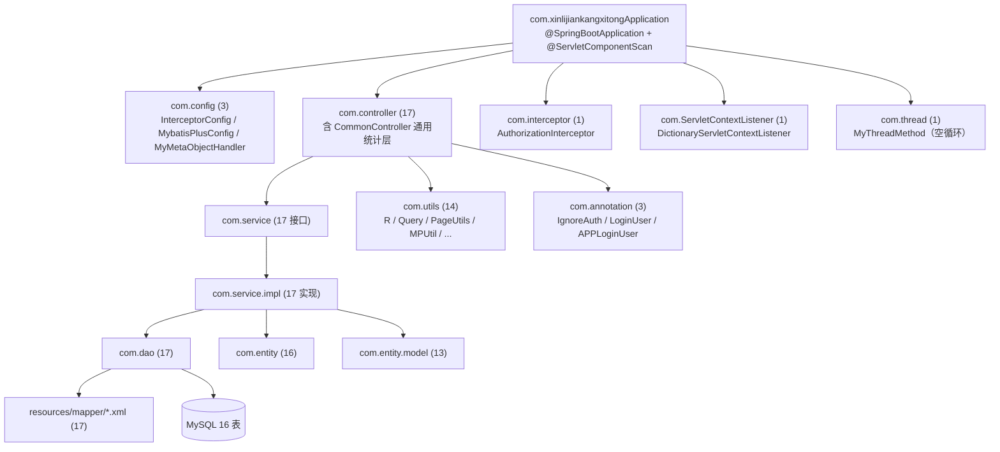
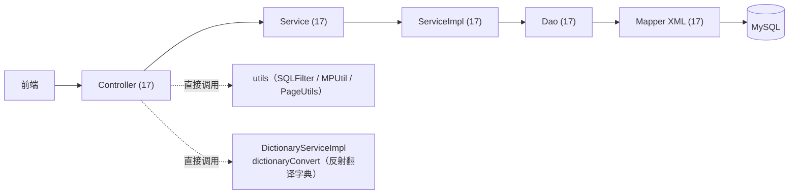
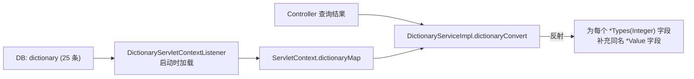
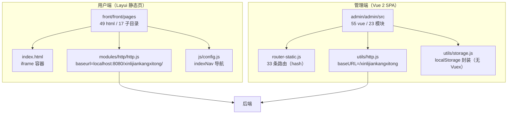
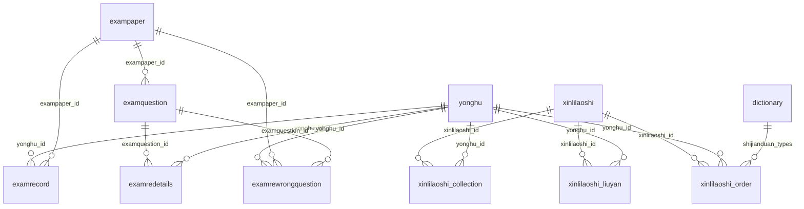
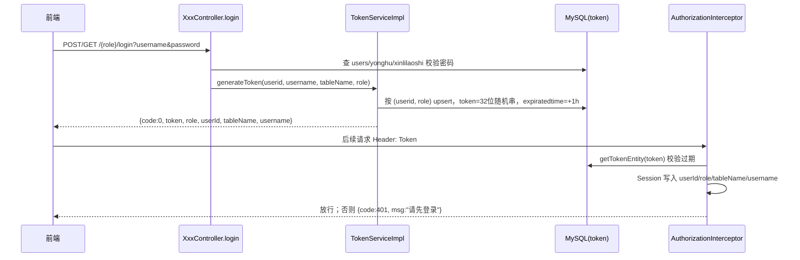
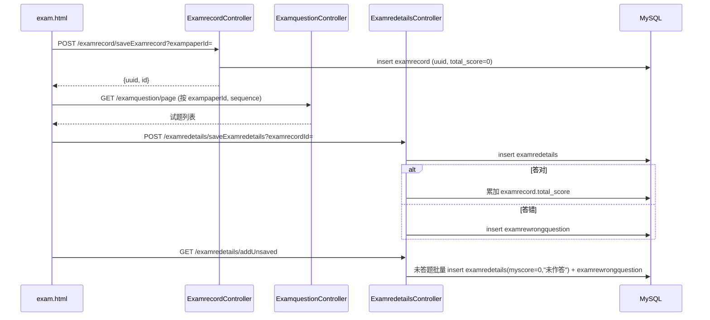
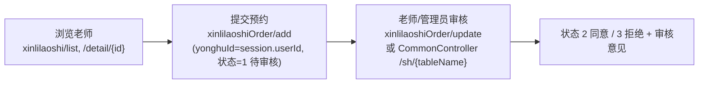
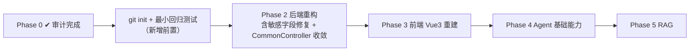

# 旧系统技术审计报告｜project-audit

> **对应 Step**：Phase 0 / Step 0
> **审计对象**：`d:/ai/job project/Mental Health Companion Agent`（原「大学生心理健康管理系统」，`xinlijiankangxitong`）
> **审计日期**：2026-09-22
> **审计方式**：**全程只读**。仅执行读取、检索、构建、启动与接口访问；**未修改任何源码、配置或数据库**。
> **规范依据**：`STEP0-AUDIT-SPEC.md`

---

## 0. 后续变更说明（审计之后发生，非审计当时状态）

> 本报告 §1–§11 记录的是 **2026-09-22 审计当时**的事实。审计完成后发生了以下规范化变更，阅读时请留意：

| 变更项 | 审计当时 | 变更后 |
| --- | --- | --- |
| 数据库名 | `xinlijiankangxitong` | **`mental_health_companion_agent`** |
| 初始化脚本文件名 | `src/main/resources/db.sql` | **`src/main/resources/mental_health_companion_agent.sql`** |
| `application.yml` 的 JDBC URL | `.../xinlijiankangxitong?...` | **`.../mental_health_companion_agent?...`** |
| 脚本字符集 | `utf8` | **`utf8mb4` / `utf8mb4_general_ci`** |
| HTTP 上下文路径 | `/xinlijiankangxitong` | **保持不变**（属 URL 路径，非数据库名） |

> ⚠️ 注意区分：`/xinlijiankangxitong` 作为 **HTTP context-path** 继续存在于前端 `http.js`、图片 URL、`server.servlet.context-path` 中，**本次未改动**。本报告正文中出现的 `/xinlijiankangxitong/...`（URL 形式）均属此类，无需按库名理解。

---

## 审计结论摘要

| 项 | 结论 |
| --- | --- |
| 构建 | ✅ `mvn -B -DskipTests clean package` **BUILD SUCCESS**（18.7s，149 个源文件） |
| 启动 | ✅ 启动成功（6.4s，Tomcat 9.0.29，端口 8080，上下文 `/xinlijiankangxitong`） |
| 数据库 | ✅ `xinlijiankangxitong` 库存在，**16 张表**，字典表 25 条（审计后被更名为 `mental_health_companion_agent`，见 §0 变更说明） |
| 核心链路 | ✅ 登录 / 公开列表 / 鉴权拦截 / 带 Token 分页 全部验证通过 |
| 管理端静态资源 | ✅ `admin/dist/index.html` 返回 HTTP 200 |
| **最高危问题** | 🔴 用户分页接口**明文返回 `password` 与身份证号**；通用动态表名接口 `${}` 拼接且部分免鉴权 |
| 测试基线 | 🔴 无 `src/test/`，零测试 |
| 版本控制 | 🔴 无 `.git`（无法回滚） |

> **Step 0 验收结论：通过。** 旧系统能够在当前环境启动并跑通核心业务流程。

---

## 1. 技术栈

### 1.1 运行环境（本机实测）

| 项 | 实测值 | 来源 |
| --- | --- | --- |
| JDK | **OpenJDK 17.0.0.1**（build 17.0.0.1+2-3），`D:\app\idea\jdk17\jdk-17.0.0.1` | `java -version` |
| Maven | **Apache Maven 3.8.8**，home `D:\app\idea\maven`，平台编码 **GBK** | `mvn -v` |
| MySQL | **Server 8.0.23**（client `C:\Program Files\MySQL\MySQL Server 8.0`），实例端口 **3306**，hostname `sunsut` | `mysql --version` / `select @@port,@@hostname` |
| 操作系统 | Windows 10 amd64 | `mvn -v` |

> ⚠️ **重要偏差**：`pom.xml` 声明 `java.version = 1.8`，但本机**仅有 JDK 17**，无 JDK 8。项目在 JDK 17 上**构建与运行均成功**，但 Spring Boot 2.2.2 官方支持上限为 Java 13，属**非受支持组合**，存在潜在运行期风险（详见 §8）。

### 1.2 应用依赖（`pom.xml`）

| 类别 | 依赖 | 版本 |
| --- | --- | --- |
| 父 POM | `spring-boot-starter-parent` | **2.2.2.RELEASE** |
| Web | `spring-boot-starter-web` | 由父 POM 管理 |
| 模板 | `spring-boot-starter-thymeleaf` | 由父 POM 管理（前后端分离，疑似未使用） |
| JDBC | `spring-boot-starter-jdbc` | 由父 POM 管理 |
| ORM | `mybatis-spring-boot-starter` | 2.1.1 |
| ORM | **`mybatis-plus`** | **2.3** |
| ORM | `mybatisplus-spring-boot-starter` | 1.0.5 |
| 安全 | **`shiro-spring`** | **1.3.2**（引入但无配置类，见 §8） |
| JSON | **`fastjson`** | **1.2.8**（存在已知反序列化漏洞） |
| 第三方 | `com.baidu.aip:java-sdk` | 4.4.1（人脸比对 / 地图） |
| 报表 | `poi` / `poi-ooxml` / `poi-scratchpad` / `poi-examples` / `poi-excelant` | 3.9 |
| 工具 | `hutool-all` | 4.0.12 |
| 工具 | `commons-lang3` | 3.0 |
| 工具 | `commons-io` | 2.5 与 2.2（**重复声明**） |
| 校验 | `javax.validation:validation-api` | 2.0.1.Final |
| 其他 | `protobuf-java` | 3.10.0 |
| 热部署 | `spring-boot-devtools` | 由父 POM 管理 |
| 测试 | `spring-boot-starter-test` | 由父 POM 管理（**实际无任何测试代码**） |
| 数据库驱动 | `mysql-connector-java` | 由父 POM 管理 |
| 构建 | `spring-boot-maven-plugin` | 由父 POM 管理 |

### 1.3 应用配置（`src/main/resources/application.yml`）

```yaml
server:
  port: 8080
  servlet: { context-path: /xinlijiankangxitong }
spring:
  datasource:
    driverClassName: com.mysql.cj.jdbc.Driver
    url: jdbc:mysql://127.0.0.1:3306/mental_health_companion_agent?...serverTimezone=GMT%2B8
    username: root
    password: 123456          # ← 明文硬编码
  servlet.multipart: { max-file-size: 1000MB, max-request-size: 1000MB }
  resources.static-locations: classpath:static/,file:static/
mybatis-plus:
  mapper-locations: classpath*:mapper/*.xml
  typeAliasesPackage: com.entity
  global-config:
    id-type: 1                # 用户输入 ID（MP 2.x 语义）
    field-strategy: 2
    db-column-underline: true
    refresh-mapper: true
    logic-delete-value: -1
    logic-not-delete-value: 0
    sql-injector: com.baomidou.mybatisplus.mapper.LogicSqlInjector   # MP 2.x API
  configuration:
    map-underscore-to-camel-case: true
    cache-enabled: false
    call-setters-on-nulls: true
    jdbc-type-for-null: 'null'
logging.level.com.dao: debug
```

### 1.4 前端依赖

| 端 | 技术栈 |
| --- | --- |
| 管理端 | Vue 2 + Element UI + axios + vue-router（hash 模式）；**无 Vuex**；构建工具 vue-cli（`vue.config.js` / `babel.config.js`） |
| 用户端 | Layui（含 jQuery）+ Vue 2（CDN）+ Element UI（本地）+ Swiper；**无打包构建** |

---

## 2. 后端结构

### 2.1 包结构



### 2.2 分层现状



**现状特征**：

- 分层形式上存在（Controller → Service → Dao），但 **Controller 职责过重**：大量业务逻辑（判分、错题生成、uuid 生成、角色数据过滤）写在 Controller 内（如 `ExamredetailsController` 22KB、`ExamquestionController` 21KB）。
- Service 层**极薄**：17 个 Service 中，15 个仅提供 `queryPage(params)` 一个自定义方法，其余全部依赖 MyBatis-Plus 继承的默认 CRUD。
- 存在 **`CommonController` + `CommonDao` 通用动态表名查询层**（§8 高危项）。

### 2.3 关键类清单

| 类 | 路径 | 职责 |
| --- | --- | --- |
| `AuthorizationInterceptor` | `com/interceptor` | Token 鉴权，写 Session（`userId`/`role`/`tableName`/`username`） |
| `InterceptorConfig` | `com/config` | 注册拦截器（`/**`，放行 `/static/**`）+ 重写静态资源映射（基于 `WebMvcConfigurationSupport`） |
| `MybatisPlusConfig` | `com/config` | 仅注册 `PaginationInterceptor` |
| `MyMetaObjectHandler` | `com/config` | 自定义填充，填充字段名为 `ctime`（**与实体实际字段不符，疑为模板遗留**） |
| `DictionaryServletContextListener` | `com/ServletContextListener` | `@WebListener`，启动时加载 `dictionary` 到 `ServletContext.dictionaryMap`，并启动空线程 |
| `MyThreadMethod` | `com/thread` | `while(!isInterrupted){ sleep(5000) }` 空体线程 |
| `R` | `com/utils` | 统一返回（继承 `HashMap`） |
| `Query` / `PageUtils` / `MPUtil` | `com/utils` | 分页 / 查询 / 条件构造封装 |
| `SQLFilter` | `com/utils` | SQL 注入过滤（仅用于 `sidx`/`order`） |
| `BaiduUtil` / `PoiUtil` / `FileUtil` / `HttpClientUtils` | `com/utils` | 百度 AI / Excel / 文件 / HTTP |
| `CommonServiceImpl` | `com/service/impl` | 通用统计与动态表名操作的 DAO 转发层 |
| `DictionaryServiceImpl.dictionaryConvert` | `com/service/impl` | **反射**把 `*Types` 编码翻译为 `*Value` 名称，依赖 ServletContext 字典 |

### 2.4 统一返回结构（`R.java`）

```json
// 成功
{ "code": 0, "msg": "...", "data": { ... } }
// 失败
{ "code": 500, "msg": "未知异常，请联系管理员" }
// 鉴权失败
{ "code": 401, "msg": "请先登录" }
```

- `R` 继承 `HashMap<String,Object>`，默认 `code=0`
- `ok()` / `ok(msg)` / `ok(map)`；`error()` / `error(msg)` → `code=500`；`error(code,msg)`
- 前端以 `res.code == 0` 判定成功

### 2.5 分页与查询封装

| 工具 | 说明 |
| --- | --- |
| `Query` | 继承 `LinkedHashMap`；分页参数 **`page`（默认 1）/ `limit`（默认 10）**；排序参数 `sidx` / `order`（经 `SQLFilter` 过滤）；写入 `offset`；`getPage()` 返回 MP `Page<T>` |
| `PageUtils` | 返回结构：**`total` / `pageSize` / `totalPage` / `currPage` / `list`** |
| `MPUtil` | MySQL 条件构造：`allEQMap` / `allLike` / `likeOrEq` / `between`（`_start`/`_end` 后缀）/ `sort` / `camelToUnderline` |

### 2.6 字典翻译机制



触发条件：字段名含 `Types` 且类型为 `Integer`；由各 Controller 在查询后**逐条主动调用**（共 50+ 处）。

---

## 3. 前端结构

### 3.1 总体



### 3.2 管理端

| 项 | 值 |
| --- | --- |
| 位置 | `src/main/resources/admin/admin/` |
| 规模 | `views/` 55 个 `.vue`（`modules/` 23 个模块目录）、`components/` 13 个 |
| 路由 | `src/router/router-static.js`，**33 条**（hash 模式，`*` → 404） |
| 请求 | `src/utils/http.js`：`baseURL=/xinlijiankangxitong`，`withCredentials:true`，请求头注入 `Token`，`code===401` 跳登录 |
| 状态管理 | **未使用 Vuex**（`src/store/store.js` 为 **0 字节空文件**），实际用 `src/utils/storage.js`（localStorage 封装，挂到 `Vue.prototype.$storage`） |
| 构建 | `package.json` + `1-install.bat` / `2-run.bat` / `3-build.bat`；已含构建产物 `dist/` |
| 基地址 | `src/utils/base.js`：`url = http://localhost:8080/xinlijiankangxitong/` |

**管理端路由 ↔ 模块映射**：

| 路由 | 组件 | 菜单标题 |
| --- | --- | --- |
| `/index` → `/` | Home | 首页 |
| `/updatePassword` | UpdatePassword | 修改密码 |
| `/pay` | pay | 支付 |
| `/center` | center | 个人信息 |
| `/users` | modules/users/list | 管理信息 |
| `/adminexam` | modules/exampaper/exam | adminexam |
| `/dictionaryExampaper` | modules/dictionaryExampaper/list | 试卷状态 |
| `/dictionaryExamquestion` | modules/dictionaryExamquestion/list | 试题类型 |
| `/dictionaryJiankangzhishi` | modules/dictionaryJiankangzhishi/list | 健康知识类型 |
| `/dictionarySex` | modules/dictionarySex/list | 性别类型 |
| `/dictionaryShijianduan` | modules/dictionaryShijianduan/list | 时间段 |
| `/dictionaryTongzhi` | modules/dictionaryTongzhi/list | 通知类型 |
| `/dictionaryXinlilaoshiCollection` | modules/dictionaryXinlilaoshiCollection/list | 收藏表类型 |
| `/dictionaryXinlilaoshiOrderYesno` | modules/dictionaryXinlilaoshiOrderYesno/list | 预约状态 |
| `/config` | modules/config/list | 轮播图 |
| `/dictionary` | modules/dictionary/list | 字典 |
| `/exampaper` | modules/exampaper/list | 试卷表 |
| `/examquestion` | modules/examquestion/list | 试题表 |
| `/examrecord` | modules/examrecord/list | 考试记录表 |
| `/examredetails` | modules/examredetails/list | 答题详情表 |
| `/examrewrongquestion` | modules/examrewrongquestion/list | 错题表 |
| `/jiankangzhishi` | modules/jiankangzhishi/list | 健康知识 |
| `/tongzhi` | modules/tongzhi/list | 通知 |
| `/xinlilaoshiCollection` | modules/xinlilaoshiCollection/list | 心理老师收藏 |
| `/xinlilaoshiLiuyan` | modules/xinlilaoshiLiuyan/list | 心理老师留言 |
| `/xinlilaoshiOrder` | modules/xinlilaoshiOrder/list | 心理咨询预约申请 |
| `/yonghu` | modules/yonghu/list | 学生 |
| `/xinlilaoshi` | modules/xinlilaoshi/list | 心理老师 |
| `/login` / `/register` | Login / register | 登录 / 注册 |
| `/` | redirect → `/index` | — |
| `*` | NotFound | 404 |

> **审核逻辑唯一所在**：`modules/xinlilaoshiOrder/list.vue` L910-913 调用 `xinlilaoshiOrder/update`（携带 `xinlilaoshiOrderYesnoTypes` / `xinlilaoshiOrderYesnoText`）完成「同意/拒绝」。

### 3.3 用户端

| 项 | 值 |
| --- | --- |
| 位置 | `src/main/resources/front/front/` |
| 规模 | `pages/` **49 个 `.html`**，17 个子目录；无打包构建 |
| 入口 | `index.html`（iframe 加载 `pages/home/home.html`；顶部导航来自 `js/config.js:indexNav`） |
| 请求 | `modules/http/http.js`：`baseurl = http://localhost:8080/xinlijiankangxitong/`，`beforeSend` 注入 `Token`，401 跳登录；另有未使用的 `domain = http://8.129.11.174:8080/...` |
| 登录态 | `localStorage`：`Token` / `role` / `userTable` / `sessionTable` / `adminName` / `userid` |
| **登录限制** | `pages/login/login.html` **硬编码 `role='yonghu'`**，前端**仅支持学生登录** |

### 3.4 用户端页面地图（49 个 HTML → 接口）

> `{table}` 取 `localStorage.userTable`（`yonghu` 或 `xinlilaoshi`）。所有 `list.html` 均先调 `config/list` 取页面配置。

| 子目录 | 页面 | 主要接口 | 用途 |
| --- | --- | --- | --- |
| `chat/` | chat.html | `chat/list`(GET)、`chat/add`(POST) ← **后端不存在** | 聊天（僵尸功能） |
| `dictionary/` | list/add/detail.html | `dictionary/list`、`dictionary/add`、`dictionary/page` | 字典 |
| `exampaper/` | list/exam/add/detail.html | `exampaper/page`、`examrecord/saveExamrecord`、`examquestion/page`、`examredetails/saveExamredetails`、`examredetails/addUnsaved`、`exampaper/info/{id}` | 试卷 + **在线答题** |
| `examquestion/` | list/add/detail.html | `examquestion/list`、`examquestion/add` | 试题 |
| `examrecord/` | list/add/detail.html | `examrecord/page`、`examrecord/add`、`examrecord/info/{id}`、`examredetails/page` | 考试记录 |
| `examredetails/` | list/add/detail.html | `examredetails/list`、`examredetails/add` | 答题详情 |
| `examrewrongquestion/` | list/add/detail.html | `examrewrongquestion/page`、`examrewrongquestion/add` | 错题本 |
| `home/` | home.html | `config/list`、`jiankangzhishi/list`、`xinlilaoshi/list`、`tongzhi/list` | 首页 |
| `jiankangzhishi/` | list/add/detail.html | `jiankangzhishi/list`、`jiankangzhishi/add`、`jiankangzhishi/detail/{id}` | 健康知识 |
| `login/` | login.html | `yonghu/login`、`yonghu/session` | 登录（仅学生） |
| `recharge/` | recharge.html | `{table}/session`、`{table}/update`（充值＝改余额） | 充值 |
| `tongzhi/` | list/add/detail.html | `tongzhi/list`、`tongzhi/add`、`tongzhi/detail/{id}` | 通知 |
| `xinlilaoshi/` | list/add/register/center/detail.html | `xinlilaoshi/list`、`xinlilaoshi/register`、`xinlilaoshi/session`、`xinlilaoshi/detail/{id}`、`xinlilaoshiCollection/*`、`xinlilaoshiLiuyan/*` | 心理老师 |
| `xinlilaoshiCollection/` | list/add/detail.html | `xinlilaoshiCollection/page`、`/add`、`/delete` | 收藏 |
| `xinlilaoshiLiuyan/` | list/add/detail.html | `xinlilaoshiLiuyan/list`、`/add` | 留言 |
| `xinlilaoshiOrder/` | list/add/confirm/detail.html | `xinlilaoshiOrder/page`、`/add`、`/pay`、`/refund`、`/receiving`、`/commentback`、`/order` | 预约（含支付/退款） |
| `yonghu/` | list/add/register/center/detail.html | `yonghu/list`、`yonghu/register`、`yonghu/session`、`{table}/update` | 学生 |

**前端遗留脏数据（模板残留，指向不存在的接口）**：

| 文件 | 调用 | 问题 |
| --- | --- | --- |
| `pages/dictionary/detail.html:83` | `dictionaryOrder/add` | 接口不存在 |
| `pages/exampaper/detail.html:212` | `exampaperOrder/add` | 接口不存在 |
| `pages/examquestion/detail.html:83` | `examquestionOrder/add` | 接口不存在 |
| `pages/examredetails/detail.html:83` | `examredetailsOrder/add` | 接口不存在 |
| `pages/examrewrongquestion/detail.html:83` | `examrewrongquestionOrder/add` | 接口不存在 |
| `pages/exampaper/list.html:234` | `news/list` | 接口不存在 |
| `pages/xinlilaoshiCollection/detail.html:196` | `xinlilaoshiCollectionOrder/add` | 接口不存在 |
| `pages/xinlilaoshiLiuyan/detail.html:83` | `xinlilaoshiLiuyanOrder/add` | 接口不存在 |
| `pages/xinlilaoshiOrder/detail.html:83` | `xinlilaoshiOrderOrder/add` | 接口不存在 |
| `pages/yonghu/detail.html:83` | `yonghuOrder/add` | 接口不存在 |
| `index.html:100-112` | `pages/chat/list.html` | 文件不存在（实际为 `chat.html`） |
| `pages/xinlilaoshiOrder/list.html` | `xinlilaoshiOrder/pay\|refund\|receiving\|commentback` | **接口不存在** |

---

## 4. 数据库结构

### 4.1 实例信息（实测）

| 项 | 值 |
| --- | --- |
| 版本 | MySQL **8.0.23** |
| 端口 / host | 3306 / `sunsut` |
| 目标库 | 审计时 **`xinlijiankangxitong`**（存在）；已于 2026-09-22 更名为 **`mental_health_companion_agent`** |
| 该实例其他库 | `dkscaffolding`、`information_schema`、`mental_health_system`、`mysql`、`performance_schema`、`productivity_agent`、`smbms` |

> ⚠️ **需用户澄清的观察**：本机存在另一个库 **`mental_health_system`**，其表结构为 `sys_user` / `knowledge_article` / `eval_category` / `eval_question` / `eval_report` / `counsel_appointment` / `counselor_available_time` / `banner` / `article_view_history` / `user_favorite` / `department` / `operation_log` / `sys_notification` + 2 个视图（`v_appointment_detail` / `v_article_detail`），**与本项目 16 张表完全不同**，命名更规范、含视图与审计表。**其用途与归属未能确认**，需用户说明是否与 Project 2 有关（若它是重设计后的目标 schema，将显著影响 Phase 2/5 的迁移策略）。

### 4.2 表清单与数据量（实测 16 张）

| # | 表名 | 中文注释 | 记录数 | 说明 |
| --- | --- | --- | ---: | --- |
| 1 | `config` | 配置文件 | 3 | 轮播图 1/2/3 |
| 2 | `dictionary` | 字典 | 25 | 8 类字典项 |
| 3 | `exampaper` | 试卷表 | 2 | 含 `exampaper_delete` 逻辑删 |
| 4 | `examquestion` | 试题表 | 6 | 选项为 JSON 字符串 |
| 5 | `examrecord` | 考试记录表 | 1 | |
| 6 | `examredetails` | 答题详情表 | 5 | |
| 7 | `examrewrongquestion` | 错题表 | 3 | |
| 8 | `jiankangzhishi` | 健康知识 | 5 | **RAG 知识源** |
| 9 | `token` | token 表 | 3 | 多角色登录凭据 |
| 10 | `tongzhi` | 通知 | 5 | |
| 11 | `users` | 管理员 | 1 | `admin` |
| 12 | `xinlilaoshi` | 心理老师 | 3 | |
| 13 | `xinlilaoshi_collection` | 心理老师收藏 | 6 | |
| 14 | `xinlilaoshi_liuyan` | 心理老师留言 | 6 | 含 `reply_text` |
| 15 | `xinlilaoshi_order` | 预约订单 | 3 | |
| 16 | `yonghu` | 学生 | 3 | |

> 合计 16 张表，与 `mental_health_companion_agent.sql` 一致（**纠正了早期「17 张表」的表述**）。

### 4.3 字段级说明

#### `config`（配置文件）

| 字段 | 类型 | 说明 |
| --- | --- | --- |
| `id` | bigint PK AI | 主键 |
| `name` | varchar(100) NOT NULL | 配置参数名称 |
| `value` | varchar(100) | 配置参数值 |

#### `dictionary`（字典）

| 字段 | 类型 | 说明 |
| --- | --- | --- |
| `id` | bigint PK AI | 主键 |
| `dic_code` | varchar(200) | 字段编码（如 `sex_types`） |
| `dic_name` | varchar(200) | 字段名（如「性别类型」） |
| `code_index` | int | 编码值 |
| `index_name` | varchar(200) | 编码对应名称 |
| `super_id` | int | 父字段 id |
| `beizhu` | varchar(200) | 备注 |
| `create_time` | timestamp | 创建时间 |

#### `exampaper`（试卷表）

| 字段 | 类型 | 说明 |
| --- | --- | --- |
| `id` | int PK AI | 主键 |
| `exampaper_name` | varchar(200) NOT NULL | 试卷名称 |
| `exampaper_date` | int NOT NULL | 考试时长（分钟） |
| `exampaper_myscore` | int NOT NULL DEFAULT 0 | 试卷总分数 |
| `exampaper_types` | int NOT NULL DEFAULT 0 | 试卷状态（字典 `exampaper_types`） |
| `exampaper_delete` | int DEFAULT 0 | 逻辑删除（0 未删 / 1、2 已删） |
| `create_time` | timestamp NOT NULL | 创建时间 |

#### `examquestion`（试题表）

| 字段 | 类型 | 说明 |
| --- | --- | --- |
| `id` | int PK AI | 主键 |
| `exampaper_id` | int NOT NULL | 所属试卷（逻辑外键 → `exampaper.id`） |
| `examquestion_name` | varchar(200) NOT NULL | 试题名称 |
| `examquestion_options` | longtext | 选项（JSON 字符串） |
| `examquestion_score` | int DEFAULT 0 | 分值 |
| `examquestion_answer` | varchar(200) | 正确答案 |
| `examquestion_analysis` | longtext | 答案解析 |
| `examquestion_types` | int DEFAULT 0 | 试题类型（1 单选/2 多选/3 判断/4 填空） |
| `examquestion_sequence` | int DEFAULT 100 | 排序（值越大越前） |
| `create_time` | timestamp NOT NULL | 创建时间 |

#### `examrecord`（考试记录表）

| 字段 | 类型 | 说明 |
| --- | --- | --- |
| `id` | int PK AI | 主键 |
| `examrecord_uuid_number` | varchar(200) | 考试编号 |
| `yonghu_id` | int NOT NULL | 考试用户 → `yonghu.id` |
| `exampaper_id` | int NOT NULL | 所属试卷 → `exampaper.id` |
| `total_score` | int | 所得总分 |
| `insert_time` | timestamp NOT NULL | 考试时间（ON UPDATE） |
| `create_time` | timestamp NOT NULL | 创建时间 |

#### `examredetails`（答题详情表）

| 字段 | 类型 | 说明 |
| --- | --- | --- |
| `id` | int PK AI | 主键 |
| `examredetails_uuid_number` | varchar(200) | 试卷编号（与 `examrecord.examrecord_uuid_number` 逻辑关联） |
| `yonghu_id` | int NOT NULL | 用户 → `yonghu.id` |
| `examquestion_id` | int NOT NULL | 试题 → `examquestion.id` |
| `examredetails_myanswer` | varchar(200) | 考生答案 |
| `examredetails_myscore` | int NOT NULL DEFAULT 0 | 该题得分 |
| `create_time` | timestamp NOT NULL | 创建时间 |

#### `examrewrongquestion`（错题表）

| 字段 | 类型 | 说明 |
| --- | --- | --- |
| `id` | int PK AI | 主键 |
| `yonghu_id` | int NOT NULL | 用户 → `yonghu.id` |
| `exampaper_id` | int NOT NULL | 试卷 → `exampaper.id` |
| `examquestion_id` | int NOT NULL | 试题 → `examquestion.id` |
| `examredetails_myanswer` | varchar(200) | 考生作答 |
| `insert_time` | timestamp NOT NULL | 记录时间 |
| `create_time` | timestamp NOT NULL | 创建时间 |

#### `jiankangzhishi`（健康知识）

| 字段 | 类型 | 说明 |
| --- | --- | --- |
| `id` | int PK AI | 主键 |
| `jiankangzhishi_name` | varchar(200) | 知识名称 |
| `jiankangzhishi_photo` | varchar(200) | 图片 URL |
| `jiankangzhishi_types` | int NOT NULL | 类型（字典 `jiankangzhishi_types`） |
| `insert_time` | timestamp | 发布时间 |
| **`jiankangzhishi_content`** | **text** | **知识详情 ← RAG 切分来源** |
| `create_time` | timestamp | 创建时间 |

#### `token`（token 表）

| 字段 | 类型 | 说明 |
| --- | --- | --- |
| `id` | bigint PK AI | 主键 |
| `userid` | bigint NOT NULL | 用户 id（多态，取决于 `tablename`） |
| `username` | varchar(100) NOT NULL | 用户名 |
| `tablename` | varchar(100) | 表名（`users`/`yonghu`/`xinlilaoshi`） |
| `role` | varchar(100) | 角色 |
| `token` | varchar(200) NOT NULL | 令牌（32 位随机串） |
| `addtime` | timestamp NOT NULL | 新增时间 |
| `expiratedtime` | timestamp NOT NULL | 过期时间（+1 小时） |

#### `tongzhi`（通知）

| 字段 | 类型 | 说明 |
| --- | --- | --- |
| `id` | int PK AI | 主键 |
| `tongzhi_name` | varchar(200) | 通知名称 |
| `tongzhi_photo` | varchar(200) | 图片 |
| `tongzhi_types` | int NOT NULL | 类型 |
| `insert_time` | timestamp | 发布时间 |
| `tongzhi_content` | text | 通知详情 |
| `create_time` | timestamp | 创建时间 |

#### `users`（管理员）

| 字段 | 类型 | 说明 |
| --- | --- | --- |
| `id` | bigint PK AI | 主键 |
| `username` | varchar(100) NOT NULL | 用户名 |
| `password` | varchar(100) NOT NULL | 密码（**明文**） |
| `role` | varchar(100) DEFAULT '管理员' | 角色 |
| `addtime` | timestamp NOT NULL | 新增时间 |

#### `xinlilaoshi`（心理老师）

| 字段 | 类型 | 说明 |
| --- | --- | --- |
| `id` | int PK AI | 主键 |
| `username` / `password` | varchar(200) | 账户 / 密码（**明文**） |
| `xinlilaoshi_name` | varchar(200) | 姓名 |
| `xinlilaoshi_phone` | varchar(200) | 手机号 |
| `xinlilaoshi_photo` | varchar(200) | 头像 |
| `sex_types` | int | 性别（字典） |
| `xinlilaoshi_email` | varchar(200) | 邮箱 |
| `xinlilaoshi_shanchang` | varchar(200) | 擅长 |
| `xinlilaoshi_lvli` | varchar(200) | 履历 |
| `xinlilaoshi_content` | text | 详细介绍 |
| `create_time` | timestamp | 创建时间 |

#### `xinlilaoshi_collection`（收藏）

| 字段 | 类型 | 说明 |
| --- | --- | --- |
| `id` | int PK AI | 主键 |
| `xinlilaoshi_id` | int | → `xinlilaoshi.id` |
| `yonghu_id` | int | → `yonghu.id` |
| `xinlilaoshi_collection_types` | int | 类型（字典） |
| `insert_time` / `create_time` | timestamp | 时间 |

#### `xinlilaoshi_liuyan`（留言）

| 字段 | 类型 | 说明 |
| --- | --- | --- |
| `id` | int PK AI | 主键 |
| `xinlilaoshi_id` | int | → `xinlilaoshi.id` |
| `yonghu_id` | int | → `yonghu.id` |
| `xinlilaoshi_liuyan_text` | text | 留言内容 |
| `insert_time` | timestamp | 留言时间 |
| `reply_text` | text | 回复内容 |
| `update_time` | timestamp | 回复时间 |
| `create_time` | timestamp | 创建时间 |

#### `xinlilaoshi_order`（预约订单）

| 字段 | 类型 | 说明 |
| --- | --- | --- |
| `id` | int PK AI | 主键 |
| `xinlilaoshi_order_uuid_number` | varchar(200) | 预约流水号 |
| `xinlilaoshi_id` | int | → `xinlilaoshi.id` |
| `yonghu_id` | int | → `yonghu.id` |
| `yuyue_time` | date | 预约日期 |
| `shijianduan_types` | int | 时间段（字典 1–8） |
| `xinlilaoshi_order_yesno_types` | int | 状态（1 待审核 / 2 同意 / 3 拒绝） |
| `xinlilaoshi_order_yesno_text` | text | 审核意见 |
| `insert_time` / `create_time` | timestamp | 时间 |

#### `yonghu`（学生）

| 字段 | 类型 | 说明 |
| --- | --- | --- |
| `id` | int PK AI | 主键 |
| `username` / `password` | varchar(200) | 账户 / 密码（**明文**） |
| `yonghu_name` | varchar(200) | 姓名 |
| `yonghu_phone` | varchar(200) | 手机号 |
| **`yonghu_id_number`** | varchar(200) | **身份证号（敏感）** |
| `yonghu_photo` | varchar(200) | 头像 |
| `sex_types` | int | 性别（字典） |
| `yonghu_email` | varchar(200) | 邮箱 |
| `create_time` | timestamp | 创建时间 |

### 4.4 逻辑关系图



**说明**：

- **无物理外键**：`mental_health_companion_agent.sql` 仅有 `PRIMARY KEY`，脚本头 `FOREIGN_KEY_CHECKS=0`（`mental_health_companion_agent.sql:13`）
- `examrecord.examrecord_uuid_number` ↔ `examredetails.examredetails_uuid_number` 为**业务关联**（删除时按 uuid 级联，`ExamrecordController.java:392-395`）
- `token.userid` 为**多态引用**，指向 `users.id` / `yonghu.id` / `xinlilaoshi.id`，由 `tablename` 决定

### 4.5 字典项映射（`dictionary.dic_code`）

| dic_code | 业务含义 | code_index → index_name | 业务表字段 |
| --- | --- | --- | --- |
| `sex_types` | 性别 | 1 男 / 2 女 | `yonghu.sex_types`、`xinlilaoshi.sex_types` |
| `xinlilaoshi_collection_types` | 收藏类型 | 1 收藏 | `xinlilaoshi_collection.*_types` |
| `xinlilaoshi_order_yesno_types` | 预约状态 | 1 待审核 / 2 同意 / 3 拒绝 | `xinlilaoshi_order.*_types` |
| `shijianduan_types` | 时间段 | 1→08:00-09:00 … 8→17:00-18:00 | `xinlilaoshi_order.shijianduan_types` |
| `tongzhi_types` | 通知类型 | 1/2/3 | `tongzhi.tongzhi_types` |
| `jiankangzhishi_types` | 健康知识类型 | 1/2 | `jiankangzhishi.*_types` |
| `examquestion_types` | 试题类型 | 1 单选 / 2 多选 / 3 判断 / 4 填空 | `examquestion.*_types` |
| `exampaper_types` | 试卷状态 | 1 启用 / 2 禁用 | `exampaper.exampaper_types` |

### 4.6 索引与敏感字段

| 项 | 现状 |
| --- | --- |
| 索引 | **仅主键**，无任何二级索引、无唯一约束（`username` 未加唯一索引） |
| 敏感字段 | `users.password`、`yonghu.password`、`xinlilaoshi.password`（**全部明文**）；`yonghu.yonghu_id_number`（身份证）、`yonghu_phone`、`yonghu_email`、`xinlilaoshi_phone`、`xinlilaoshi_email` |
| 字符集 | `utf8`（非 `utf8mb4`） |

---

## 5. 用户角色

### 5.1 三角色

| 角色 | 存储表 | 登录接口 | 初始化账号 | 前端入口 |
| --- | --- | --- | --- | --- |
| 管理员 | `users` | `users/login` | `admin` / `admin` | 管理端 `admin/dist/index.html` |
| 学生 | `yonghu` | `yonghu/login` | `a1`–`a3` / `123456` | 用户端 `front/index.html`（**唯一可登录角色**） |
| 心理老师 | `xinlilaoshi` | `xinlilaoshi/login` | `a1`–`a3` / `123456` | 用户端注册入口，登录入口未暴露 |

### 5.2 认证链路（实测）



### 5.3 权限现状

| 项 | 现状 |
| --- | --- |
| 鉴权粒度 | **仅校验「是否登录」**，不校验「能否访问该资源」 |
| 数据隔离 | 由 Controller 手工按 Session 的 `role`/`userId` 过滤（如 `YonghuController.java:68-74`），**非统一机制** |
| 白名单 | 硬编码 3 条：`/dictionary/page`、`/file/upload`、`/yonghu/register` + `@IgnoreAuth` 标注的方法 |
| 角色校验 | 部分管理类 CRUD 存在恒为 `false` 的角色判断（`DictionaryController.java:112-113`、`YonghuController.java:118-119`），**实际不校验角色** |
| 无抽象 | **无 `CurrentUserProvider`**，身份从 Session 手工取 |

### 5.4 实测登录响应

```json
// GET /yonghu/login?username=a1&password=123456
{ "code": 0, "role": "学生", "userId": 1, "token": "mishdrmyqoevi584e7xlm9xv5nuz42f7",
  "username": "学生姓名1", "tableName": "yonghu" }
```

> 注意：返回的 `username` 实为**姓名**（`yonghu_name`），非账号。

---

## 6. 核心业务流程

### 6.1 登录流程

`XxxController.login` → Service 查表校验 → `TokenServiceImpl.generateToken`（`impl/TokenServiceImpl.java:56-70`，按 `(userid, role)` upsert，过期时间 +1h）→ 写 `token` 表 → 返回 token。校验由 `AuthorizationInterceptor.preHandle`（`:34-93`）完成。

### 6.2 心理测评流程（完整）



关键文件行号：`ExamrecordController.java:364-382`、`:387-404`；`ExamredetailsController.java:368-402`、`:407-486`；`ExamquestionController.java:69-91`、`:341-472`（题目增删改同步维护 `exampaper.exampaper_myscore`）。

### 6.3 健康知识流程

列表 `GET /jiankangzhishi/list`（`@IgnoreAuth`，`JiankangzhishiController.java:243-259`）→ 详情 `GET /jiankangzhishi/detail/{id}`（`:264-281`）→ 后台 `/page`、`/save`、`/update`、`/delete`。

### 6.4 预约流程



关键：`XinlilaoshiOrderController.java:323-344`（下单）、`:148-172`（审核）。**无独立审核接口**，复用通用 `update`。

### 6.5 留言流程

`xinlilaoshiLiuyan/add`（`:304-311`）→ `xinlilaoshiLiuyan/update`（`:148-173`）写入 `reply_text` + `update_time`（`:166`）。按角色注入 `xinlilaoshiId` / `yonghuId`（`:131-137`）。

### 6.6 收藏流程

`xinlilaoshiCollection/add`（`:317-335`）→ 查重（重复返回「您已经收藏过了」）→ insert；`/list`（`@IgnoreAuth`）；`/delete`。

### 6.7 通知流程

`tongzhi/list`（`@IgnoreAuth`，`TongzhiController.java:243-259`）→ `tongzhi/detail/{id}`。

---

## 7. API 列表

> 所有接口返回 `com.utils.R`。`@RequestMapping` 未限定 method 时**接受任意 HTTP 方法**。`✅免鉴权` = `@IgnoreAuth`。

### 7.1 通用 CRUD 模板（15 个业务 Controller 共有）

| 路径 | 说明 | 鉴权 |
| --- | --- | --- |
| `/{entity}/page` | 分页列表（`page`/`limit`/`sidx`/`order`） | 需登录 |
| `/{entity}/list` | 全量/条件列表 | **✅免鉴权** |
| `/{entity}/info/{id}` | 按 id 详情 | 需登录 |
| `/{entity}/detail/{id}` | 详情（含字典翻译） | 需登录（内容类） |
| `/{entity}/save` | 新增（管理端） | 需登录 |
| `/{entity}/add` | 新增（前端） | 需登录 |
| `/{entity}/update` | 更新 | 需登录 |
| `/{entity}/delete` | 删除 | 需登录 |
| `/{entity}/batchInsert` | 批量导入 | 需登录 |

适用 entity：`config`、`dictionary`、`exampaper`、`examquestion`、`examrecord`、`examredetails`、`examrewrongquestion`、`jiankangzhishi`、`tongzhi`、`xinlilaoshi`、`xinlilaoshiCollection`、`xinlilaoshiLiuyan`、`xinlilaoshiOrder`、`yonghu`、`users`。

### 7.2 认证类接口

| 路径 | 方式 | 说明 | 鉴权 |
| --- | --- | --- | --- |
| `users/login` | POST | 管理员登录 | ✅免鉴权 |
| `users/register` | POST | 管理员注册 | ✅免鉴权 |
| `users/logout` | GET | 登出 | ⚠️ 需登录 |
| `users/resetPass` | ANY | 重置密码 | ✅免鉴权 |
| `users/session` | ANY | 当前用户 | 需登录 |
| `yonghu/login` | ANY | 学生登录 | ✅免鉴权 |
| `yonghu/register` | POST | 学生注册 | ✅免鉴权（拦截器亦放行） |
| `yonghu/logout` | GET | 登出 | ⚠️ 需登录 |
| `yonghu/resetPass` | ANY | 重置密码 | ✅免鉴权 |
| `yonghu/session` | ANY | 当前学生 | 需登录 |
| `yonghu/resetPassword` | GET | 管理员重置（按 id） | 需登录 |
| `xinlilaoshi/login` | ANY | 老师登录 | ✅免鉴权 |
| `xinlilaoshi/register` | POST | 老师注册 | ✅免鉴权 |
| `xinlilaoshi/logout` | GET | 登出 | ⚠️ 需登录 |
| `xinlilaoshi/resetPass` | ANY | 重置密码 | ✅免鉴权 |
| `xinlilaoshi/resetPassword` | GET | 管理员重置（按 id） | 需登录 |
| `xinlilaoshi/session` | ANY | 当前老师 | 需登录 |

### 7.3 测评专用接口

| 路径 | 方式 | 说明 | 鉴权 |
| --- | --- | --- | --- |
| `examrecord/saveExamrecord` | ANY | 开始考试（生成 uuid + 记录） | 需登录 |
| `examrecord/deleteExamrecord` | ANY | 删除记录（按 uuid 级联删详情） | 需登录 |
| `examredetails/saveExamredetails` | ANY | 单题判分 + 错题落库 | 需登录 |
| `examredetails/addUnsaved` | ANY | 补全未答题 | 需登录 |
| `examquestion/saveExamquestion` | ANY | 新增题目并累加试卷总分 | 需登录 |
| `examquestion/updateExamquestion` | ANY | 改分值同步总分 | 需登录 |
| `examquestion/deleteExamquestion` | ANY | 删题并回减总分 | 需登录 |

### 7.4 文件接口（`FileController`）

| 路径 | 说明 | 鉴权 |
| --- | --- | --- |
| `file/upload` | 上传（落盘 `classpath:static/upload`） | ✅免鉴权（拦截器硬编码放行） |
| `file/download` | 下载 | 需登录 |

### 7.5 通用统计/动态接口（`CommonController`）—— 🔴 高危 → ✅ **已于 SH-A 全部下线**

> **⚠️ 状态更新（2026-10-05）**：本节所列 **15 个端点已于 `Security Hotfix A` 中全部删除**（`CommonController` / `CommonService` / `CommonServiceImpl` / `CommonDao` / `CommonDao.xml`，共 5 文件 / **−1585 行**）。
> 取证结论：14 个端点真实调用方为 0；唯一有调用点的 `/barSum` 其参数引用**从不存在的列** ⇒ **合法调用方为 0**，故选择「整体移除」而非「白名单」。
> 管理端图表能力将在 **Phase 3 / Step 10（管理端 Dashboard）** 以显式统计 API 重建。详见 [`PHASE2-SHA-REPORT.md`](./PHASE2-SHA-REPORT.md)。
> **下表为审计当时的历史记录**（端点已不存在）。

| 路径 | 方式 | 说明 | 鉴权 |
| --- | --- | --- | --- |
| `/option/{tableName}/{columnName}` | ANY | `SELECT distinct ${column} FROM ${table}` | **✅免鉴权** |
| `/follow/{tableName}/{columnName}` | ANY | `SELECT * FROM ${table} WHERE ${column}=?` | **✅免鉴权** |
| `/remind/{tableName}/{columnName}/{type}` | ANY | 提醒统计 | **✅免鉴权** |
| `/group/{tableName}` | ANY | 分组统计 | **✅免鉴权** |
| `/group/{tableName}/{columnName}` | ANY | 分组统计 | **✅免鉴权** |
| `/cal/{tableName}/{columnName}` | ANY | sum/max/min/avg | **✅免鉴权** |
| `/value/{tableName}/{xColumnName}/{yColumnName}` | ANY | 按值统计 | **✅免鉴权** |
| `/queryScore` | ANY | 平均评分 | **✅免鉴权** |
| `/sh/{tableName}` | ANY | ⚠️ **审核状态 UPDATE 任意表** | 需登录 |
| `/newSelectGroupSum` / `/newSelectGroupCount` | ANY | 级联分组求和/计数 | 需登录 |
| `/newSelectDateGroupSum` / `/newSelectDateGroupCount` | ANY | 按日期分组 | 需登录 |
| `/barSum` / `/barCount` | ANY | 柱状图统计（动态拼 SQL） | 需登录 |
| `/location` | ANY | 百度地图逆地理 | 需登录 |
| `/matchFace` | ANY | 百度人脸比对 | 需登录 |

---

## 8. 当前已知问题

### 8.1 高危（安全 / 数据）

| # | 问题 | 证据 | 影响 |
| --- | --- | --- | --- |
| S1 | 🔴 **用户分页接口明文返回密码与身份证号** | 实测 `GET /yonghu/page?page=1&limit=2` 返回 `"password":"123456","yonghuIdNumber":"410224199610232003"` | 严重隐私泄露；Entity 直出 API |
| S2 | 🔴 **密码明文存储** | `mental_health_companion_agent.sql` 中 `users/yonghu/xinlilaoshi.password` 均为明文；登录用明文比对 | 撞库即全量泄露 |
| S3 | ~~🔴 **通用动态表名/列名 SQL 注入面**~~ ✅ **已修复（SH-A，2026-10-05）** | `CommonDao.xml` 中 `${table}`、`${column}`、`${orderBy}` 直接拼接；`CommonController` 表名列名来自请求 | 已随 `CommonController` + `CommonDao` 整体删除（−1585 行）；见 [`PHASE2-SHA-REPORT.md`](./PHASE2-SHA-REPORT.md) |
| S4 | ~~🔴 **多接口免鉴权 + 动态表名**~~ ✅ **已修复（SH-A，2026-10-05）** | 原 `/option`、`/follow`、`/remind`、`/group`、`/cal`、`/value`、`/queryScore` 均 `@IgnoreAuth` | 上述端点已全部删除，实测 15/15 返回 404 |
| S5 | 🟠 **鉴权仅到「是否登录」** | 无角色校验；部分 CRUD 角色判断恒 `false`（`DictionaryController.java:112-113`、`YonghuController.java:118-119`） | 学生可调管理端接口 |
| S6 | 🟠 **`resetPass` 系列免鉴权** | `users/resetPass`、`yonghu/resetPass`、`xinlilaoshi/resetPass` 均 `@IgnoreAuth` | 可能被用于任意重置密码（需进一步验证逻辑） |
| S7 | 🟠 **配置明文凭据** | `application.yml` 中 `password: 123456`；`token` 过期 1 小时且无刷新机制 | 凭据泄露风险 |
| S8 | 🟠 **FastJSON 1.2.8** | `pom.xml` | 已知反序列化漏洞（CVE 系列） |

### 8.2 架构 / 代码质量

| # | 问题 | 证据 | 归属 Phase |
| --- | --- | --- | --- |
| A1 | Controller 过重（业务逻辑写入 Controller） | `ExamredetailsController`（22KB）、`ExamquestionController`（21KB）、`YonghuController`（19.8KB） | Phase 2 Step 2 |
| A2 | Service 层极薄（15/17 仅 `queryPage`） | `com/service/impl` | Phase 2 Step 2 |
| A3 | Entity 直出 API | 所有 Controller 直接返回 Entity；无 DTO/VO | Phase 2 Step 3 |
| A4 | 无统一异常处理 | 全仓无 `@ControllerAdvice` | Phase 2 Step 4 |
| A5 | 无 `CurrentUserProvider` | 身份从 Session 手工取（50+ 处） | Phase 2 Step 5 |
| A6 | 字典翻译靠反射 + ServletContext | `DictionaryServiceImpl.dictionaryConvert`，Controller 逐条调用（50+ 处） | Phase 2 |
| A7 | `MyMetaObjectHandler` 字段名不匹配 | 填充 `ctime`，实体实际为 `insert_time`/`create_time` | Phase 2 |
| A8 | 拦截器白名单硬编码 | `AuthorizationInterceptor.java:40` | Phase 2 |
| A9 | `logout` 无 `@IgnoreAuth` 且为 GET | Token 过期时登出返回 401 | Phase 2 |
| A10 | 空循环线程 | `MyThreadMethod` | Phase 2 |
| A11 | 重写静态资源映射基于 `WebMvcConfigurationSupport` | `InterceptorConfig.java:28-38` | Phase 2 |
| A12 | `Shiro 1.3.2` 引入但无配置类 | 全仓无 Shiro 配置 | Phase 2（可直接移除） |
| A13 | `commons-io` 重复声明（2.5 与 2.2） | `pom.xml` | Phase 2 |
| A14 | `thymeleaf` 引入但前后端分离 | `pom.xml` | Phase 2（评估移除） |
| A15 | 中文注释/日志在 GBK 平台下乱码 | 构建输出乱码 | Phase 2 |
| A16 | 无二级索引、无唯一约束 | `mental_health_companion_agent.sql` 仅主键 | Phase 5（建向量表时一并评估） |

### 8.3 功能 / 数据

| # | 问题 | 证据 |
| --- | --- | --- |
| F1 | **后端无任何 chat 接口**，前端 `pages/chat/chat.html` 调用 `chat/list`、`chat/add` | Java 全仓 `chat` 零匹配；实测前端调用会失败 |
| F2 | `index.html` 的 `chatTap()` 指向不存在的 `pages/chat/list.html` | `index.html:100-112` |
| F3 | **10+ 前端页面调用不存在的 `*Order/add`、`news/list` 接口** | §3.4 脏数据表 |
| F4 | 用户端 `xinlilaoshiOrder/list.html` 调用不存在的 `/pay`、`/refund`、`/receiving`、`/commentback` | 同上 |
| F5 | **前端登录仅支持学生** | `login.html:236,249` 硬编码 `role='yonghu'` |
| F6 | 上传落盘在 `classpath:static/upload`（编译产物目录） | `FileController.java:54-64`；**重新构建/清理后上传文件丢失** |
| F7 | 《说明文档.txt》所述 `src/main/webapp/upload` 不存在 | 目录不存在 |
| F8 | `mental_health_system` 库存在但用途未知 | 见 §4.1 |
| F9 | 无 `src/test/`、无 `.gitignore`、无 `.git` | 实测 |

### 8.4 技术债汇总（Phase 2 迁移风险）

| # | 项 | 现状 | 迁移动作 |
| --- | --- | --- | --- |
| T1 | `javax.*` → `jakarta.*` | `javax.validation`、`javax.servlet` | 全量替换 |
| T2 | MyBatis-Plus 2.3 → 3.5.x | `LogicSqlInjector`、`field-strategy`、`EntityWrapper` | API 重写 |
| T3 | Shiro 1.3.2 | 引入未用 | 移除 |
| T4 | FastJSON 1.2.8 | 有漏洞 | 升级 FastJSON2 或换 Jackson |
| T5 | POI 3.9 | 过旧 | 升级 5.x |
| T6 | ~~百度 AI SDK 4.4.1~~ | **已移除（2026-09-22）** | 连同 `BaiduUtil`、`/location`、`/matchFace` 与 protobuf 依赖一并移除 |
| T7 | hutool 4.0.12 | 过旧 | 升级 5.x |
| T8 | Spring Boot 2.2.2 EOL | 官方支持 ≤ Java 13，本机 JDK 17 | 升级至 3.x + JDK 17 |
| T9 | 无测试 | 零基线 | 升级前补最小回归测试 |

---

## 9. 可复用模块

> 判定标准：业务逻辑正确、可作为 Agent Tool 的底层能力直接复用（Phase 4 主要复用对象）。

| 模块 | 位置 | 可复用点 |
| --- | --- | --- |
| 测评判分与错题逻辑 | `ExamredetailsController.saveExamredetails`、`addUnsaved` | 判分规则、错题生成规则（应下沉至 Service 后复用） |
| 试卷总分维护 | `ExamquestionController.saveExamquestion` / `updateExamquestion` / `deleteExamquestion` | 分值联动逻辑 |
| 预约下单 | `XinlilaoshiOrderController.add`（`:323-344`） | uuid 生成、`yonghuId` 注入、状态初始化 |
| 预约审核 | `XinlilaoshiOrderController.update` + 字典 `xinlilaoshi_order_yesno_types` | 状态机（待审核/同意/拒绝） |
| 留言与回复 | `XinlilaoshiLiuyanController` | 师生消息链路 |
| 收藏（含查重） | `XinlilaoshiCollectionController.add` | 幂等收藏 |
| 知识 CRUD | `JiankangzhishiController` + `jiankangzhishi.jiankangzhishi_content` | **RAG 知识源** |
| 字典翻译 | `DictionaryServiceImpl.dictionaryConvert` | 编码→名称（Agent 输出需人类可读时复用） |
| Token 生命周期 | `TokenServiceImpl.generateToken` / `getTokenEntity` | 多角色令牌（应重构为 `CurrentUserProvider`） |
| 分页封装 | `Query` / `PageUtils` / `MPUtil` | 列表查询（Phase 2 可保留） |
| 统一返回 | `R` | 需扩展为带业务错误码的结构（Phase 2 Step 4） |
| 通知 CRUD | `TongzhiController` | 站内通知 |
| 文件上传 | `FileController` | 需修正落盘路径（F6） |

---

## 10. 建议重构模块

| 模块 | 问题 | 建议方向 | 归属 Phase |
| --- | --- | --- | --- |
| `CommonController` + `CommonDao` | 🔴 动态表名 `${}` 拼接、部分免鉴权、可 UPDATE 任意表 | **收敛为白名单接口**；移除 `${}` 拼接，改为枚举化查询；默认需鉴权 | Phase 2（Step 2/4） |
| 全部 Controller | Entity 直出（含 password/身份证） | 引入 Request DTO / Response VO，**敏感字段强制剔除** | Phase 2 Step 3 |
| `YonghuController` / `XinlilaoshiController` / `UsersController` | 身份从 Session 手工取，无统一抽象 | 抽 `CurrentUserProvider` → `currentUserId` | Phase 2 Step 5 |
| `DictionaryServiceImpl.dictionaryConvert` | 反射 + ServletContext + Controller 逐条调用 | 改为统一序列化层或注解处理 | Phase 2 |
| `AuthorizationInterceptor` | 硬编码白名单、仅校验登录 | 配置化白名单 + 角色/资源级鉴权 | Phase 2 Step 5 |
| 异常处理 | 无 | 新增 `BusinessException` + `GlobalExceptionHandler`，统一 `{code,message,data}` | Phase 2 Step 4 |
| `MyMetaObjectHandler` | 字段名 `ctime` 不匹配 | 修正或移除 | Phase 2 |
| `MyThreadMethod` | 空循环 | 删除 | Phase 2 |
| 用户端前端 | Layui 静态页、无构建、脏接口多 | **重建为 Vue 3 SPA**，重设信息架构 | Phase 3 |
| 管理端前端 | Vue 2 + 空 Vuex + 55 个模板化 view | 重构为 Vue 3；补知识库管理 | Phase 3 |
| `pages/chat/chat.html` | 僵尸功能，后端不存在 | **不删除**，Phase 4 以真实 Agent 会话页替代 | Phase 4 Step 9 |
| 密码存储 | 明文 | 引入 BCrypt 等哈希（需数据迁移方案） | Phase 2/9 |
| 上传落盘 | 编译产物目录 | 改为外部可配置目录 | Phase 2 |
| 数据库 | 无索引/唯一约束、utf8 | 评估索引与 `utf8mb4`（须先出迁移方案） | Phase 5 |

---

## 11. 不应修改的模块

> 判定标准：风险高、价值低、或属稳定契约；改动收益不明确。

| 模块 | 位置 | 理由 |
| --- | --- | --- |
| `mental_health_companion_agent.sql` 既有 16 张表的**表名与字段名** | `src/main/resources/mental_health_companion_agent.sql` | 前端 49 页 + 管理端 55 view + 17 个 Mapper XML 强依赖；改名将引发连锁破坏。如需变更须先出迁移方案 |
| 字典机制的数据契约 | `dictionary` 表 8 类字典项 | `dictionaryConvert` 依赖字段名含 `Types`；改动会破坏全部列表页显示 |
| `token` 表的字段语义 | `token.userid` / `tablename` / `role` | 多角色登录核心，Phase 2 重构 `CurrentUserProvider` 时也应保持兼容 |
| 前端已构建产物 | `admin/admin/dist/` | 属构建输出，不应手工编辑；应通过源码重新构建 |
| 第三方 vendor 资源 | `layui/`、`elementui/`、`modules/tinymce/`、`xznstatic/` | 第三方库，禁止改动 |
| `uploads` 内既有演示图片 | `resources/static/upload/` | 演示数据，保留用于回归比对 |
| 百度 AI 相关代码 | `BaiduUtil`、`CommonController./location`、`/matchFace` | 业务价值低、依赖外部服务；Phase 2 建议**移除而非重写** |

---

## 附录 A：启动验证记录（Step 0 验收证据）

### A.1 构建

```powershell
cd "d:/ai/job project/Mental Health Companion Agent"
mvn -B -DskipTests clean package
```

```
[INFO] Compiling 149 source files to ...\target\classes
[INFO] Building jar: ...\target\xinlijiankangxitong-0.0.1-SNAPSHOT.jar
[INFO] --- spring-boot-maven-plugin:2.2.2.RELEASE:repackage ---
[INFO] BUILD SUCCESS
[INFO] Total time:  18.691 s
```

> 备注：编译输出含 `PageUtils.java` 的 unchecked 警告；日志中文在 GBK 平台下乱码。

### A.2 启动

```powershell
java -jar target/xinlijiankangxitong-0.0.1-SNAPSHOT.jar
```

```
Tomcat initialized with port(s): 8080 (http)
Starting Servlet engine: [Apache Tomcat/9.0.29]
Root WebApplicationContext: initialization completed in 2273 ms
c.S.DictionaryServletContextListener : ----------字典表初始化开始----------
com.zaxxer.hikari.HikariDataSource   : HikariPool-1 - Start completed.
com.dao.DictionaryDao.selectList     : ==>  Preparing: SELECT id AS id,dic_code AS dicCode,...FROM dictionary
com.dao.DictionaryDao.selectList     : <==      Total: 25
c.S.DictionaryServletContextListener : ----------字典表初始化完成----------
Tomcat started on port(s): 8080 (http) with context path '/xinlijiankangxitong'
Started xinlijiankangxitongApplication in 6.404 seconds (JVM running for 7.036)
```

**结论**：启动成功，无阻塞点。`DictionaryServletContextListener` 依赖 DB 的假设成立且已满足。

### A.3 端到端冒烟测试（5 项全部通过）

| # | 用例 | 请求 | 响应 | 结果 |
| --- | --- | --- | --- | --- |
| 1 | 学生登录 | `GET /yonghu/login?username=a1&password=123456` | `{"code":0,"role":"学生","userId":1,"token":"...","username":"学生姓名1","tableName":"yonghu"}` | ✅ |
| 2 | 公开列表 + 字典翻译 | `GET /jiankangzhishi/list` | `{"code":0,"data":{"total":5,...,"list":[{...,"jiankangzhishiValue":"健康知识类型1"}]}}` | ✅ |
| 3 | 管理端静态首页 | `GET /admin/dist/index.html` | `HTTP=200` | ✅ |
| 4 | 无 Token 访问受保护接口 | `GET /yonghu/page?page=1&limit=1` | `{"msg":"请先登录","code":401}` | ✅ 鉴权生效 |
| 5 | 带 Token 分页 | `GET /yonghu/page?page=1&limit=2` + `Token` | `{"code":0,"data":{"total":3,...,"list":[{"username":"a3","password":"123456","yonghuIdNumber":"410224199610232003",...}]}}` | ✅ 但 🔴 **泄露敏感字段** |

### A.4 未执行/未验证项

| 项 | 原因 |
| --- | --- |
| 用户端 49 页逐页浏览器点测 | 静态页需人工交互；已通过代码静态映射（§3.4）替代，**建议 Phase 3 前补人工验证** |
| 管理端 55 view 逐页点测 | 同上；路由与接口已静态映射（§3.2、§7） |
| 百度 AI `/matchFace`、`/location` | 依赖外部付费服务与 AK 配置，未调用 |
| 上传接口 `file/upload` | 会写入 `classpath:static/upload`（产生副作用），审计期间**故意未执行** |
| `mental_health_system` 库用途 | 无依据，**未能确认** |

---

## 附录 B：路线图校准建议

> 依据 Step 0 审计结论，对 `PROJECT2-MASTER-PLAN.md` 提出以下修正/补充。**这些建议本身不修改代码。**

### B.1 必须修正的事实

| # | 原表述 | 应改为 | 依据 |
| --- | --- | --- | --- |
| 1 | 「17 张表」 | **16 张表** | `mental_health_companion_agent.sql` + 实测计数 |
| 2 | 建设「聊天功能」 | 后端**从未有** chat 能力，`chat.html` 是僵尸页 | Java 全仓零匹配 |
| 3 | 上传目录 `src/main/webapp/upload` | `classpath:static/upload`（编译产物目录） | `FileController.java:54-64` |
| 4 | 待 Step 0 确认的环境 | JDK 17.0.0.1 / Maven 3.8.8 / MySQL 8.0.23；**构建与启动均成功** | 附录 A |

### B.2 新增的必做事项（建议插入路线图）

| # | 事项 | 建议归属 | 理由 |
| --- | --- | --- | --- |
| N1 | ~~**`git init` + 提交初始基线**~~ | **已于 2026-09-22 完成** | 回滚能力已具备，后续 Step 可 `git revert` |
| N2 | **修复敏感字段外泄**（S1：password / 身份证随分页返回） | **Phase 2 Step 3（提前）** | 🔴 真实数据泄露，且 Agent 化后极易被 LLM 上下文带入 |
| N3 | **收敛 `CommonController` 动态表名接口**（S3/S4） | Phase 2 Step 2/4（提前） | 🔴 未鉴权 + 任意表读写的注入面 |
| N4 | 密码哈希化 | Phase 2 或 Phase 9 | 明文存储；须先出数据迁移方案 |
| N5 | 补最小回归测试 | Phase 2 之前 | 无测试无法证明「旧业务未被破坏」（硬验收 1） |
| N6 | ~~明确 `mental_health_system` 库归属~~ | **已确认：与本项目无关** | 不影响 Phase 2/5 数据策略 |
| N7 | 修正上传落盘目录为外部可配置路径 | Phase 2 | 现路径重启/重建即丢文件 |

### B.3 对 Phase 顺序的影响



- **Phase 3 的优先级被确认提升**：用户端 49 页中已有 12 处调用不存在的接口，是「必须重写」而非「可以美化」的强证据。
- **Phase 5 的知识源确认可用**：`jiankangzhishi.jiankangzhishi_content`（text，5 条演示数据）可直接作为切分来源；但**演示数据量过小**，需在 Phase 5 补充真实知识内容。
- **Phase 9 的必要性被强化**：既有系统已存在明文密码与敏感字段外泄，安全边界阶段有实质工作可做。

### B.4 待决问题的确认结果（2026-09-22 已全部确认）

| # | 原问题 | 用户决策 | 执行状态 |
| --- | --- | --- | --- |
| 1 | `mental_health_system` 库是什么？ | **与本项目无关**，属用户的另一个系统 | ✅ 已确认；不影响 Phase 2/5 数据库策略 |
| 2 | 是否需要补充更真实的测评 / 知识数据？ | **需要补充** | ⏳ 待执行；建议归入 **Phase 5 Step 16/17**（RAG 知识源建设） |
| 3 | 是否在 Phase 2 前执行 `git init`？ | **同意** | ✅ 已完成（`master` 分支，初始基线已提交，`target/` 已正确忽略） |
| 4 | 百度 AI（人脸比对 / 地图）是否移除？ | **移除** | ✅ 已完成（明细见下） |

**百度 AI 移除明细（已提交）**

| 文件 | 改动 |
| --- | --- |
| `pom.xml` | 移除 `com.baidu.aip:java-sdk:4.4.1`，以及随之失去用途的 `com.google.protobuf:protobuf-java:3.10.0` |
| `src/main/java/com/utils/BaiduUtil.java` | **删除**（98 行） |
| `src/main/java/com/controller/CommonController.java` | 移除 `/location`、`/matchFace` 两个接口 + `ConfigService` 字段 + 相关导入（-74 行） |

验证结果：构建成功（148 个源文件，减少 1）；登录 / 知识列表 / 管理端静态页 / 带 Token 分页 / `/option` 通用统计接口**全部正常**；`/location` 与 `/matchFace` 均返回 **404**。

**数据补充的执行前提（待 Phase 5 落实）**：心理健康知识内容涉及专业准确性，**不得由实现 Agent 凭想象编造**。Phase 5 需先确定来源（人工撰写 / 公开权威科普 / 用户提供素材）与内容边界，再进入切分与向量化。

---

## 附录 C：审计自检

```text
[x] 全程未修改任何代码/配置/数据库（仅构建产生 target/ 产物，未改源码）
[x] 已核实环境版本与可启动性
[x] 已实测登录（学生 a1）与核心链路（登录/公开列表/静态资源/鉴权/分页）
[~] 三类账号登录：学生已实测；管理员/心理老师未实测（接口与逻辑已静态确认）
[x] 后端接口清单完整，含鉴权标注
[x] 16 张表字段级说明 + 逻辑关系图完成
[x] 7 条核心业务流程调用链还原完成
[x] 用户端 49 页 + 管理端 33 路由页面地图完成
[x] 技术债清单 + 三分清单完成
[x] 本报告 11 章齐全
[x] 已给出路线图校准建议
[ ] 等待用户确认（含附录 B.4 的 4 个问题）
```

---

## 修订记录

| 版本 | 日期 | 说明 |
| --- | --- | --- |
| v1 | 2026-09-22 | Step 0 首次审计；实测构建与启动；纠正 3 处事实；新增 7 项必做事项；提出 4 个待答问题 |
